# Frozen ECTS models: unseen-corruption transfer

**Scope:** 26 main datasets x five paired draws x ten unseen settings x nine causal checkpoints. No retraining. New corruptions and analysis families were fixed before inspecting their results. All previous runs were read-only.

Macro means first average all 26 datasets within each draw; +/- denotes sample SD (ddof=1) over five draw means. Significance uses 26 paired dataset-level five-draw means, two-sided Wilcoxon, with globally Holm-corrected families. A significant gain requires positive mean gain AND positive signed-rank direction. Rank-biserial effects and nonzero-pair counts are retained.

## Reviewed conclusion

**The representational-robustness thesis is supported for specific unseen corruptions, not universally. Noise+random-missing augmentation transfers to spikes and coarse quantization. It does not consistently transfer to causal time warping, baseline drift, or the tested burst missingness schedules. The single mixed stopping calibration does not transfer uniformly to these unseen shifts.**

The table averages error reductions over all nine MATCHED checkpoints (then datasets/draws). Positive numbers favor the augmented model. +/- is sample SD of five paired macro draw means; p_Holm uses the declared separate 30-test curve-average family, not the 60-test primary fixed-checkpoint family.

| condition | MR augmentation vs clean, pp +/- SD | p_Holm | TCN vs augmented MR, pp +/- SD | TCN p_Holm |
| --- | --- | --- | --- | --- |
| spike_005 | +6.35 +/- 0.15 | 0.01496 | +4.59 +/- 0.70 | 0.006414 |
| spike_015 | +4.19 +/- 0.29 | 0.005928 | +3.97 +/- 0.47 | 0.0142 |
| warp_moderate | -1.82 +/- 0.21 | 0.0003206 | +0.39 +/- 0.13 | 1 |
| warp_strong | -1.33 +/- 0.15 | 0.02563 | +1.21 +/- 0.20 | 0.6989 |
| quantization_8 | +7.44 +/- 0.28 | 0.005456 | +3.20 +/- 0.45 | 0.01122 |
| quantization_4 | +4.95 +/- 0.55 | 0.0007274 | +4.41 +/- 0.85 | 0.07291 |
| drift_small | -1.50 +/- 0.13 | 0.002363 | -3.66 +/- 0.16 | 0.1409 |
| drift_large | -1.71 +/- 0.16 | 0.02618 | -5.44 +/- 0.25 | 0.01122 |
| burst_3x10 | +0.63 +/- 0.24 | 1 | +3.37 +/- 0.23 | 0.02246 |
| burst_1x30 | -0.30 +/- 0.10 | 1 | +3.39 +/- 0.37 | 0.09167 |

- **Spikes: positive transfer.** Augmented MiniRocket has lower mean error than the clean backbone at every one of the nine matched prefixes for both severities. Both curve-average gains survive Holm. In the stricter primary checkpoint family, the 15% spike gains at .5/.6 are +6.34/+4.70 pp (p=.0407/.0209); the 5% spike gains +7.31/+7.17 pp do not survive correction (p=.2546/.0820). Thus the result is not significant at every time/severity.
- **Quantization: positive transfer.** Augmented MiniRocket is better in mean at all nine matched prefixes for both 8 and 4 levels; both curve-average gains are significant. Three of the four primary .5/.6 comparisons are significant. The fourth, 4 levels at .6, has p=.0534.
- **Warp and drift: no positive transfer.** Augmented MiniRocket is worse in mean at every matched prefix for both severities of each type. All four curve-average losses survive the separate Holm correction. At primary checkpoints, moderate warp at .6 and small drift at .6 are significant losses.
- **Burst missingness: no clear MR augmentation benefit.** Curve-average effects are +0.63 pp for three shorter bursts and -0.30 pp for one long burst, neither significant; none of the four primary comparisons is a significant gain.

**The learned spike advantage extends.** TCN_aug improves on augmented MiniRocket at every matched prefix for both spike severities. Curve-average gains are +4.59 +/- 0.70 pp (5% spikes, p=.0064) and +3.97 +/- 0.47 pp (15%, p=.0142). At exact prefix .6, gains are +5.35 +/- 1.57 pp (p=.0286) and +4.30 +/- 1.53 pp (p=.0136); the .5 gains do not survive the primary correction. TCN also wins several burst comparisons: at .6, +5.35/+7.56 pp against augmented MiniRocket (p=.0131/.0097). These are conditional results, not a universal learned-model win: under large drift the TCN loses 5.44 pp on the curve average versus augmented MiniRocket (p=.0112).

**Deployable stopping does not establish an additional TCN win.** No positive TCN-versus-augmented-MiniRocket stopping comparison survives the 140-test Holm family at either calibration target. The TCN has significant stopping losses under both drift severities. Augmented MiniRocket has significant stopping wins over clean TEASER/ECEC under spikes and several wins under quantization, but realized waiting times differ; the exact-prefix comparisons are the evidence for representational transfer at equal earliness.

**Mixed calibration: no uniform small-gap transfer.** For the primary MiniRocket_aug recipe, same-alpha mixed-minus-oracle gaps below average both severities and both calibration targets. They are descriptive macro comparisons, not tests at equal realized time. The added absolute per-dataset gaps expose cancellation.

| type | mixed - oracle error pp +/- SD | mixed - oracle decision fraction +/- SD | mean absolute dataset error gap, pp | mean absolute dataset time gap |
| --- | --- | --- | --- | --- |
| spike | +1.48 +/- 0.56 | -0.27 +/- 0.01 | 2.79 | 0.278 |
| warp | -1.90 +/- 0.39 | -0.25 +/- 0.00 | 5.50 | 0.272 |
| quantization | +2.26 +/- 0.80 | -0.28 +/- 0.01 | 4.02 | 0.308 |
| drift | +0.13 +/- 0.67 | -0.01 +/- 0.02 | 2.41 | 0.145 |
| burst | +2.86 +/- 0.31 | -0.10 +/- 0.01 | 4.37 | 0.153 |

For example, under 5% spikes at calibration target .5, mixed versus oracle error is 50.75% versus 48.30%, but decision fraction is .564 versus .833. Under 4-level quantization it is 56.04% versus 53.53%, with times .479 versus .838. These are substantial differences in waiting, even where error gaps look modest. Drift has small macro same-alpha gaps, but its mean absolute per-dataset time gap is about .145, so even this is not uniform transfer. The type-matched oracle alpha grid also fails to reach the desired .5/.6 calibration earliness on some datasets; choosing its closest setting does not make the oracle exactly time-matched. A matched oracle can score worse, particularly for warp, and is not a proven upper bound.

**A small oracle gap is not an error guarantee.** At common alpha=.10, mixed-calibrated MiniRocket_aug macro test error ranges from 28.24% to 62.66% across these shifts. The condition-matched oracle also remains well above 10%, because these forced-decision models cannot in general meet that target. This experiment supports some cross-type representation transfer, not reliable error control under arbitrary unseen corruptions.

**Burst-schedule scope.** Observed gaps are sampled by a multinomial allocation of the nonmissing positions, so burst locations concentrate near evenly spaced positions (the single long burst is near the middle in expectation). They are not uniform-start bursts. This explains the non-monotone prefix curves, and burst findings apply to this structured placement scheme. Both versions still remove exactly round(.30*L) samples, use causal forward fill, and never inspect future values. No corruption setting was changed after inspecting these results.

**Execution:** zero training or installations; 33.71 minutes inference-worker wall time across the three GPUs. All 1,300 condition records are present. The audit reproduces 10,400 selected decisions and 15,600 oracle threshold vectors; all 10,103 protected files are unchanged. One preflight import-path issue was fixed before evaluation and is preserved verbatim below.

## Explicit per-type answers

- **spike:** augmented MiniRocket beats the clean backbone significantly at **2/4** primary exact-time comparisons (two severities x checkpoints .5/.6); mean error reduction +6.38 pp. TCN beats augmented MiniRocket significantly at 2/4. The mixed/oracle same-alpha gap is jointly small at 0/4 operating comparisons; calibration-time-matched oracle gives 0/4. Mean same-alpha error gap +1.48 pp and decision-fraction gap -0.271.
- **warp:** augmented MiniRocket beats the clean backbone significantly at **0/4** primary exact-time comparisons (two severities x checkpoints .5/.6); mean error reduction -1.63 pp. TCN beats augmented MiniRocket significantly at 0/4. The mixed/oracle same-alpha gap is jointly small at 0/4 operating comparisons; calibration-time-matched oracle gives 0/4. Mean same-alpha error gap -1.90 pp and decision-fraction gap -0.252.
- **quantization:** augmented MiniRocket beats the clean backbone significantly at **3/4** primary exact-time comparisons (two severities x checkpoints .5/.6); mean error reduction +6.68 pp. TCN beats augmented MiniRocket significantly at 1/4. The mixed/oracle same-alpha gap is jointly small at 0/4 operating comparisons; calibration-time-matched oracle gives 0/4. Mean same-alpha error gap +2.26 pp and decision-fraction gap -0.281.
- **drift:** augmented MiniRocket beats the clean backbone significantly at **0/4** primary exact-time comparisons (two severities x checkpoints .5/.6); mean error reduction -1.62 pp. TCN beats augmented MiniRocket significantly at 0/4. The mixed/oracle same-alpha gap is jointly small at 4/4 operating comparisons; calibration-time-matched oracle gives 0/4. Mean same-alpha error gap +0.13 pp and decision-fraction gap -0.012.
- **burst:** augmented MiniRocket beats the clean backbone significantly at **0/4** primary exact-time comparisons (two severities x checkpoints .5/.6); mean error reduction -0.24 pp. TCN beats augmented MiniRocket significantly at 3/4. The mixed/oracle same-alpha gap is jointly small at 0/4 operating comparisons; calibration-time-matched oracle gives 0/4. Mean same-alpha error gap +2.86 pp and decision-fraction gap -0.103.

**Overall:** augmentation has lower mean error at 9/20 primary matched checkpoints, with 5/20 significant wins. Generalization is condition-specific; universal superiority and universal calibration transfer are not implied. The per-type counts and the signed tables below determine the honest conclusion.

Clean Probability/TEASER/ECEC use the same frozen clean backbone. At forced checkpoints, that common backbone is the equal-earliness reference; actual baseline stopping policies are evaluated separately.

## Corruption specification and causal checks

| Type | Frozen settings in archived normalized units |
| --- | --- |
| Spike | Bernoulli fractions .05/.15, independent random-sign additive amplitude 5 |
| Warp | One-sided monotone causal clock, speed amplitude .4/.8, independent phase/frequency; source index <= current time |
| Quantization | 8/4 equally spaced levels on fixed [-3,3], with clipping; no per-series range estimation |
| Drift | Signed linear ramp from zero to .5/1.5 units over declared horizon |
| Burst | Exact round(.30*L) missing: three shorter runs vs one long run; forward fill, initial holes=0 |

Both burst settings remove 30%; severity here changes contiguity. Burst tests an unseen temporal missingness pattern, rather than a wholly new measurement mechanism. Each random mechanism uses per-series, dataset/draw/partition/type seeds, shared across severity. Calibration and test seeds are independent. Quantization is deterministic across draws; clean-model outputs are therefore identical across those draws.

Corrupt raw archive values, then apply the unchanged prefix-only running mean/std normalization. The pre-existing archive normalization is retained. The known horizon sets schedules but no future signal values are read. Warp interpolation reads only acquired samples; this one-sided warp differs from an offline spline warp. Future-suffix perturbation, truncated-prefix reproduction and normalization audits pass for all ten settings. Every dataset receives an additional TCN inference-prefix equivalence check; the prior audit already covers all 130 frozen TCN checkpoints.

## Exact-time error comparisons (N=26)

Positive gain = baseline error minus model error, in percentage points. Primary Holm family: 60 tests (three pairings x ten conditions x checkpoints .5/.6). Other checkpoints: separate 210-test exploratory family. All-nine-prefix averages: separate 30-test family.

Checkpoint 0.5:

| condition | model | baseline | time/target | gain pp +/- SD | W/T/L | p_raw | p_holm | rank_biserial |
| --- | --- | --- | --- | --- | --- | --- | --- | --- |
| spike_005 | MiniRocket_aug | MiniRocket_clean | 0.5 | 7.31 +/- 0.93 | 17/0/9 | 0.0102 | 0.2546 | 0.5670 |
| spike_005 | TCN_aug | MiniRocket_clean | 0.5 | 11.83 +/- 0.88 | 22/0/4 | 0.0001 | 0.0044 | 0.8177 |
| spike_005 | TCN_aug | MiniRocket_aug | 0.5 | 4.52 +/- 1.60 | 21/0/5 | 0.0022 | 0.0785 | 0.6638 |
| spike_015 | MiniRocket_aug | MiniRocket_clean | 0.5 | 6.34 +/- 0.94 | 20/0/6 | 0.0010 | 0.0407 | 0.7037 |
| spike_015 | TCN_aug | MiniRocket_clean | 0.5 | 9.93 +/- 0.41 | 21/1/4 | 0.0000 | 0.0023 | 0.9385 |
| spike_015 | TCN_aug | MiniRocket_aug | 0.5 | 3.59 +/- 1.09 | 22/0/4 | 0.0022 | 0.0785 | 0.6638 |
| warp_moderate | MiniRocket_aug | MiniRocket_clean | 0.5 | -1.71 +/- 0.34 | 7/0/19 | 0.0052 | 0.1510 | -0.6268 |
| warp_moderate | TCN_aug | MiniRocket_clean | 0.5 | -0.35 +/- 0.38 | 14/0/12 | 0.8222 | 1.0000 | -0.0541 |
| warp_moderate | TCN_aug | MiniRocket_aug | 0.5 | 1.36 +/- 0.15 | 19/0/7 | 0.0525 | 0.8928 | 0.4359 |
| warp_strong | MiniRocket_aug | MiniRocket_clean | 0.5 | -1.14 +/- 0.38 | 10/0/16 | 0.0993 | 1.0000 | -0.3732 |
| warp_strong | TCN_aug | MiniRocket_clean | 0.5 | 0.67 +/- 0.45 | 14/0/12 | 0.6171 | 1.0000 | 0.1168 |
| warp_strong | TCN_aug | MiniRocket_aug | 0.5 | 1.82 +/- 0.56 | 17/0/9 | 0.0559 | 0.8937 | 0.4302 |
| quantization_8 | MiniRocket_aug | MiniRocket_clean | 0.5 | 8.02 +/- 0.98 | 20/0/6 | 0.0006 | 0.0260 | 0.7322 |
| quantization_8 | TCN_aug | MiniRocket_clean | 0.5 | 12.35 +/- 0.39 | 21/0/5 | 0.0001 | 0.0050 | 0.8120 |
| quantization_8 | TCN_aug | MiniRocket_aug | 0.5 | 4.33 +/- 1.26 | 23/0/3 | 0.0001 | 0.0034 | 0.8291 |
| quantization_4 | MiniRocket_aug | MiniRocket_clean | 0.5 | 4.93 +/- 1.49 | 21/0/5 | 0.0007 | 0.0313 | 0.7208 |
| quantization_4 | TCN_aug | MiniRocket_clean | 0.5 | 9.01 +/- 0.20 | 20/0/6 | 0.0004 | 0.0189 | 0.7493 |
| quantization_4 | TCN_aug | MiniRocket_aug | 0.5 | 4.09 +/- 1.56 | 18/0/8 | 0.0140 | 0.3081 | 0.5442 |
| drift_small | MiniRocket_aug | MiniRocket_clean | 0.5 | -1.31 +/- 0.24 | 6/0/20 | 0.0086 | 0.2245 | -0.5783 |
| drift_small | TCN_aug | MiniRocket_clean | 0.5 | -2.68 +/- 0.17 | 11/0/15 | 0.1731 | 1.0000 | -0.3105 |
| drift_small | TCN_aug | MiniRocket_aug | 0.5 | -1.37 +/- 0.12 | 9/0/17 | 0.3666 | 1.0000 | -0.2080 |
| drift_large | MiniRocket_aug | MiniRocket_clean | 0.5 | -1.68 +/- 0.34 | 7/0/19 | 0.0067 | 0.1873 | -0.5954 |
| drift_large | TCN_aug | MiniRocket_clean | 0.5 | -4.05 +/- 0.29 | 8/0/18 | 0.0130 | 0.2979 | -0.5499 |
| drift_large | TCN_aug | MiniRocket_aug | 0.5 | -2.37 +/- 0.30 | 9/0/17 | 0.1358 | 1.0000 | -0.3390 |
| burst_3x10 | MiniRocket_aug | MiniRocket_clean | 0.5 | -0.28 +/- 0.56 | 12/1/13 | 0.7366 | 1.0000 | -0.0769 |
| burst_3x10 | TCN_aug | MiniRocket_clean | 0.5 | 3.81 +/- 0.16 | 20/0/6 | 0.0027 | 0.0878 | 0.6524 |
| burst_3x10 | TCN_aug | MiniRocket_aug | 0.5 | 4.08 +/- 0.55 | 20/0/6 | 0.0043 | 0.1284 | 0.6239 |
| burst_1x30 | MiniRocket_aug | MiniRocket_clean | 0.5 | -1.12 +/- 0.47 | 7/0/19 | 0.0254 | 0.5324 | -0.4986 |
| burst_1x30 | TCN_aug | MiniRocket_clean | 0.5 | 4.42 +/- 0.56 | 19/0/7 | 0.0029 | 0.0939 | 0.6467 |
| burst_1x30 | TCN_aug | MiniRocket_aug | 0.5 | 5.54 +/- 0.82 | 20/0/6 | 0.0010 | 0.0407 | 0.7037 |

Checkpoint 0.6:

| condition | model | baseline | time/target | gain pp +/- SD | W/T/L | p_raw | p_holm | rank_biserial |
| --- | --- | --- | --- | --- | --- | --- | --- | --- |
| spike_005 | MiniRocket_aug | MiniRocket_clean | 0.6 | 7.17 +/- 0.92 | 17/0/9 | 0.0024 | 0.0820 | 0.6581 |
| spike_005 | TCN_aug | MiniRocket_clean | 0.6 | 12.52 +/- 0.78 | 24/0/2 | 0.0000 | 0.0002 | 0.9259 |
| spike_005 | TCN_aug | MiniRocket_aug | 0.6 | 5.35 +/- 1.57 | 22/0/4 | 0.0007 | 0.0286 | 0.7265 |
| spike_015 | MiniRocket_aug | MiniRocket_clean | 0.6 | 4.69 +/- 0.82 | 21/0/5 | 0.0005 | 0.0209 | 0.7436 |
| spike_015 | TCN_aug | MiniRocket_clean | 0.6 | 8.99 +/- 0.75 | 22/0/4 | 0.0000 | 0.0022 | 0.8462 |
| spike_015 | TCN_aug | MiniRocket_aug | 0.6 | 4.30 +/- 1.53 | 24/0/2 | 0.0003 | 0.0135 | 0.7664 |
| warp_moderate | MiniRocket_aug | MiniRocket_clean | 0.6 | -2.23 +/- 0.48 | 4/0/22 | 0.0001 | 0.0039 | -0.8234 |
| warp_moderate | TCN_aug | MiniRocket_clean | 0.6 | -1.20 +/- 0.36 | 11/1/14 | 0.4374 | 1.0000 | -0.1795 |
| warp_moderate | TCN_aug | MiniRocket_aug | 0.6 | 1.02 +/- 0.42 | 16/0/10 | 0.2228 | 1.0000 | 0.2735 |
| warp_strong | MiniRocket_aug | MiniRocket_clean | 0.6 | -1.42 +/- 0.62 | 5/0/21 | 0.0067 | 0.1873 | -0.5954 |
| warp_strong | TCN_aug | MiniRocket_clean | 0.6 | 0.24 +/- 0.46 | 12/0/14 | 0.8222 | 1.0000 | 0.0541 |
| warp_strong | TCN_aug | MiniRocket_aug | 0.6 | 1.66 +/- 0.40 | 18/0/8 | 0.0669 | 0.9364 | 0.4131 |
| quantization_8 | MiniRocket_aug | MiniRocket_clean | 0.6 | 8.04 +/- 0.62 | 19/0/7 | 0.0007 | 0.0313 | 0.7208 |
| quantization_8 | TCN_aug | MiniRocket_clean | 0.6 | 10.87 +/- 0.61 | 22/0/4 | 0.0000 | 0.0016 | 0.8575 |
| quantization_8 | TCN_aug | MiniRocket_aug | 0.6 | 2.83 +/- 0.91 | 22/0/4 | 0.0036 | 0.1101 | 0.6353 |
| quantization_4 | MiniRocket_aug | MiniRocket_clean | 0.6 | 5.74 +/- 1.73 | 21/0/5 | 0.0014 | 0.0534 | 0.6866 |
| quantization_4 | TCN_aug | MiniRocket_clean | 0.6 | 10.27 +/- 0.43 | 21/0/5 | 0.0004 | 0.0171 | 0.7550 |
| quantization_4 | TCN_aug | MiniRocket_aug | 0.6 | 4.52 +/- 2.00 | 19/0/7 | 0.0407 | 0.7335 | 0.4587 |
| drift_small | MiniRocket_aug | MiniRocket_clean | 0.6 | -1.64 +/- 0.20 | 4/0/22 | 0.0002 | 0.0109 | -0.7778 |
| drift_small | TCN_aug | MiniRocket_clean | 0.6 | -3.75 +/- 0.23 | 8/0/18 | 0.0594 | 0.8937 | -0.4245 |
| drift_small | TCN_aug | MiniRocket_aug | 0.6 | -2.11 +/- 0.36 | 11/0/15 | 0.3802 | 1.0000 | -0.2023 |
| drift_large | MiniRocket_aug | MiniRocket_clean | 0.6 | -1.86 +/- 0.31 | 8/0/18 | 0.0334 | 0.6348 | -0.4758 |
| drift_large | TCN_aug | MiniRocket_clean | 0.6 | -5.46 +/- 0.21 | 8/0/18 | 0.0110 | 0.2651 | -0.5613 |
| drift_large | TCN_aug | MiniRocket_aug | 0.6 | -3.60 +/- 0.39 | 9/0/17 | 0.0292 | 0.5830 | -0.4872 |
| burst_3x10 | MiniRocket_aug | MiniRocket_clean | 0.6 | 0.66 +/- 0.40 | 16/0/10 | 0.1814 | 1.0000 | 0.3048 |
| burst_3x10 | TCN_aug | MiniRocket_clean | 0.6 | 6.02 +/- 0.64 | 21/0/5 | 0.0001 | 0.0065 | 0.8006 |
| burst_3x10 | TCN_aug | MiniRocket_aug | 0.6 | 5.35 +/- 0.89 | 21/0/5 | 0.0003 | 0.0131 | 0.8177 |
| burst_1x30 | MiniRocket_aug | MiniRocket_clean | 0.6 | -0.23 +/- 0.76 | 12/0/14 | 0.6710 | 1.0000 | -0.0997 |
| burst_1x30 | TCN_aug | MiniRocket_clean | 0.6 | 7.33 +/- 0.89 | 19/0/7 | 0.0008 | 0.0334 | 0.7151 |
| burst_1x30 | TCN_aug | MiniRocket_aug | 0.6 | 7.56 +/- 1.29 | 20/0/6 | 0.0002 | 0.0097 | 0.7835 |

All-nine-prefix averages:

| condition | model | baseline | time/target | gain pp +/- SD | W/T/L | p_raw | p_holm | rank_biserial |
| --- | --- | --- | --- | --- | --- | --- | --- | --- |
| spike_005 | MiniRocket_aug | MiniRocket_clean | all_prefixes | 6.35 +/- 0.15 | 19/0/7 | 0.0009 | 0.0150 | 0.7094 |
| spike_005 | TCN_aug | MiniRocket_clean | all_prefixes | 10.93 +/- 0.58 | 23/0/3 | 0.0000 | 0.0003 | 0.8860 |
| spike_005 | TCN_aug | MiniRocket_aug | all_prefixes | 4.59 +/- 0.70 | 21/0/5 | 0.0003 | 0.0064 | 0.7607 |
| spike_015 | MiniRocket_aug | MiniRocket_clean | all_prefixes | 4.19 +/- 0.29 | 21/0/5 | 0.0003 | 0.0059 | 0.7664 |
| spike_015 | TCN_aug | MiniRocket_clean | all_prefixes | 8.16 +/- 0.28 | 23/0/3 | 0.0000 | 0.0001 | 0.9259 |
| spike_015 | TCN_aug | MiniRocket_aug | all_prefixes | 3.97 +/- 0.47 | 22/0/4 | 0.0008 | 0.0142 | 0.7151 |
| warp_moderate | MiniRocket_aug | MiniRocket_clean | all_prefixes | -1.82 +/- 0.21 | 5/0/21 | 0.0000 | 0.0003 | -0.8860 |
| warp_moderate | TCN_aug | MiniRocket_clean | all_prefixes | -1.42 +/- 0.14 | 14/0/12 | 0.3403 | 1.0000 | -0.2194 |
| warp_moderate | TCN_aug | MiniRocket_aug | all_prefixes | 0.39 +/- 0.13 | 15/0/11 | 0.4374 | 1.0000 | 0.1795 |
| warp_strong | MiniRocket_aug | MiniRocket_clean | all_prefixes | -1.33 +/- 0.15 | 6/0/20 | 0.0020 | 0.0256 | -0.6695 |
| warp_strong | TCN_aug | MiniRocket_clean | all_prefixes | -0.12 +/- 0.20 | 13/0/13 | 1.0000 | 1.0000 | 0.0028 |
| warp_strong | TCN_aug | MiniRocket_aug | all_prefixes | 1.21 +/- 0.20 | 16/0/10 | 0.1165 | 0.6989 | 0.3561 |
| quantization_8 | MiniRocket_aug | MiniRocket_clean | all_prefixes | 7.44 +/- 0.28 | 20/0/6 | 0.0002 | 0.0055 | 0.7721 |
| quantization_8 | TCN_aug | MiniRocket_clean | all_prefixes | 10.63 +/- 0.30 | 23/0/3 | 0.0000 | 0.0008 | 0.8519 |
| quantization_8 | TCN_aug | MiniRocket_aug | all_prefixes | 3.20 +/- 0.45 | 21/0/5 | 0.0006 | 0.0112 | 0.7322 |
| quantization_4 | MiniRocket_aug | MiniRocket_clean | all_prefixes | 4.95 +/- 0.55 | 21/1/4 | 0.0000 | 0.0007 | 0.8575 |
| quantization_4 | TCN_aug | MiniRocket_clean | all_prefixes | 9.36 +/- 0.35 | 20/0/6 | 0.0001 | 0.0029 | 0.8006 |
| quantization_4 | TCN_aug | MiniRocket_aug | all_prefixes | 4.41 +/- 0.85 | 17/0/9 | 0.0073 | 0.0729 | 0.5897 |
| drift_small | MiniRocket_aug | MiniRocket_clean | all_prefixes | -1.50 +/- 0.13 | 6/0/20 | 0.0001 | 0.0024 | -0.8120 |
| drift_small | TCN_aug | MiniRocket_clean | all_prefixes | -5.16 +/- 0.19 | 8/0/18 | 0.0032 | 0.0355 | -0.6410 |
| drift_small | TCN_aug | MiniRocket_aug | all_prefixes | -3.66 +/- 0.16 | 9/0/17 | 0.0176 | 0.1409 | -0.5271 |
| drift_large | MiniRocket_aug | MiniRocket_clean | all_prefixes | -1.71 +/- 0.16 | 6/0/20 | 0.0022 | 0.0262 | -0.6638 |
| drift_large | TCN_aug | MiniRocket_clean | all_prefixes | -7.15 +/- 0.16 | 4/0/22 | 0.0001 | 0.0024 | -0.8120 |
| drift_large | TCN_aug | MiniRocket_aug | all_prefixes | -5.44 +/- 0.25 | 7/0/19 | 0.0006 | 0.0112 | -0.7322 |
| burst_3x10 | MiniRocket_aug | MiniRocket_clean | all_prefixes | 0.63 +/- 0.24 | 14/0/12 | 0.2079 | 1.0000 | 0.2877 |
| burst_3x10 | TCN_aug | MiniRocket_clean | all_prefixes | 4.01 +/- 0.20 | 20/0/6 | 0.0012 | 0.0175 | 0.6980 |
| burst_3x10 | TCN_aug | MiniRocket_aug | all_prefixes | 3.37 +/- 0.23 | 19/0/7 | 0.0016 | 0.0225 | 0.6809 |
| burst_1x30 | MiniRocket_aug | MiniRocket_clean | all_prefixes | -0.30 +/- 0.10 | 12/0/14 | 0.4992 | 1.0000 | -0.1567 |
| burst_1x30 | TCN_aug | MiniRocket_clean | all_prefixes | 3.09 +/- 0.35 | 16/0/10 | 0.0272 | 0.1904 | 0.4929 |
| burst_1x30 | TCN_aug | MiniRocket_aug | all_prefixes | 3.39 +/- 0.37 | 16/0/10 | 0.0102 | 0.0917 | 0.5670 |

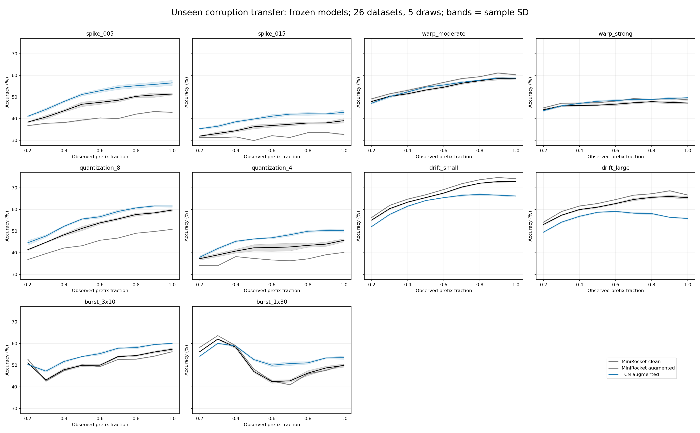

## Deployable operating points fixed from original mixed calibration

Every per-dataset setting is copied exactly from deep_scale_v1: five-draw mean MIXED calibration earliness closest to .5/.6, held across every unseen condition. Saved per-draw thresholds, clean TEASER safety models and ECEC rates are reused. No new type, test confidence, test label or test condition enters deployed policy selection. MiniRocket_aug and TCN_aug retain the six-alpha sweep and force a decision at full length. TEASER is the saved aeon rule on clean MiniRocket probabilities. ECEC is the prior in-pipeline adaptation, not a new official reproduction.

**Matching limit:** equal calibration targets do not imply equal realized test earliness. These N=26 stopping comparisons retain every dataset, report actual waiting differences, and do not replace exact-prefix evidence. Holm correction spans all 140 stopping tests (two augmented models vs three clean baselines plus TCN vs augmented MiniRocket, x ten conditions x two targets).

| condition | model | baseline | time/target | gain pp +/- SD | W/T/L | p_raw | p_holm | rank_biserial | model_time | baseline_time | mean_absolute_dataset_time_gap | N_gap_within_005 |
| --- | --- | --- | --- | --- | --- | --- | --- | --- | --- | --- | --- | --- |
| spike_005 | MiniRocket_aug | Probability | 0.5000 | 6.81 +/- 0.40 | 19/0/7 | 0.0036 | 0.2663 | 0.6353 | 0.5640 | 0.4294 | 0.1807 | 6 |
| spike_005 | MiniRocket_aug | TEASER | 0.5000 | 7.60 +/- 0.44 | 21/0/5 | 0.0001 | 0.0065 | 0.8348 | 0.5640 | 0.5277 | 0.1703 | 5 |
| spike_005 | MiniRocket_aug | ECEC | 0.5000 | 8.64 +/- 0.48 | 20/0/6 | 0.0002 | 0.0211 | 0.7835 | 0.5640 | 0.4901 | 0.1785 | 7 |
| spike_005 | TCN_aug | Probability | 0.5000 | 11.14 +/- 0.74 | 22/0/4 | 0.0000 | 0.0049 | 0.8462 | 0.5941 | 0.4294 | 0.2185 | 3 |
| spike_005 | TCN_aug | TEASER | 0.5000 | 11.93 +/- 0.79 | 21/0/5 | 0.0000 | 0.0022 | 0.8746 | 0.5941 | 0.5277 | 0.2124 | 1 |
| spike_005 | TCN_aug | ECEC | 0.5000 | 12.97 +/- 0.76 | 23/0/3 | 0.0000 | 0.0001 | 0.9487 | 0.5941 | 0.4901 | 0.1821 | 4 |
| spike_005 | TCN_aug | MiniRocket_aug | 0.5000 | 4.33 +/- 0.88 | 19/0/7 | 0.0027 | 0.2182 | 0.6524 | 0.5941 | 0.5640 | 0.1117 | 9 |
| spike_005 | MiniRocket_aug | Probability | 0.6000 | 6.50 +/- 0.40 | 20/0/6 | 0.0029 | 0.2376 | 0.6467 | 0.6015 | 0.4775 | 0.1943 | 5 |
| spike_005 | MiniRocket_aug | TEASER | 0.6000 | 6.93 +/- 0.46 | 19/0/7 | 0.0009 | 0.0823 | 0.7094 | 0.6015 | 0.6605 | 0.1695 | 6 |
| spike_005 | MiniRocket_aug | ECEC | 0.6000 | 9.10 +/- 0.44 | 22/0/4 | 0.0000 | 0.0057 | 0.8405 | 0.6015 | 0.5545 | 0.1660 | 6 |
| spike_005 | TCN_aug | Probability | 0.6000 | 10.77 +/- 0.52 | 21/0/5 | 0.0003 | 0.0334 | 0.7607 | 0.6442 | 0.4775 | 0.2404 | 4 |
| spike_005 | TCN_aug | TEASER | 0.6000 | 11.20 +/- 0.59 | 21/0/5 | 0.0002 | 0.0211 | 0.7835 | 0.6442 | 0.6605 | 0.1827 | 3 |
| spike_005 | TCN_aug | ECEC | 0.6000 | 13.37 +/- 0.58 | 23/0/3 | 0.0000 | 0.0005 | 0.9202 | 0.6442 | 0.5545 | 0.1576 | 8 |
| spike_005 | TCN_aug | MiniRocket_aug | 0.6000 | 4.27 +/- 0.81 | 18/0/8 | 0.0086 | 0.6131 | 0.5783 | 0.6442 | 0.6015 | 0.0940 | 11 |
| spike_015 | MiniRocket_aug | Probability | 0.5000 | 5.03 +/- 0.29 | 20/1/5 | 0.0029 | 0.2376 | 0.6800 | 0.6232 | 0.3733 | 0.2613 | 4 |
| spike_015 | MiniRocket_aug | TEASER | 0.5000 | 6.38 +/- 0.35 | 22/0/4 | 0.0000 | 0.0012 | 0.8917 | 0.6232 | 0.5135 | 0.1864 | 4 |
| spike_015 | MiniRocket_aug | ECEC | 0.5000 | 5.58 +/- 0.36 | 20/0/6 | 0.0001 | 0.0168 | 0.7949 | 0.6232 | 0.5032 | 0.2230 | 5 |
| spike_015 | TCN_aug | Probability | 0.5000 | 8.62 +/- 0.64 | 21/0/5 | 0.0002 | 0.0189 | 0.7892 | 0.6277 | 0.3733 | 0.2741 | 4 |
| spike_015 | TCN_aug | TEASER | 0.5000 | 9.98 +/- 0.70 | 21/1/4 | 0.0001 | 0.0132 | 0.8831 | 0.6277 | 0.5135 | 0.2250 | 2 |
| spike_015 | TCN_aug | ECEC | 0.5000 | 9.18 +/- 0.69 | 21/1/4 | 0.0004 | 0.0356 | 0.8154 | 0.6277 | 0.5032 | 0.2080 | 4 |
| spike_015 | TCN_aug | MiniRocket_aug | 0.5000 | 3.60 +/- 0.52 | 21/0/5 | 0.0013 | 0.1129 | 0.6923 | 0.6277 | 0.6232 | 0.1228 | 8 |
| spike_015 | MiniRocket_aug | Probability | 0.6000 | 5.13 +/- 0.17 | 19/1/6 | 0.0029 | 0.2376 | 0.6800 | 0.6648 | 0.4280 | 0.2613 | 3 |
| spike_015 | MiniRocket_aug | TEASER | 0.6000 | 7.39 +/- 0.38 | 23/0/3 | 0.0000 | 0.0007 | 0.9088 | 0.6648 | 0.6663 | 0.1876 | 4 |
| spike_015 | MiniRocket_aug | ECEC | 0.6000 | 6.08 +/- 0.42 | 20/0/6 | 0.0001 | 0.0086 | 0.8234 | 0.6648 | 0.5680 | 0.2102 | 6 |
| spike_015 | TCN_aug | Probability | 0.6000 | 8.25 +/- 0.39 | 21/0/5 | 0.0003 | 0.0296 | 0.7664 | 0.6775 | 0.4280 | 0.2668 | 6 |
| spike_015 | TCN_aug | TEASER | 0.6000 | 10.51 +/- 0.46 | 21/1/4 | 0.0001 | 0.0071 | 0.9200 | 0.6775 | 0.6663 | 0.1878 | 3 |
| spike_015 | TCN_aug | ECEC | 0.6000 | 9.21 +/- 0.55 | 21/1/4 | 0.0004 | 0.0383 | 0.8092 | 0.6775 | 0.5680 | 0.1912 | 5 |
| spike_015 | TCN_aug | MiniRocket_aug | 0.6000 | 3.12 +/- 0.43 | 18/0/8 | 0.0094 | 0.6568 | 0.5726 | 0.6775 | 0.6648 | 0.1051 | 9 |
| warp_moderate | MiniRocket_aug | Probability | 0.5000 | 0.11 +/- 0.50 | 14/0/12 | 0.7644 | 1.0000 | 0.0712 | 0.5420 | 0.5453 | 0.1342 | 6 |
| warp_moderate | MiniRocket_aug | TEASER | 0.5000 | 0.76 +/- 0.35 | 12/0/14 | 0.8417 | 1.0000 | 0.0484 | 0.5420 | 0.5226 | 0.1438 | 7 |
| warp_moderate | MiniRocket_aug | ECEC | 0.5000 | 0.60 +/- 0.26 | 13/1/12 | 0.9893 | 1.0000 | 0.0031 | 0.5420 | 0.4866 | 0.1291 | 7 |
| warp_moderate | TCN_aug | Probability | 0.5000 | -1.68 +/- 0.69 | 13/0/13 | 0.3941 | 1.0000 | -0.1966 | 0.5545 | 0.5453 | 0.1138 | 8 |
| warp_moderate | TCN_aug | TEASER | 0.5000 | -1.03 +/- 0.51 | 12/0/14 | 0.5153 | 1.0000 | -0.1510 | 0.5545 | 0.5226 | 0.1410 | 7 |
| warp_moderate | TCN_aug | ECEC | 0.5000 | -1.19 +/- 0.57 | 11/0/15 | 0.1987 | 1.0000 | -0.2934 | 0.5545 | 0.4866 | 0.1247 | 4 |
| warp_moderate | TCN_aug | MiniRocket_aug | 0.5000 | -1.79 +/- 0.72 | 12/0/14 | 0.1165 | 1.0000 | -0.3561 | 0.5545 | 0.5420 | 0.0760 | 13 |
| warp_moderate | MiniRocket_aug | Probability | 0.6000 | 0.30 +/- 0.70 | 12/0/14 | 0.9602 | 1.0000 | 0.0142 | 0.5733 | 0.5970 | 0.1452 | 7 |
| warp_moderate | MiniRocket_aug | TEASER | 0.6000 | 0.05 +/- 0.47 | 10/0/16 | 0.5483 | 1.0000 | -0.1396 | 0.5733 | 0.6440 | 0.1590 | 3 |
| warp_moderate | MiniRocket_aug | ECEC | 0.6000 | 0.16 +/- 0.42 | 13/0/13 | 0.9403 | 1.0000 | -0.0199 | 0.5733 | 0.5672 | 0.1116 | 7 |
| warp_moderate | TCN_aug | Probability | 0.6000 | -1.89 +/- 0.68 | 13/0/13 | 0.3533 | 1.0000 | -0.2137 | 0.6016 | 0.5970 | 0.1412 | 6 |
| warp_moderate | TCN_aug | TEASER | 0.6000 | -2.13 +/- 0.65 | 9/0/17 | 0.1499 | 1.0000 | -0.3276 | 0.6016 | 0.6440 | 0.1404 | 3 |
| warp_moderate | TCN_aug | ECEC | 0.6000 | -2.02 +/- 0.52 | 10/0/16 | 0.0292 | 1.0000 | -0.4872 | 0.6016 | 0.5672 | 0.1097 | 7 |
| warp_moderate | TCN_aug | MiniRocket_aug | 0.6000 | -2.18 +/- 0.79 | 13/0/13 | 0.1358 | 1.0000 | -0.3390 | 0.6016 | 0.5733 | 0.0655 | 13 |
| warp_strong | MiniRocket_aug | Probability | 0.5000 | 0.50 +/- 0.50 | 12/0/14 | 0.8222 | 1.0000 | 0.0541 | 0.5155 | 0.5035 | 0.1305 | 6 |
| warp_strong | MiniRocket_aug | TEASER | 0.5000 | -0.27 +/- 0.32 | 10/0/16 | 0.4374 | 1.0000 | -0.1795 | 0.5155 | 0.5342 | 0.1435 | 7 |
| warp_strong | MiniRocket_aug | ECEC | 0.5000 | -0.30 +/- 0.47 | 11/0/15 | 0.5822 | 1.0000 | -0.1282 | 0.5155 | 0.4898 | 0.1116 | 6 |
| warp_strong | TCN_aug | Probability | 0.5000 | 0.12 +/- 0.49 | 15/0/11 | 0.7454 | 1.0000 | 0.0769 | 0.5493 | 0.5035 | 0.1224 | 6 |
| warp_strong | TCN_aug | TEASER | 0.5000 | -0.65 +/- 0.50 | 14/0/12 | 0.6893 | 1.0000 | -0.0940 | 0.5493 | 0.5342 | 0.1390 | 7 |
| warp_strong | TCN_aug | ECEC | 0.5000 | -0.68 +/- 0.48 | 10/1/15 | 0.3032 | 1.0000 | -0.2365 | 0.5493 | 0.4898 | 0.1173 | 6 |
| warp_strong | TCN_aug | MiniRocket_aug | 0.5000 | -0.38 +/- 0.67 | 13/0/13 | 0.8222 | 1.0000 | -0.0541 | 0.5493 | 0.5155 | 0.0785 | 12 |
| warp_strong | MiniRocket_aug | Probability | 0.6000 | 0.80 +/- 0.64 | 11/0/15 | 0.7835 | 1.0000 | 0.0655 | 0.5455 | 0.5537 | 0.1463 | 6 |
| warp_strong | MiniRocket_aug | TEASER | 0.6000 | -0.43 +/- 0.58 | 9/0/17 | 0.4082 | 1.0000 | -0.1909 | 0.5455 | 0.6638 | 0.1906 | 1 |
| warp_strong | MiniRocket_aug | ECEC | 0.6000 | 0.15 +/- 0.50 | 12/0/14 | 0.8417 | 1.0000 | -0.0484 | 0.5455 | 0.5689 | 0.1060 | 7 |
| warp_strong | TCN_aug | Probability | 0.6000 | 0.05 +/- 0.45 | 14/0/12 | 0.8222 | 1.0000 | 0.0541 | 0.5952 | 0.5537 | 0.1660 | 2 |
| warp_strong | TCN_aug | TEASER | 0.6000 | -1.18 +/- 0.53 | 11/0/15 | 0.3666 | 1.0000 | -0.2080 | 0.5952 | 0.6638 | 0.1532 | 4 |
| warp_strong | TCN_aug | ECEC | 0.6000 | -0.60 +/- 0.34 | 9/1/16 | 0.2578 | 1.0000 | -0.2593 | 0.5952 | 0.5689 | 0.1053 | 7 |
| warp_strong | TCN_aug | MiniRocket_aug | 0.6000 | -0.75 +/- 0.61 | 13/0/13 | 0.6171 | 1.0000 | -0.1168 | 0.5952 | 0.5455 | 0.0752 | 15 |
| quantization_8 | MiniRocket_aug | Probability | 0.5000 | 9.11 +/- 0.64 | 20/0/6 | 0.0002 | 0.0211 | 0.7835 | 0.5033 | 0.4507 | 0.1453 | 5 |
| quantization_8 | MiniRocket_aug | TEASER | 0.5000 | 10.07 +/- 0.64 | 21/0/5 | 0.0000 | 0.0042 | 0.8519 | 0.5033 | 0.5137 | 0.1517 | 3 |
| quantization_8 | MiniRocket_aug | ECEC | 0.5000 | 10.02 +/- 0.64 | 22/0/4 | 0.0000 | 0.0057 | 0.8405 | 0.5033 | 0.4805 | 0.1101 | 10 |
| quantization_8 | TCN_aug | Probability | 0.5000 | 11.65 +/- 0.77 | 21/0/5 | 0.0002 | 0.0189 | 0.7892 | 0.5748 | 0.4507 | 0.1876 | 6 |
| quantization_8 | TCN_aug | TEASER | 0.5000 | 12.61 +/- 0.77 | 21/0/5 | 0.0000 | 0.0042 | 0.8519 | 0.5748 | 0.5137 | 0.1551 | 4 |
| quantization_8 | TCN_aug | ECEC | 0.5000 | 12.57 +/- 0.77 | 22/0/4 | 0.0000 | 0.0057 | 0.8405 | 0.5748 | 0.4805 | 0.1481 | 4 |
| quantization_8 | TCN_aug | MiniRocket_aug | 0.5000 | 2.54 +/- 1.31 | 17/0/9 | 0.0334 | 1.0000 | 0.4758 | 0.5748 | 0.5033 | 0.1274 | 8 |
| quantization_8 | MiniRocket_aug | Probability | 0.6000 | 9.09 +/- 0.75 | 20/0/6 | 0.0004 | 0.0356 | 0.7550 | 0.5335 | 0.4938 | 0.1626 | 4 |
| quantization_8 | MiniRocket_aug | TEASER | 0.6000 | 9.43 +/- 0.75 | 19/0/7 | 0.0003 | 0.0334 | 0.7607 | 0.5335 | 0.6454 | 0.1870 | 3 |
| quantization_8 | MiniRocket_aug | ECEC | 0.6000 | 9.69 +/- 0.75 | 21/0/5 | 0.0003 | 0.0334 | 0.7607 | 0.5335 | 0.5708 | 0.1401 | 7 |
| quantization_8 | TCN_aug | Probability | 0.6000 | 11.33 +/- 0.68 | 21/0/5 | 0.0002 | 0.0189 | 0.7892 | 0.6210 | 0.4938 | 0.2176 | 2 |
| quantization_8 | TCN_aug | TEASER | 0.6000 | 11.67 +/- 0.68 | 22/0/4 | 0.0000 | 0.0057 | 0.8405 | 0.6210 | 0.6454 | 0.1295 | 7 |
| quantization_8 | TCN_aug | ECEC | 0.6000 | 11.94 +/- 0.68 | 21/0/5 | 0.0001 | 0.0098 | 0.8177 | 0.6210 | 0.5708 | 0.1227 | 9 |
| quantization_8 | TCN_aug | MiniRocket_aug | 0.6000 | 2.25 +/- 1.24 | 19/0/7 | 0.0292 | 1.0000 | 0.4872 | 0.6210 | 0.5335 | 0.1243 | 10 |
| quantization_4 | MiniRocket_aug | Probability | 0.5000 | 6.68 +/- 0.55 | 20/1/5 | 0.0005 | 0.0491 | 0.7908 | 0.4790 | 0.4152 | 0.1459 | 7 |
| quantization_4 | MiniRocket_aug | TEASER | 0.5000 | 5.59 +/- 0.55 | 19/1/6 | 0.0029 | 0.2376 | 0.6800 | 0.4790 | 0.5252 | 0.1751 | 3 |
| quantization_4 | MiniRocket_aug | ECEC | 0.5000 | 4.69 +/- 0.55 | 19/1/6 | 0.0049 | 0.3646 | 0.6431 | 0.4790 | 0.4871 | 0.1342 | 5 |
| quantization_4 | TCN_aug | Probability | 0.5000 | 11.41 +/- 0.51 | 21/0/5 | 0.0001 | 0.0098 | 0.8177 | 0.5699 | 0.4152 | 0.2131 | 7 |
| quantization_4 | TCN_aug | TEASER | 0.5000 | 10.33 +/- 0.51 | 22/0/4 | 0.0000 | 0.0049 | 0.8462 | 0.5699 | 0.5252 | 0.1737 | 3 |
| quantization_4 | TCN_aug | ECEC | 0.5000 | 9.42 +/- 0.51 | 20/0/6 | 0.0006 | 0.0526 | 0.7322 | 0.5699 | 0.4871 | 0.1575 | 9 |
| quantization_4 | TCN_aug | MiniRocket_aug | 0.5000 | 4.74 +/- 0.94 | 18/0/8 | 0.0140 | 0.9664 | 0.5442 | 0.5699 | 0.4790 | 0.1404 | 7 |
| quantization_4 | MiniRocket_aug | Probability | 0.6000 | 6.18 +/- 0.37 | 18/1/7 | 0.0019 | 0.1602 | 0.7108 | 0.5081 | 0.4566 | 0.1556 | 9 |
| quantization_4 | MiniRocket_aug | TEASER | 0.6000 | 5.55 +/- 0.37 | 19/1/6 | 0.0021 | 0.1734 | 0.7046 | 0.5081 | 0.6451 | 0.2126 | 2 |
| quantization_4 | MiniRocket_aug | ECEC | 0.6000 | 5.84 +/- 0.37 | 19/1/6 | 0.0016 | 0.1350 | 0.7231 | 0.5081 | 0.5660 | 0.1586 | 3 |
| quantization_4 | TCN_aug | Probability | 0.6000 | 10.79 +/- 0.60 | 21/0/5 | 0.0002 | 0.0211 | 0.7835 | 0.6152 | 0.4566 | 0.2172 | 6 |
| quantization_4 | TCN_aug | TEASER | 0.6000 | 10.16 +/- 0.60 | 23/0/3 | 0.0001 | 0.0074 | 0.8291 | 0.6152 | 0.6451 | 0.1627 | 4 |
| quantization_4 | TCN_aug | ECEC | 0.6000 | 10.45 +/- 0.60 | 21/1/4 | 0.0004 | 0.0356 | 0.8154 | 0.6152 | 0.5660 | 0.1496 | 9 |
| quantization_4 | TCN_aug | MiniRocket_aug | 0.6000 | 4.61 +/- 0.86 | 17/0/9 | 0.0254 | 1.0000 | 0.4986 | 0.6152 | 0.5081 | 0.1278 | 7 |
| drift_small | MiniRocket_aug | Probability | 0.5000 | -1.99 +/- 0.50 | 9/2/15 | 0.0736 | 1.0000 | -0.4092 | 0.5200 | 0.5487 | 0.1375 | 4 |
| drift_small | MiniRocket_aug | TEASER | 0.5000 | -0.40 +/- 0.34 | 6/0/20 | 0.0842 | 1.0000 | -0.3903 | 0.5200 | 0.4831 | 0.1490 | 6 |
| drift_small | MiniRocket_aug | ECEC | 0.5000 | 0.61 +/- 0.33 | 12/1/13 | 0.8028 | 1.0000 | -0.0598 | 0.5200 | 0.4729 | 0.1452 | 10 |
| drift_small | TCN_aug | Probability | 0.5000 | -6.28 +/- 0.68 | 4/0/22 | 0.0002 | 0.0231 | -0.7778 | 0.5391 | 0.5487 | 0.1382 | 8 |
| drift_small | TCN_aug | TEASER | 0.5000 | -4.69 +/- 0.65 | 6/0/20 | 0.0032 | 0.2486 | -0.6410 | 0.5391 | 0.4831 | 0.1419 | 8 |
| drift_small | TCN_aug | ECEC | 0.5000 | -3.68 +/- 0.58 | 6/1/19 | 0.0080 | 0.5790 | -0.6062 | 0.5391 | 0.4729 | 0.1583 | 5 |
| drift_small | TCN_aug | MiniRocket_aug | 0.5000 | -4.29 +/- 0.66 | 4/0/22 | 0.0003 | 0.0334 | -0.7607 | 0.5391 | 0.5200 | 0.1059 | 10 |
| drift_small | MiniRocket_aug | Probability | 0.6000 | -2.26 +/- 0.36 | 8/2/16 | 0.0230 | 1.0000 | -0.5200 | 0.5471 | 0.6011 | 0.1524 | 7 |
| drift_small | MiniRocket_aug | TEASER | 0.6000 | -1.62 +/- 0.26 | 6/0/20 | 0.0032 | 0.2486 | -0.6410 | 0.5471 | 0.5897 | 0.1248 | 6 |
| drift_small | MiniRocket_aug | ECEC | 0.6000 | -0.37 +/- 0.21 | 10/0/16 | 0.3802 | 1.0000 | -0.2023 | 0.5471 | 0.5483 | 0.1230 | 8 |
| drift_small | TCN_aug | Probability | 0.6000 | -7.18 +/- 0.53 | 5/0/21 | 0.0003 | 0.0334 | -0.7607 | 0.5824 | 0.6011 | 0.1572 | 4 |
| drift_small | TCN_aug | TEASER | 0.6000 | -6.54 +/- 0.55 | 5/0/21 | 0.0004 | 0.0387 | -0.7493 | 0.5824 | 0.5897 | 0.1240 | 6 |
| drift_small | TCN_aug | ECEC | 0.6000 | -5.29 +/- 0.44 | 4/0/22 | 0.0003 | 0.0334 | -0.7607 | 0.5824 | 0.5483 | 0.1338 | 9 |
| drift_small | TCN_aug | MiniRocket_aug | 0.6000 | -4.92 +/- 0.61 | 5/0/21 | 0.0004 | 0.0387 | -0.7493 | 0.5824 | 0.5471 | 0.0882 | 10 |
| drift_large | MiniRocket_aug | Probability | 0.5000 | -1.22 +/- 0.27 | 10/0/16 | 0.2173 | 1.0000 | -0.2821 | 0.5259 | 0.5446 | 0.1464 | 2 |
| drift_large | MiniRocket_aug | TEASER | 0.5000 | -0.74 +/- 0.30 | 6/0/20 | 0.0993 | 1.0000 | -0.3732 | 0.5259 | 0.4949 | 0.1545 | 5 |
| drift_large | MiniRocket_aug | ECEC | 0.5000 | -0.42 +/- 0.25 | 11/0/15 | 0.4374 | 1.0000 | -0.1795 | 0.5259 | 0.4765 | 0.1389 | 9 |
| drift_large | TCN_aug | Probability | 0.5000 | -7.95 +/- 0.55 | 5/0/21 | 0.0001 | 0.0086 | -0.8234 | 0.5412 | 0.5446 | 0.1397 | 8 |
| drift_large | TCN_aug | TEASER | 0.5000 | -7.47 +/- 0.54 | 5/0/21 | 0.0002 | 0.0211 | -0.7835 | 0.5412 | 0.4949 | 0.1455 | 7 |
| drift_large | TCN_aug | ECEC | 0.5000 | -7.15 +/- 0.43 | 5/0/21 | 0.0001 | 0.0168 | -0.7949 | 0.5412 | 0.4765 | 0.1549 | 5 |
| drift_large | TCN_aug | MiniRocket_aug | 0.5000 | -6.73 +/- 0.47 | 7/0/19 | 0.0005 | 0.0477 | -0.7379 | 0.5412 | 0.5259 | 0.0985 | 11 |
| drift_large | MiniRocket_aug | Probability | 0.6000 | -1.44 +/- 0.21 | 9/0/17 | 0.1651 | 1.0000 | -0.3162 | 0.5534 | 0.5954 | 0.1579 | 5 |
| drift_large | MiniRocket_aug | TEASER | 0.6000 | -1.81 +/- 0.20 | 6/0/20 | 0.0073 | 0.5322 | -0.5897 | 0.5534 | 0.6098 | 0.1325 | 7 |
| drift_large | MiniRocket_aug | ECEC | 0.6000 | -1.48 +/- 0.22 | 9/0/17 | 0.0993 | 1.0000 | -0.3732 | 0.5534 | 0.5540 | 0.1168 | 9 |
| drift_large | TCN_aug | Probability | 0.6000 | -8.85 +/- 0.65 | 5/0/21 | 0.0001 | 0.0112 | -0.8120 | 0.5836 | 0.5954 | 0.1592 | 5 |
| drift_large | TCN_aug | TEASER | 0.6000 | -9.22 +/- 0.66 | 5/0/21 | 0.0000 | 0.0036 | -0.8575 | 0.5836 | 0.6098 | 0.1333 | 5 |
| drift_large | TCN_aug | ECEC | 0.6000 | -8.90 +/- 0.53 | 4/0/22 | 0.0000 | 0.0005 | -0.9202 | 0.5836 | 0.5540 | 0.1277 | 10 |
| drift_large | TCN_aug | MiniRocket_aug | 0.6000 | -7.41 +/- 0.65 | 7/0/19 | 0.0005 | 0.0428 | -0.7436 | 0.5836 | 0.5534 | 0.0790 | 11 |
| burst_3x10 | MiniRocket_aug | Probability | 0.5000 | 2.17 +/- 0.84 | 16/0/10 | 0.3153 | 1.0000 | 0.2308 | 0.5332 | 0.5127 | 0.1501 | 5 |
| burst_3x10 | MiniRocket_aug | TEASER | 0.5000 | 4.20 +/- 0.87 | 18/0/8 | 0.0292 | 1.0000 | 0.4872 | 0.5332 | 0.5677 | 0.1466 | 6 |
| burst_3x10 | MiniRocket_aug | ECEC | 0.5000 | 1.87 +/- 0.91 | 16/0/10 | 0.1358 | 1.0000 | 0.3390 | 0.5332 | 0.5020 | 0.1136 | 9 |
| burst_3x10 | TCN_aug | Probability | 0.5000 | 3.17 +/- 0.32 | 15/0/11 | 0.0559 | 1.0000 | 0.4302 | 0.5607 | 0.5127 | 0.1555 | 3 |
| burst_3x10 | TCN_aug | TEASER | 0.5000 | 5.20 +/- 0.38 | 18/0/8 | 0.0022 | 0.1811 | 0.6638 | 0.5607 | 0.5677 | 0.1440 | 7 |
| burst_3x10 | TCN_aug | ECEC | 0.5000 | 2.87 +/- 0.36 | 18/0/8 | 0.0382 | 1.0000 | 0.4644 | 0.5607 | 0.5020 | 0.1102 | 7 |
| burst_3x10 | TCN_aug | MiniRocket_aug | 0.5000 | 1.00 +/- 0.56 | 17/0/9 | 0.1574 | 1.0000 | 0.3219 | 0.5607 | 0.5332 | 0.1064 | 8 |
| burst_3x10 | MiniRocket_aug | Probability | 0.6000 | 1.73 +/- 0.98 | 15/0/11 | 0.3802 | 1.0000 | 0.2023 | 0.5662 | 0.5693 | 0.1673 | 5 |
| burst_3x10 | MiniRocket_aug | TEASER | 0.6000 | 2.87 +/- 1.05 | 15/0/11 | 0.2370 | 1.0000 | 0.2707 | 0.5662 | 0.6946 | 0.1796 | 1 |
| burst_3x10 | MiniRocket_aug | ECEC | 0.6000 | 1.87 +/- 1.08 | 16/0/10 | 0.0890 | 1.0000 | 0.3846 | 0.5662 | 0.5861 | 0.1204 | 5 |
| burst_3x10 | TCN_aug | Probability | 0.6000 | 2.56 +/- 0.43 | 14/0/12 | 0.1651 | 1.0000 | 0.3162 | 0.6118 | 0.5693 | 0.1999 | 3 |
| burst_3x10 | TCN_aug | TEASER | 0.6000 | 3.70 +/- 0.50 | 16/0/10 | 0.0463 | 1.0000 | 0.4473 | 0.6118 | 0.6946 | 0.1514 | 4 |
| burst_3x10 | TCN_aug | ECEC | 0.6000 | 2.70 +/- 0.54 | 15/0/11 | 0.0709 | 1.0000 | 0.4074 | 0.6118 | 0.5861 | 0.1108 | 8 |
| burst_3x10 | TCN_aug | MiniRocket_aug | 0.6000 | 0.83 +/- 0.58 | 16/0/10 | 0.3802 | 1.0000 | 0.2023 | 0.6118 | 0.5662 | 0.0965 | 10 |
| burst_1x30 | MiniRocket_aug | Probability | 0.5000 | 1.46 +/- 0.16 | 14/0/12 | 0.9801 | 1.0000 | -0.0085 | 0.5179 | 0.5168 | 0.1222 | 5 |
| burst_1x30 | MiniRocket_aug | TEASER | 0.5000 | -3.18 +/- 0.34 | 9/0/17 | 0.0151 | 1.0000 | -0.5385 | 0.5179 | 0.5122 | 0.1443 | 3 |
| burst_1x30 | MiniRocket_aug | ECEC | 0.5000 | 0.43 +/- 0.32 | 14/0/12 | 0.7835 | 1.0000 | 0.0655 | 0.5179 | 0.4818 | 0.1110 | 9 |
| burst_1x30 | TCN_aug | Probability | 0.5000 | 1.57 +/- 0.44 | 13/0/13 | 0.4227 | 1.0000 | 0.1852 | 0.5525 | 0.5168 | 0.1198 | 8 |
| burst_1x30 | TCN_aug | TEASER | 0.5000 | -3.07 +/- 0.51 | 10/0/16 | 0.1165 | 1.0000 | -0.3561 | 0.5525 | 0.5122 | 0.1499 | 6 |
| burst_1x30 | TCN_aug | ECEC | 0.5000 | 0.54 +/- 0.51 | 15/0/11 | 0.4525 | 1.0000 | 0.1738 | 0.5525 | 0.4818 | 0.1332 | 3 |
| burst_1x30 | TCN_aug | MiniRocket_aug | 0.5000 | 0.11 +/- 0.50 | 13/0/13 | 0.6710 | 1.0000 | 0.0997 | 0.5525 | 0.5179 | 0.0818 | 12 |
| burst_1x30 | MiniRocket_aug | Probability | 0.6000 | 2.18 +/- 0.34 | 15/1/10 | 0.6528 | 1.0000 | 0.1054 | 0.5464 | 0.5686 | 0.1420 | 6 |
| burst_1x30 | MiniRocket_aug | TEASER | 0.6000 | 0.11 +/- 0.29 | 9/0/17 | 0.2687 | 1.0000 | -0.2536 | 0.5464 | 0.6514 | 0.1691 | 3 |
| burst_1x30 | MiniRocket_aug | ECEC | 0.6000 | 0.95 +/- 0.40 | 14/0/12 | 0.7078 | 1.0000 | 0.0883 | 0.5464 | 0.5694 | 0.1125 | 7 |
| burst_1x30 | TCN_aug | Probability | 0.6000 | 2.55 +/- 0.46 | 13/0/13 | 0.3032 | 1.0000 | 0.2365 | 0.5962 | 0.5686 | 0.1594 | 4 |
| burst_1x30 | TCN_aug | TEASER | 0.6000 | 0.49 +/- 0.41 | 15/0/11 | 0.7454 | 1.0000 | 0.0769 | 0.5962 | 0.6514 | 0.1458 | 5 |
| burst_1x30 | TCN_aug | ECEC | 0.6000 | 1.32 +/- 0.38 | 12/0/14 | 0.3403 | 1.0000 | 0.2194 | 0.5962 | 0.5694 | 0.1172 | 8 |
| burst_1x30 | TCN_aug | MiniRocket_aug | 0.6000 | 0.37 +/- 0.57 | 14/0/12 | 0.4834 | 1.0000 | 0.1624 | 0.5962 | 0.5464 | 0.0785 | 12 |

Macro stopping metrics:

| condition | target | method | accuracy % +/- SD | balanced acc % +/- SD | error % +/- SD | time +/- SD | forced % +/- SD |
| --- | --- | --- | --- | --- | --- | --- | --- |
| burst_1x30 | 0.5000 | ECEC | 58.95 +/- 0.11 | 55.51 +/- 0.11 | 41.05 +/- 0.11 | 0.48 +/- 0.00 | 0.51 +/- 0.01 |
| burst_1x30 | 0.6000 | ECEC | 57.91 +/- 0.19 | 54.38 +/- 0.19 | 42.09 +/- 0.19 | 0.57 +/- 0.00 | 3.28 +/- 0.08 |
| burst_1x30 | 0.5000 | MiniRocket_aug | 59.38 +/- 0.24 | 56.65 +/- 0.39 | 40.62 +/- 0.24 | 0.52 +/- 0.01 | 9.13 +/- 0.88 |
| burst_1x30 | 0.6000 | MiniRocket_aug | 58.85 +/- 0.39 | 56.13 +/- 0.50 | 41.15 +/- 0.39 | 0.55 +/- 0.01 | 11.55 +/- 1.45 |
| burst_1x30 | 0.5000 | Probability | 57.92 +/- 0.12 | 55.17 +/- 0.14 | 42.08 +/- 0.12 | 0.52 +/- 0.00 | 11.15 +/- 0.12 |
| burst_1x30 | 0.6000 | Probability | 56.67 +/- 0.13 | 53.88 +/- 0.14 | 43.33 +/- 0.13 | 0.57 +/- 0.00 | 18.02 +/- 0.17 |
| burst_1x30 | 0.5000 | TCN_aug | 59.49 +/- 0.44 | 55.95 +/- 0.62 | 40.51 +/- 0.44 | 0.55 +/- 0.01 | 22.11 +/- 1.79 |
| burst_1x30 | 0.6000 | TCN_aug | 59.23 +/- 0.38 | 55.61 +/- 0.53 | 40.77 +/- 0.38 | 0.60 +/- 0.01 | 26.61 +/- 1.98 |
| burst_1x30 | 0.5000 | TEASER | 62.56 +/- 0.17 | 59.69 +/- 0.17 | 37.44 +/- 0.17 | 0.51 +/- 0.00 | 13.85 +/- 0.15 |
| burst_1x30 | 0.6000 | TEASER | 58.74 +/- 0.24 | 56.07 +/- 0.28 | 41.26 +/- 0.24 | 0.65 +/- 0.00 | 29.02 +/- 0.20 |
| burst_3x10 | 0.5000 | ECEC | 54.79 +/- 0.23 | 51.83 +/- 0.21 | 45.21 +/- 0.23 | 0.50 +/- 0.00 | 0.88 +/- 0.04 |
| burst_3x10 | 0.6000 | ECEC | 55.31 +/- 0.34 | 52.71 +/- 0.39 | 44.69 +/- 0.34 | 0.59 +/- 0.00 | 3.36 +/- 0.11 |
| burst_3x10 | 0.5000 | MiniRocket_aug | 56.66 +/- 0.69 | 53.81 +/- 0.46 | 43.34 +/- 0.69 | 0.53 +/- 0.01 | 11.92 +/- 1.71 |
| burst_3x10 | 0.6000 | MiniRocket_aug | 57.18 +/- 0.85 | 54.39 +/- 0.50 | 42.82 +/- 0.85 | 0.57 +/- 0.01 | 15.04 +/- 1.11 |
| burst_3x10 | 0.5000 | Probability | 54.49 +/- 0.22 | 52.13 +/- 0.25 | 45.51 +/- 0.22 | 0.51 +/- 0.00 | 16.60 +/- 0.14 |
| burst_3x10 | 0.6000 | Probability | 55.46 +/- 0.29 | 53.05 +/- 0.32 | 44.54 +/- 0.29 | 0.57 +/- 0.00 | 25.33 +/- 0.19 |
| burst_3x10 | 0.5000 | TCN_aug | 57.66 +/- 0.14 | 54.27 +/- 0.36 | 42.34 +/- 0.14 | 0.56 +/- 0.01 | 24.10 +/- 1.42 |
| burst_3x10 | 0.6000 | TCN_aug | 58.01 +/- 0.31 | 54.64 +/- 0.57 | 41.99 +/- 0.31 | 0.61 +/- 0.02 | 29.86 +/- 1.96 |
| burst_3x10 | 0.5000 | TEASER | 52.46 +/- 0.30 | 50.27 +/- 0.29 | 47.54 +/- 0.30 | 0.57 +/- 0.00 | 15.15 +/- 0.11 |
| burst_3x10 | 0.6000 | TEASER | 54.31 +/- 0.30 | 52.42 +/- 0.31 | 45.69 +/- 0.30 | 0.69 +/- 0.00 | 28.94 +/- 0.19 |
| drift_large | 0.5000 | ECEC | 65.30 +/- 0.18 | 61.55 +/- 0.18 | 34.70 +/- 0.18 | 0.48 +/- 0.00 | 1.10 +/- 0.05 |
| drift_large | 0.6000 | ECEC | 66.95 +/- 0.22 | 63.38 +/- 0.21 | 33.05 +/- 0.22 | 0.55 +/- 0.00 | 3.07 +/- 0.07 |
| drift_large | 0.5000 | MiniRocket_aug | 64.88 +/- 0.42 | 62.18 +/- 0.49 | 35.12 +/- 0.42 | 0.53 +/- 0.01 | 15.91 +/- 0.50 |
| drift_large | 0.6000 | MiniRocket_aug | 65.47 +/- 0.37 | 62.83 +/- 0.48 | 34.53 +/- 0.37 | 0.55 +/- 0.01 | 18.03 +/- 0.84 |
| drift_large | 0.5000 | Probability | 66.10 +/- 0.24 | 63.15 +/- 0.27 | 33.90 +/- 0.24 | 0.54 +/- 0.00 | 22.43 +/- 0.16 |
| drift_large | 0.6000 | Probability | 66.90 +/- 0.20 | 63.93 +/- 0.24 | 33.10 +/- 0.20 | 0.60 +/- 0.00 | 29.08 +/- 0.16 |
| drift_large | 0.5000 | TCN_aug | 58.15 +/- 0.49 | 54.40 +/- 0.43 | 41.85 +/- 0.49 | 0.54 +/- 0.01 | 22.49 +/- 1.87 |
| drift_large | 0.6000 | TCN_aug | 58.05 +/- 0.58 | 54.34 +/- 0.52 | 41.95 +/- 0.58 | 0.58 +/- 0.01 | 26.61 +/- 2.14 |
| drift_large | 0.5000 | TEASER | 65.62 +/- 0.21 | 62.20 +/- 0.23 | 34.38 +/- 0.21 | 0.49 +/- 0.00 | 10.08 +/- 0.15 |
| drift_large | 0.6000 | TEASER | 67.28 +/- 0.22 | 64.31 +/- 0.26 | 32.72 +/- 0.22 | 0.61 +/- 0.00 | 20.02 +/- 0.08 |
| drift_small | 0.5000 | ECEC | 68.92 +/- 0.14 | 65.34 +/- 0.14 | 31.08 +/- 0.14 | 0.47 +/- 0.00 | 1.35 +/- 0.03 |
| drift_small | 0.6000 | ECEC | 70.75 +/- 0.15 | 67.29 +/- 0.15 | 29.25 +/- 0.15 | 0.55 +/- 0.00 | 3.15 +/- 0.04 |
| drift_small | 0.5000 | MiniRocket_aug | 69.53 +/- 0.43 | 66.75 +/- 0.39 | 30.47 +/- 0.43 | 0.52 +/- 0.01 | 16.19 +/- 0.71 |
| drift_small | 0.6000 | MiniRocket_aug | 70.38 +/- 0.31 | 67.64 +/- 0.24 | 29.62 +/- 0.31 | 0.55 +/- 0.01 | 18.23 +/- 0.69 |
| drift_small | 0.5000 | Probability | 71.52 +/- 0.19 | 68.67 +/- 0.17 | 28.48 +/- 0.19 | 0.55 +/- 0.00 | 25.32 +/- 0.05 |
| drift_small | 0.6000 | Probability | 72.64 +/- 0.13 | 69.77 +/- 0.11 | 27.36 +/- 0.13 | 0.60 +/- 0.00 | 31.95 +/- 0.06 |
| drift_small | 0.5000 | TCN_aug | 65.24 +/- 0.53 | 61.49 +/- 0.52 | 34.76 +/- 0.53 | 0.54 +/- 0.01 | 23.62 +/- 1.19 |
| drift_small | 0.6000 | TCN_aug | 65.46 +/- 0.42 | 61.78 +/- 0.45 | 34.54 +/- 0.42 | 0.58 +/- 0.01 | 27.65 +/- 1.04 |
| drift_small | 0.5000 | TEASER | 69.93 +/- 0.18 | 66.88 +/- 0.19 | 30.07 +/- 0.18 | 0.48 +/- 0.00 | 8.54 +/- 0.11 |
| drift_small | 0.6000 | TEASER | 72.00 +/- 0.13 | 69.18 +/- 0.15 | 28.00 +/- 0.13 | 0.59 +/- 0.00 | 17.09 +/- 0.08 |
| quantization_4 | 0.5000 | ECEC | 39.28 +/- 0.00 | 37.34 +/- 0.00 | 60.72 +/- 0.00 | 0.49 +/- 0.00 | 0.69 +/- 0.00 |
| quantization_4 | 0.6000 | ECEC | 38.52 +/- 0.00 | 35.89 +/- 0.00 | 61.48 +/- 0.00 | 0.57 +/- 0.00 | 3.72 +/- 0.00 |
| quantization_4 | 0.5000 | MiniRocket_aug | 43.96 +/- 0.55 | 40.99 +/- 0.54 | 56.04 +/- 0.55 | 0.48 +/- 0.01 | 9.01 +/- 0.89 |
| quantization_4 | 0.6000 | MiniRocket_aug | 44.35 +/- 0.37 | 41.45 +/- 0.45 | 55.65 +/- 0.37 | 0.51 +/- 0.01 | 11.46 +/- 0.65 |
| quantization_4 | 0.5000 | Probability | 37.28 +/- 0.00 | 35.81 +/- 0.00 | 62.72 +/- 0.00 | 0.42 +/- 0.00 | 10.29 +/- 0.00 |
| quantization_4 | 0.6000 | Probability | 38.17 +/- 0.00 | 36.74 +/- 0.00 | 61.83 +/- 0.00 | 0.46 +/- 0.00 | 16.35 +/- 0.00 |
| quantization_4 | 0.5000 | TCN_aug | 48.70 +/- 0.51 | 44.27 +/- 0.72 | 51.30 +/- 0.51 | 0.57 +/- 0.03 | 24.98 +/- 3.03 |
| quantization_4 | 0.6000 | TCN_aug | 48.96 +/- 0.60 | 44.61 +/- 0.71 | 51.04 +/- 0.60 | 0.62 +/- 0.03 | 30.29 +/- 2.70 |
| quantization_4 | 0.5000 | TEASER | 38.37 +/- 0.00 | 37.80 +/- 0.00 | 61.63 +/- 0.00 | 0.53 +/- 0.00 | 12.90 +/- 0.00 |
| quantization_4 | 0.6000 | TEASER | 38.80 +/- 0.00 | 38.46 +/- 0.00 | 61.20 +/- 0.00 | 0.65 +/- 0.00 | 25.04 +/- 0.00 |
| quantization_8 | 0.5000 | ECEC | 45.40 +/- 0.00 | 43.96 +/- 0.00 | 54.60 +/- 0.00 | 0.48 +/- 0.00 | 0.56 +/- 0.00 |
| quantization_8 | 0.6000 | ECEC | 46.62 +/- 0.00 | 45.16 +/- 0.00 | 53.38 +/- 0.00 | 0.57 +/- 0.00 | 3.86 +/- 0.00 |
| quantization_8 | 0.5000 | MiniRocket_aug | 55.42 +/- 0.64 | 52.58 +/- 0.52 | 44.58 +/- 0.64 | 0.50 +/- 0.01 | 10.19 +/- 1.52 |
| quantization_8 | 0.6000 | MiniRocket_aug | 56.32 +/- 0.75 | 53.53 +/- 0.62 | 43.68 +/- 0.75 | 0.53 +/- 0.01 | 13.14 +/- 1.49 |
| quantization_8 | 0.5000 | Probability | 46.31 +/- 0.00 | 45.96 +/- 0.00 | 53.69 +/- 0.00 | 0.45 +/- 0.00 | 13.45 +/- 0.00 |
| quantization_8 | 0.6000 | Probability | 47.23 +/- 0.00 | 46.85 +/- 0.00 | 52.77 +/- 0.00 | 0.49 +/- 0.00 | 19.95 +/- 0.00 |
| quantization_8 | 0.5000 | TCN_aug | 57.97 +/- 0.77 | 53.67 +/- 0.79 | 42.03 +/- 0.77 | 0.57 +/- 0.02 | 24.52 +/- 2.59 |
| quantization_8 | 0.6000 | TCN_aug | 58.56 +/- 0.68 | 54.33 +/- 0.77 | 41.44 +/- 0.68 | 0.62 +/- 0.02 | 29.58 +/- 2.81 |
| quantization_8 | 0.5000 | TEASER | 45.36 +/- 0.00 | 45.14 +/- 0.00 | 54.64 +/- 0.00 | 0.51 +/- 0.00 | 14.14 +/- 0.00 |
| quantization_8 | 0.6000 | TEASER | 46.89 +/- 0.00 | 46.73 +/- 0.00 | 53.11 +/- 0.00 | 0.65 +/- 0.00 | 25.30 +/- 0.00 |
| spike_005 | 0.5000 | ECEC | 40.61 +/- 0.14 | 37.93 +/- 0.18 | 59.39 +/- 0.14 | 0.49 +/- 0.00 | 0.17 +/- 0.02 |
| spike_005 | 0.6000 | ECEC | 40.75 +/- 0.10 | 38.40 +/- 0.17 | 59.25 +/- 0.10 | 0.55 +/- 0.00 | 1.23 +/- 0.07 |
| spike_005 | 0.5000 | MiniRocket_aug | 49.25 +/- 0.43 | 46.55 +/- 0.45 | 50.75 +/- 0.43 | 0.56 +/- 0.00 | 20.57 +/- 1.11 |
| spike_005 | 0.6000 | MiniRocket_aug | 49.85 +/- 0.48 | 47.19 +/- 0.56 | 50.15 +/- 0.48 | 0.60 +/- 0.01 | 24.28 +/- 1.62 |
| spike_005 | 0.5000 | Probability | 42.44 +/- 0.13 | 39.66 +/- 0.18 | 57.56 +/- 0.13 | 0.43 +/- 0.00 | 13.75 +/- 0.14 |
| spike_005 | 0.6000 | Probability | 43.35 +/- 0.08 | 40.45 +/- 0.13 | 56.65 +/- 0.08 | 0.48 +/- 0.00 | 20.08 +/- 0.21 |
| spike_005 | 0.5000 | TCN_aug | 53.58 +/- 0.64 | 49.49 +/- 0.61 | 46.42 +/- 0.64 | 0.59 +/- 0.02 | 29.13 +/- 2.41 |
| spike_005 | 0.6000 | TCN_aug | 54.12 +/- 0.48 | 50.07 +/- 0.46 | 45.88 +/- 0.48 | 0.64 +/- 0.02 | 35.42 +/- 2.71 |
| spike_005 | 0.5000 | TEASER | 41.65 +/- 0.16 | 39.36 +/- 0.16 | 58.35 +/- 0.16 | 0.53 +/- 0.00 | 13.76 +/- 0.23 |
| spike_005 | 0.6000 | TEASER | 42.92 +/- 0.15 | 40.79 +/- 0.16 | 57.08 +/- 0.15 | 0.66 +/- 0.00 | 27.48 +/- 0.22 |
| spike_015 | 0.5000 | ECEC | 32.56 +/- 0.14 | 29.61 +/- 0.12 | 67.44 +/- 0.14 | 0.50 +/- 0.00 | 0.05 +/- 0.01 |
| spike_015 | 0.6000 | ECEC | 32.70 +/- 0.10 | 30.29 +/- 0.12 | 67.30 +/- 0.10 | 0.57 +/- 0.00 | 0.97 +/- 0.03 |
| spike_015 | 0.5000 | MiniRocket_aug | 38.15 +/- 0.29 | 34.71 +/- 0.29 | 61.85 +/- 0.29 | 0.62 +/- 0.01 | 28.19 +/- 2.07 |
| spike_015 | 0.6000 | MiniRocket_aug | 38.79 +/- 0.38 | 35.34 +/- 0.33 | 61.21 +/- 0.38 | 0.66 +/- 0.01 | 33.12 +/- 2.02 |
| spike_015 | 0.5000 | Probability | 33.12 +/- 0.26 | 29.79 +/- 0.23 | 66.88 +/- 0.26 | 0.37 +/- 0.00 | 9.24 +/- 0.10 |
| spike_015 | 0.6000 | Probability | 33.66 +/- 0.29 | 30.35 +/- 0.25 | 66.34 +/- 0.29 | 0.43 +/- 0.00 | 14.38 +/- 0.13 |
| spike_015 | 0.5000 | TCN_aug | 41.75 +/- 0.59 | 37.35 +/- 0.78 | 58.25 +/- 0.59 | 0.63 +/- 0.02 | 33.65 +/- 3.39 |
| spike_015 | 0.6000 | TCN_aug | 41.91 +/- 0.49 | 37.55 +/- 0.56 | 58.09 +/- 0.49 | 0.68 +/- 0.02 | 40.75 +/- 3.71 |
| spike_015 | 0.5000 | TEASER | 31.76 +/- 0.11 | 29.15 +/- 0.14 | 68.24 +/- 0.11 | 0.51 +/- 0.00 | 9.18 +/- 0.11 |
| spike_015 | 0.6000 | TEASER | 31.40 +/- 0.11 | 29.82 +/- 0.11 | 68.60 +/- 0.11 | 0.67 +/- 0.00 | 24.90 +/- 0.29 |
| warp_moderate | 0.5000 | ECEC | 58.71 +/- 0.29 | 55.62 +/- 0.30 | 41.29 +/- 0.29 | 0.49 +/- 0.00 | 0.81 +/- 0.06 |
| warp_moderate | 0.6000 | ECEC | 59.98 +/- 0.30 | 56.96 +/- 0.29 | 40.02 +/- 0.30 | 0.57 +/- 0.00 | 2.98 +/- 0.07 |
| warp_moderate | 0.5000 | MiniRocket_aug | 59.31 +/- 0.49 | 56.37 +/- 0.34 | 40.69 +/- 0.49 | 0.54 +/- 0.01 | 15.23 +/- 1.28 |
| warp_moderate | 0.6000 | MiniRocket_aug | 60.14 +/- 0.64 | 57.27 +/- 0.49 | 39.86 +/- 0.64 | 0.57 +/- 0.01 | 18.05 +/- 1.50 |
| warp_moderate | 0.5000 | Probability | 59.21 +/- 0.30 | 56.25 +/- 0.27 | 40.79 +/- 0.30 | 0.55 +/- 0.00 | 19.11 +/- 0.16 |
| warp_moderate | 0.6000 | Probability | 59.85 +/- 0.32 | 56.86 +/- 0.29 | 40.15 +/- 0.32 | 0.60 +/- 0.00 | 26.19 +/- 0.18 |
| warp_moderate | 0.5000 | TCN_aug | 57.53 +/- 0.69 | 54.17 +/- 0.62 | 42.47 +/- 0.69 | 0.55 +/- 0.01 | 23.10 +/- 1.44 |
| warp_moderate | 0.6000 | TCN_aug | 57.96 +/- 0.70 | 54.62 +/- 0.72 | 42.04 +/- 0.70 | 0.60 +/- 0.01 | 28.78 +/- 1.83 |
| warp_moderate | 0.5000 | TEASER | 58.56 +/- 0.25 | 55.60 +/- 0.23 | 41.44 +/- 0.25 | 0.52 +/- 0.00 | 12.04 +/- 0.06 |
| warp_moderate | 0.6000 | TEASER | 60.09 +/- 0.20 | 57.48 +/- 0.22 | 39.91 +/- 0.20 | 0.64 +/- 0.00 | 24.16 +/- 0.16 |
| warp_strong | 0.5000 | ECEC | 51.19 +/- 0.16 | 48.15 +/- 0.17 | 48.81 +/- 0.16 | 0.49 +/- 0.00 | 0.78 +/- 0.05 |
| warp_strong | 0.6000 | ECEC | 51.23 +/- 0.27 | 48.28 +/- 0.31 | 48.77 +/- 0.27 | 0.57 +/- 0.00 | 2.98 +/- 0.10 |
| warp_strong | 0.5000 | MiniRocket_aug | 50.90 +/- 0.62 | 48.35 +/- 0.48 | 49.10 +/- 0.62 | 0.52 +/- 0.01 | 12.27 +/- 1.00 |
| warp_strong | 0.6000 | MiniRocket_aug | 51.38 +/- 0.73 | 48.87 +/- 0.51 | 48.62 +/- 0.73 | 0.55 +/- 0.01 | 14.87 +/- 1.20 |
| warp_strong | 0.5000 | Probability | 50.39 +/- 0.21 | 47.88 +/- 0.21 | 49.61 +/- 0.21 | 0.50 +/- 0.00 | 14.60 +/- 0.15 |
| warp_strong | 0.6000 | Probability | 50.58 +/- 0.15 | 48.06 +/- 0.16 | 49.42 +/- 0.15 | 0.55 +/- 0.00 | 21.57 +/- 0.29 |
| warp_strong | 0.5000 | TCN_aug | 50.51 +/- 0.47 | 47.11 +/- 0.39 | 49.49 +/- 0.47 | 0.55 +/- 0.01 | 22.08 +/- 1.42 |
| warp_strong | 0.6000 | TCN_aug | 50.63 +/- 0.51 | 47.22 +/- 0.49 | 49.37 +/- 0.51 | 0.60 +/- 0.01 | 27.91 +/- 1.77 |
| warp_strong | 0.5000 | TEASER | 51.16 +/- 0.38 | 48.48 +/- 0.37 | 48.84 +/- 0.38 | 0.53 +/- 0.00 | 13.69 +/- 0.21 |
| warp_strong | 0.6000 | TEASER | 51.81 +/- 0.31 | 49.39 +/- 0.32 | 48.19 +/- 0.31 | 0.66 +/- 0.00 | 28.42 +/- 0.18 |

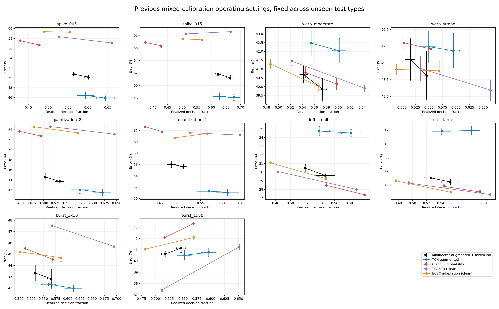

## Oracle transfer gaps: diagnostic only

Type-and-severity-matched oracle thresholds use only the original calibration labels, with independently corrupted calibration streams. They are never used by a deployable method. A matched oracle is a reference, not necessarily an upper bound. We report same-alpha oracle; oracle alpha selected by five-draw mean type-matched CALIBRATION earliness; and common alpha=.10. Error gap = mixed minus oracle; time gap = mixed minus oracle. A lower error can reflect longer waiting. A small gap does not mean either rule attains alpha=.10: actual errors and forced fractions are reported. The predeclared descriptive small-gap criterion requires BOTH absolute error gap <=2 pp and absolute decision-fraction gap <=.05. These are MACRO gaps; the additional mean absolute per-dataset gaps show heterogeneity without cancellation. A macro-small gap does not imply each dataset transfers well. Shifted reliability is not formally guaranteed.

oracle_same_alpha

| condition | model | target | mixed error % +/- SD | oracle error % +/- SD | gap pp +/- SD | mixed time | oracle time | time gap +/- SD | mixed forced % | oracle forced % | mean absolute dataset error gap pp | mean absolute dataset time gap | small joint macro gap |
| --- | --- | --- | --- | --- | --- | --- | --- | --- | --- | --- | --- | --- | --- |
| burst_1x30 | MiniRocket_aug | 0.5000 | 40.62 +/- 0.24 | 37.35 +/- 0.47 | 3.28 +/- 0.49 | 0.5179 | 0.5688 | -0.05 +/- 0.01 | 9.1261 | 33.8424 | 4.0550 | 0.1160 | False |
| burst_1x30 | MiniRocket_aug | 0.6000 | 41.15 +/- 0.39 | 37.97 +/- 0.56 | 3.17 +/- 0.40 | 0.5464 | 0.5974 | -0.05 +/- 0.01 | 11.5463 | 38.0574 | 4.2010 | 0.1172 | False |
| burst_1x30 | TCN_aug | 0.5000 | 40.51 +/- 0.44 | 38.48 +/- 0.51 | 2.03 +/- 0.49 | 0.5525 | 0.5913 | -0.04 +/- 0.02 | 22.1133 | 37.8668 | 2.1586 | 0.0926 | False |
| burst_1x30 | TCN_aug | 0.6000 | 40.77 +/- 0.38 | 39.08 +/- 0.13 | 1.69 +/- 0.46 | 0.5962 | 0.6407 | -0.04 +/- 0.02 | 26.6129 | 43.8456 | 2.1056 | 0.0939 | True |
| burst_3x10 | MiniRocket_aug | 0.5000 | 43.34 +/- 0.69 | 40.42 +/- 0.52 | 2.92 +/- 0.43 | 0.5332 | 0.6905 | -0.16 +/- 0.02 | 11.9170 | 40.3580 | 4.6183 | 0.1897 | False |
| burst_3x10 | MiniRocket_aug | 0.6000 | 42.82 +/- 0.85 | 40.73 +/- 0.44 | 2.09 +/- 0.68 | 0.5662 | 0.7178 | -0.15 +/- 0.01 | 15.0353 | 44.6606 | 4.5930 | 0.1893 | False |
| burst_3x10 | TCN_aug | 0.5000 | 42.34 +/- 0.14 | 39.40 +/- 0.22 | 2.94 +/- 0.30 | 0.5607 | 0.6603 | -0.10 +/- 0.02 | 24.0963 | 39.8710 | 3.1616 | 0.1407 | False |
| burst_3x10 | TCN_aug | 0.6000 | 41.99 +/- 0.31 | 39.33 +/- 0.23 | 2.65 +/- 0.42 | 0.6118 | 0.7061 | -0.09 +/- 0.03 | 29.8620 | 44.7716 | 2.9909 | 0.1394 | False |
| drift_large | MiniRocket_aug | 0.5000 | 35.12 +/- 0.42 | 34.43 +/- 0.44 | 0.69 +/- 0.81 | 0.5259 | 0.5588 | -0.03 +/- 0.01 | 15.9077 | 25.6410 | 2.3436 | 0.1399 | True |
| drift_large | MiniRocket_aug | 0.6000 | 34.53 +/- 0.37 | 33.74 +/- 0.40 | 0.80 +/- 0.72 | 0.5534 | 0.5908 | -0.04 +/- 0.02 | 18.0257 | 28.7378 | 2.2951 | 0.1412 | True |
| drift_large | TCN_aug | 0.5000 | 41.85 +/- 0.49 | 40.99 +/- 0.25 | 0.87 +/- 0.49 | 0.5412 | 0.6242 | -0.08 +/- 0.02 | 22.4946 | 39.5159 | 3.0045 | 0.1346 | False |
| drift_large | TCN_aug | 0.6000 | 41.95 +/- 0.58 | 41.21 +/- 0.45 | 0.74 +/- 0.63 | 0.5836 | 0.6718 | -0.09 +/- 0.02 | 26.6083 | 44.7593 | 2.8423 | 0.1344 | False |
| drift_small | MiniRocket_aug | 0.5000 | 30.47 +/- 0.43 | 31.08 +/- 0.32 | -0.62 +/- 0.73 | 0.5200 | 0.5075 | 0.01 +/- 0.02 | 16.1947 | 20.4335 | 2.6780 | 0.1498 | True |
| drift_small | MiniRocket_aug | 0.6000 | 29.62 +/- 0.31 | 29.97 +/- 0.29 | -0.35 +/- 0.51 | 0.5471 | 0.5353 | 0.01 +/- 0.02 | 18.2319 | 22.7244 | 2.3248 | 0.1478 | True |
| drift_small | TCN_aug | 0.5000 | 34.76 +/- 0.53 | 34.09 +/- 0.44 | 0.67 +/- 0.52 | 0.5391 | 0.5537 | -0.01 +/- 0.02 | 23.6213 | 29.0587 | 2.2665 | 0.0985 | True |
| drift_small | TCN_aug | 0.6000 | 34.54 +/- 0.42 | 33.55 +/- 0.51 | 0.98 +/- 0.43 | 0.5824 | 0.6029 | -0.02 +/- 0.01 | 27.6534 | 33.6705 | 1.8816 | 0.0951 | True |
| quantization_4 | MiniRocket_aug | 0.5000 | 56.04 +/- 0.55 | 53.53 +/- 0.64 | 2.51 +/- 1.04 | 0.4790 | 0.8383 | -0.36 +/- 0.01 | 9.0119 | 66.8239 | 4.9730 | 0.3709 | False |
| quantization_4 | MiniRocket_aug | 0.6000 | 55.65 +/- 0.37 | 53.58 +/- 0.67 | 2.06 +/- 0.88 | 0.5081 | 0.8515 | -0.34 +/- 0.01 | 11.4608 | 69.6306 | 4.5425 | 0.3550 | False |
| quantization_4 | TCN_aug | 0.5000 | 51.30 +/- 0.51 | 49.60 +/- 0.69 | 1.70 +/- 0.38 | 0.5699 | 0.7885 | -0.22 +/- 0.03 | 24.9777 | 59.9446 | 2.2410 | 0.2220 | False |
| quantization_4 | TCN_aug | 0.6000 | 51.04 +/- 0.60 | 49.63 +/- 0.67 | 1.41 +/- 0.68 | 0.6152 | 0.8216 | -0.21 +/- 0.03 | 30.2923 | 64.1474 | 2.0286 | 0.2113 | False |
| quantization_8 | MiniRocket_aug | 0.5000 | 44.58 +/- 0.64 | 42.12 +/- 0.39 | 2.45 +/- 0.85 | 0.5033 | 0.7187 | -0.22 +/- 0.01 | 10.1945 | 41.3547 | 3.4249 | 0.2562 | False |
| quantization_8 | MiniRocket_aug | 0.6000 | 43.68 +/- 0.75 | 41.68 +/- 0.38 | 2.01 +/- 0.99 | 0.5335 | 0.7378 | -0.20 +/- 0.02 | 13.1416 | 43.5467 | 3.1215 | 0.2485 | False |
| quantization_8 | TCN_aug | 0.5000 | 42.03 +/- 0.77 | 39.71 +/- 0.40 | 2.32 +/- 0.87 | 0.5748 | 0.6721 | -0.10 +/- 0.03 | 24.5182 | 41.1175 | 3.0130 | 0.1223 | False |
| quantization_8 | TCN_aug | 0.6000 | 41.44 +/- 0.68 | 39.27 +/- 0.40 | 2.17 +/- 0.80 | 0.6210 | 0.7098 | -0.09 +/- 0.03 | 29.5797 | 45.1581 | 2.7312 | 0.1171 | False |
| spike_005 | MiniRocket_aug | 0.5000 | 50.75 +/- 0.43 | 48.30 +/- 0.38 | 2.46 +/- 0.57 | 0.5640 | 0.8332 | -0.27 +/- 0.01 | 20.5660 | 61.1695 | 3.9974 | 0.2754 | False |
| spike_005 | MiniRocket_aug | 0.6000 | 50.15 +/- 0.48 | 48.04 +/- 0.42 | 2.11 +/- 0.78 | 0.6015 | 0.8516 | -0.25 +/- 0.01 | 24.2788 | 65.4842 | 3.3979 | 0.2563 | False |
| spike_005 | TCN_aug | 0.5000 | 46.42 +/- 0.64 | 43.57 +/- 1.14 | 2.85 +/- 1.08 | 0.5941 | 0.7614 | -0.17 +/- 0.01 | 29.1319 | 52.2531 | 3.3603 | 0.1894 | False |
| spike_005 | TCN_aug | 0.6000 | 45.88 +/- 0.48 | 43.47 +/- 1.11 | 2.41 +/- 1.10 | 0.6442 | 0.7906 | -0.15 +/- 0.02 | 35.4161 | 56.3323 | 3.2493 | 0.1725 | False |
| spike_015 | MiniRocket_aug | 0.5000 | 61.85 +/- 0.29 | 60.99 +/- 0.85 | 0.87 +/- 0.60 | 0.6232 | 0.9237 | -0.30 +/- 0.01 | 28.1918 | 82.8338 | 2.1787 | 0.3075 | False |
| spike_015 | MiniRocket_aug | 0.6000 | 61.21 +/- 0.38 | 60.74 +/- 0.83 | 0.48 +/- 0.71 | 0.6648 | 0.9299 | -0.27 +/- 0.01 | 33.1238 | 84.1425 | 1.5946 | 0.2721 | False |
| spike_015 | TCN_aug | 0.5000 | 58.25 +/- 0.59 | 56.27 +/- 0.74 | 1.99 +/- 0.89 | 0.6277 | 0.8752 | -0.25 +/- 0.02 | 33.6454 | 73.6491 | 2.4320 | 0.2621 | False |
| spike_015 | TCN_aug | 0.6000 | 58.09 +/- 0.49 | 56.32 +/- 0.78 | 1.78 +/- 0.69 | 0.6775 | 0.8860 | -0.21 +/- 0.02 | 40.7505 | 76.1345 | 2.2130 | 0.2230 | False |
| warp_moderate | MiniRocket_aug | 0.5000 | 40.69 +/- 0.49 | 41.77 +/- 0.47 | -1.09 +/- 0.37 | 0.5420 | 0.7239 | -0.18 +/- 0.00 | 15.2274 | 44.4306 | 4.5986 | 0.2166 | False |
| warp_moderate | MiniRocket_aug | 0.6000 | 39.86 +/- 0.64 | 41.13 +/- 0.49 | -1.27 +/- 0.66 | 0.5733 | 0.7504 | -0.18 +/- 0.00 | 18.0498 | 48.1912 | 4.5739 | 0.2136 | False |
| warp_moderate | TCN_aug | 0.5000 | 42.47 +/- 0.69 | 41.70 +/- 0.66 | 0.78 +/- 0.29 | 0.5545 | 0.7061 | -0.15 +/- 0.02 | 23.0984 | 45.5235 | 2.5915 | 0.1663 | False |
| warp_moderate | TCN_aug | 0.6000 | 42.04 +/- 0.70 | 41.33 +/- 0.52 | 0.71 +/- 0.43 | 0.6016 | 0.7426 | -0.14 +/- 0.01 | 28.7788 | 50.9176 | 2.5661 | 0.1554 | False |
| warp_strong | MiniRocket_aug | 0.5000 | 49.10 +/- 0.62 | 51.50 +/- 0.42 | -2.39 +/- 0.30 | 0.5155 | 0.8493 | -0.33 +/- 0.01 | 12.2684 | 69.1140 | 6.5777 | 0.3351 | False |
| warp_strong | MiniRocket_aug | 0.6000 | 48.62 +/- 0.73 | 51.44 +/- 0.36 | -2.83 +/- 0.45 | 0.5455 | 0.8619 | -0.32 +/- 0.01 | 14.8694 | 71.2272 | 6.2635 | 0.3219 | False |
| warp_strong | TCN_aug | 0.5000 | 49.49 +/- 0.47 | 49.54 +/- 0.43 | -0.05 +/- 0.40 | 0.5493 | 0.8008 | -0.25 +/- 0.01 | 22.0844 | 62.6814 | 4.1254 | 0.2652 | False |
| warp_strong | TCN_aug | 0.6000 | 49.37 +/- 0.51 | 49.51 +/- 0.28 | -0.15 +/- 0.40 | 0.5952 | 0.8314 | -0.24 +/- 0.01 | 27.9128 | 66.5702 | 4.2424 | 0.2499 | False |

oracle_calibration_time_matched

| condition | model | target | mixed error % +/- SD | oracle error % +/- SD | gap pp +/- SD | mixed time | oracle time | time gap +/- SD | mixed forced % | oracle forced % | mean absolute dataset error gap pp | mean absolute dataset time gap | small joint macro gap |
| --- | --- | --- | --- | --- | --- | --- | --- | --- | --- | --- | --- | --- | --- |
| burst_1x30 | MiniRocket_aug | 0.5000 | 40.62 +/- 0.24 | 38.92 +/- 0.44 | 1.70 +/- 0.40 | 0.5179 | 0.5974 | -0.08 +/- 0.02 | 9.1261 | 36.7939 | 4.6228 | 0.1242 | False |
| burst_1x30 | MiniRocket_aug | 0.6000 | 41.15 +/- 0.39 | 40.05 +/- 0.45 | 1.09 +/- 0.37 | 0.5464 | 0.6410 | -0.09 +/- 0.02 | 11.5463 | 42.6402 | 5.1139 | 0.1304 | False |
| burst_1x30 | TCN_aug | 0.5000 | 40.51 +/- 0.44 | 38.65 +/- 0.51 | 1.87 +/- 0.44 | 0.5525 | 0.6140 | -0.06 +/- 0.02 | 22.1133 | 40.0592 | 2.0327 | 0.0989 | False |
| burst_1x30 | TCN_aug | 0.6000 | 40.77 +/- 0.38 | 39.01 +/- 0.34 | 1.76 +/- 0.53 | 0.5962 | 0.6413 | -0.05 +/- 0.01 | 26.6129 | 43.4458 | 2.3298 | 0.0867 | True |
| burst_3x10 | MiniRocket_aug | 0.5000 | 43.34 +/- 0.69 | 39.69 +/- 0.68 | 3.65 +/- 0.56 | 0.5332 | 0.6046 | -0.07 +/- 0.02 | 11.9170 | 31.6461 | 4.9228 | 0.1498 | False |
| burst_3x10 | MiniRocket_aug | 0.6000 | 42.82 +/- 0.85 | 39.28 +/- 0.42 | 3.53 +/- 0.58 | 0.5662 | 0.6775 | -0.11 +/- 0.02 | 15.0353 | 38.6144 | 4.7236 | 0.1324 | False |
| burst_3x10 | TCN_aug | 0.5000 | 42.34 +/- 0.14 | 39.18 +/- 0.45 | 3.16 +/- 0.52 | 0.5607 | 0.6414 | -0.08 +/- 0.02 | 24.0963 | 35.4855 | 3.5704 | 0.1165 | False |
| burst_3x10 | TCN_aug | 0.6000 | 41.99 +/- 0.31 | 38.63 +/- 0.29 | 3.36 +/- 0.40 | 0.6118 | 0.6714 | -0.06 +/- 0.03 | 29.8620 | 38.7101 | 3.6207 | 0.1120 | False |
| drift_large | MiniRocket_aug | 0.5000 | 35.12 +/- 0.42 | 33.70 +/- 0.39 | 1.43 +/- 0.72 | 0.5259 | 0.5936 | -0.07 +/- 0.02 | 15.9077 | 28.7507 | 2.4583 | 0.1432 | False |
| drift_large | MiniRocket_aug | 0.6000 | 34.53 +/- 0.37 | 33.25 +/- 0.30 | 1.28 +/- 0.63 | 0.5534 | 0.6474 | -0.09 +/- 0.02 | 18.0257 | 34.7505 | 2.4833 | 0.1321 | False |
| drift_large | TCN_aug | 0.5000 | 41.85 +/- 0.49 | 40.52 +/- 0.16 | 1.34 +/- 0.37 | 0.5412 | 0.6281 | -0.09 +/- 0.01 | 22.4946 | 39.3704 | 3.2296 | 0.1465 | False |
| drift_large | TCN_aug | 0.6000 | 41.95 +/- 0.58 | 41.26 +/- 0.27 | 0.69 +/- 0.62 | 0.5836 | 0.6993 | -0.12 +/- 0.01 | 26.6083 | 47.2371 | 2.7811 | 0.1391 | False |
| drift_small | MiniRocket_aug | 0.5000 | 30.47 +/- 0.43 | 29.33 +/- 0.31 | 1.14 +/- 0.69 | 0.5200 | 0.5788 | -0.06 +/- 0.02 | 16.1947 | 25.3119 | 1.8461 | 0.1263 | False |
| drift_small | MiniRocket_aug | 0.6000 | 29.62 +/- 0.31 | 28.30 +/- 0.26 | 1.32 +/- 0.57 | 0.5471 | 0.6120 | -0.06 +/- 0.02 | 18.2319 | 28.6313 | 2.0605 | 0.1325 | False |
| drift_small | TCN_aug | 0.5000 | 34.76 +/- 0.53 | 33.24 +/- 0.59 | 1.52 +/- 0.71 | 0.5391 | 0.6202 | -0.08 +/- 0.01 | 23.6213 | 34.5586 | 1.9690 | 0.1059 | False |
| drift_small | TCN_aug | 0.6000 | 34.54 +/- 0.42 | 33.08 +/- 0.54 | 1.46 +/- 0.55 | 0.5824 | 0.6407 | -0.06 +/- 0.01 | 27.6534 | 36.8858 | 1.7376 | 0.0837 | False |
| quantization_4 | MiniRocket_aug | 0.5000 | 56.04 +/- 0.55 | 52.46 +/- 0.75 | 3.57 +/- 0.54 | 0.4790 | 0.7593 | -0.28 +/- 0.01 | 9.0119 | 53.8562 | 4.8263 | 0.3136 | False |
| quantization_4 | MiniRocket_aug | 0.6000 | 55.65 +/- 0.37 | 52.60 +/- 0.83 | 3.05 +/- 0.53 | 0.5081 | 0.7778 | -0.27 +/- 0.01 | 11.4608 | 56.3568 | 4.3702 | 0.2989 | False |
| quantization_4 | TCN_aug | 0.5000 | 51.30 +/- 0.51 | 49.63 +/- 0.69 | 1.67 +/- 0.47 | 0.5699 | 0.7373 | -0.17 +/- 0.03 | 24.9777 | 52.4438 | 2.3461 | 0.1910 | False |
| quantization_4 | TCN_aug | 0.6000 | 51.04 +/- 0.60 | 49.33 +/- 0.57 | 1.71 +/- 0.71 | 0.6152 | 0.7783 | -0.16 +/- 0.03 | 30.2923 | 56.7995 | 2.4254 | 0.1860 | False |
| quantization_8 | MiniRocket_aug | 0.5000 | 44.58 +/- 0.64 | 42.66 +/- 0.79 | 1.91 +/- 1.24 | 0.5033 | 0.6641 | -0.16 +/- 0.02 | 10.1945 | 35.5766 | 2.7255 | 0.2253 | False |
| quantization_8 | MiniRocket_aug | 0.6000 | 43.68 +/- 0.75 | 41.75 +/- 0.86 | 1.93 +/- 1.23 | 0.5335 | 0.7114 | -0.18 +/- 0.02 | 13.1416 | 39.0433 | 2.7275 | 0.2250 | False |
| quantization_8 | TCN_aug | 0.5000 | 42.03 +/- 0.77 | 39.64 +/- 0.57 | 2.40 +/- 1.12 | 0.5748 | 0.6705 | -0.10 +/- 0.03 | 24.5182 | 38.8791 | 2.7215 | 0.1101 | False |
| quantization_8 | TCN_aug | 0.6000 | 41.44 +/- 0.68 | 39.28 +/- 0.55 | 2.16 +/- 0.95 | 0.6210 | 0.6909 | -0.07 +/- 0.03 | 29.5797 | 41.2664 | 2.5361 | 0.0988 | False |
| spike_005 | MiniRocket_aug | 0.5000 | 50.75 +/- 0.43 | 48.85 +/- 0.69 | 1.90 +/- 0.80 | 0.5640 | 0.7268 | -0.16 +/- 0.02 | 20.5660 | 45.2738 | 3.3985 | 0.2310 | False |
| spike_005 | MiniRocket_aug | 0.6000 | 50.15 +/- 0.48 | 47.90 +/- 0.52 | 2.25 +/- 0.91 | 0.6015 | 0.7559 | -0.15 +/- 0.02 | 24.2788 | 47.8014 | 3.2404 | 0.2066 | False |
| spike_005 | TCN_aug | 0.5000 | 46.42 +/- 0.64 | 44.37 +/- 0.90 | 2.05 +/- 0.66 | 0.5941 | 0.7068 | -0.11 +/- 0.02 | 29.1319 | 43.9543 | 3.0735 | 0.1536 | False |
| spike_005 | TCN_aug | 0.6000 | 45.88 +/- 0.48 | 43.79 +/- 1.14 | 2.10 +/- 1.01 | 0.6442 | 0.7352 | -0.09 +/- 0.02 | 35.4161 | 46.9765 | 2.9727 | 0.1358 | False |
| spike_015 | MiniRocket_aug | 0.5000 | 61.85 +/- 0.29 | 60.69 +/- 0.67 | 1.16 +/- 0.45 | 0.6232 | 0.8360 | -0.21 +/- 0.02 | 28.1918 | 66.9316 | 2.5154 | 0.2934 | False |
| spike_015 | MiniRocket_aug | 0.6000 | 61.21 +/- 0.38 | 60.41 +/- 0.62 | 0.80 +/- 0.37 | 0.6648 | 0.8532 | -0.19 +/- 0.02 | 33.1238 | 69.0810 | 1.9415 | 0.2493 | False |
| spike_015 | TCN_aug | 0.5000 | 58.25 +/- 0.59 | 56.21 +/- 0.65 | 2.04 +/- 0.85 | 0.6277 | 0.8049 | -0.18 +/- 0.02 | 33.6454 | 62.6817 | 2.7313 | 0.2344 | False |
| spike_015 | TCN_aug | 0.6000 | 58.09 +/- 0.49 | 56.15 +/- 0.67 | 1.94 +/- 0.66 | 0.6775 | 0.8108 | -0.13 +/- 0.02 | 40.7505 | 62.9414 | 2.6619 | 0.2094 | False |
| warp_moderate | MiniRocket_aug | 0.5000 | 40.69 +/- 0.49 | 40.77 +/- 0.46 | -0.08 +/- 0.48 | 0.5420 | 0.6146 | -0.07 +/- 0.01 | 15.2274 | 30.7610 | 3.6647 | 0.1325 | False |
| warp_moderate | MiniRocket_aug | 0.6000 | 39.86 +/- 0.64 | 40.17 +/- 0.52 | -0.32 +/- 0.41 | 0.5733 | 0.6754 | -0.10 +/- 0.01 | 18.0498 | 37.1854 | 3.4486 | 0.1374 | False |
| warp_moderate | TCN_aug | 0.5000 | 42.47 +/- 0.69 | 41.59 +/- 0.65 | 0.88 +/- 0.27 | 0.5545 | 0.6472 | -0.09 +/- 0.02 | 23.0984 | 37.7188 | 2.3266 | 0.1178 | False |
| warp_moderate | TCN_aug | 0.6000 | 42.04 +/- 0.70 | 41.29 +/- 0.66 | 0.75 +/- 0.31 | 0.6016 | 0.6816 | -0.08 +/- 0.02 | 28.7788 | 41.5252 | 2.2201 | 0.1211 | False |
| warp_strong | MiniRocket_aug | 0.5000 | 49.10 +/- 0.62 | 50.01 +/- 0.91 | -0.90 +/- 0.61 | 0.5155 | 0.7052 | -0.19 +/- 0.03 | 12.2684 | 48.5354 | 4.3375 | 0.2143 | False |
| warp_strong | MiniRocket_aug | 0.6000 | 48.62 +/- 0.73 | 50.08 +/- 0.85 | -1.46 +/- 0.57 | 0.5455 | 0.7259 | -0.18 +/- 0.02 | 14.8694 | 51.1397 | 4.2142 | 0.2052 | False |
| warp_strong | TCN_aug | 0.5000 | 49.49 +/- 0.47 | 49.26 +/- 0.59 | 0.23 +/- 0.56 | 0.5493 | 0.7097 | -0.16 +/- 0.02 | 22.0844 | 51.0081 | 3.0787 | 0.1937 | False |
| warp_strong | TCN_aug | 0.6000 | 49.37 +/- 0.51 | 48.87 +/- 0.55 | 0.49 +/- 0.51 | 0.5952 | 0.7411 | -0.15 +/- 0.02 | 27.9128 | 53.9337 | 3.1714 | 0.1806 | False |

fixed_alpha_0.10

| condition | model | target | mixed error % +/- SD | oracle error % +/- SD | gap pp +/- SD | mixed time | oracle time | time gap +/- SD | mixed forced % | oracle forced % | mean absolute dataset error gap pp | mean absolute dataset time gap | small joint macro gap |
| --- | --- | --- | --- | --- | --- | --- | --- | --- | --- | --- | --- | --- | --- |
| burst_1x30 | MiniRocket_aug | alpha=.10 | 41.29 +/- 1.01 | 39.82 +/- 0.61 | 1.47 +/- 0.72 | 0.5784 | 0.6410 | -0.06 +/- 0.00 | 21.7644 | 48.9343 | 3.0606 | 0.0892 | False |
| burst_1x30 | TCN_aug | alpha=.10 | 41.82 +/- 0.46 | 40.45 +/- 0.34 | 1.37 +/- 0.31 | 0.6517 | 0.6954 | -0.04 +/- 0.01 | 39.8626 | 55.3663 | 2.1509 | 0.0592 | True |
| burst_3x10 | MiniRocket_aug | alpha=.10 | 42.75 +/- 0.83 | 40.16 +/- 0.57 | 2.59 +/- 0.40 | 0.6030 | 0.7557 | -0.15 +/- 0.01 | 27.3535 | 57.8237 | 3.9110 | 0.1581 | False |
| burst_3x10 | TCN_aug | alpha=.10 | 41.74 +/- 0.58 | 39.44 +/- 0.32 | 2.30 +/- 0.60 | 0.6721 | 0.7600 | -0.09 +/- 0.01 | 43.8574 | 58.2316 | 2.5711 | 0.0983 | False |
| drift_large | MiniRocket_aug | alpha=.10 | 33.67 +/- 0.71 | 33.63 +/- 0.22 | 0.04 +/- 0.75 | 0.5850 | 0.6335 | -0.05 +/- 0.01 | 27.9767 | 39.5741 | 1.7644 | 0.0932 | True |
| drift_large | TCN_aug | alpha=.10 | 42.05 +/- 0.41 | 41.71 +/- 0.24 | 0.34 +/- 0.36 | 0.6437 | 0.7088 | -0.07 +/- 0.01 | 40.2220 | 54.4470 | 2.1373 | 0.0861 | False |
| drift_small | MiniRocket_aug | alpha=.10 | 28.24 +/- 0.46 | 28.73 +/- 0.17 | -0.49 +/- 0.35 | 0.5767 | 0.5964 | -0.02 +/- 0.01 | 28.1898 | 34.4648 | 1.4769 | 0.0924 | True |
| drift_small | TCN_aug | alpha=.10 | 34.16 +/- 0.66 | 33.66 +/- 0.67 | 0.50 +/- 0.22 | 0.6382 | 0.6608 | -0.02 +/- 0.01 | 40.5110 | 45.8552 | 1.4652 | 0.0655 | True |
| quantization_4 | MiniRocket_aug | alpha=.10 | 55.37 +/- 0.57 | 53.07 +/- 0.52 | 2.30 +/- 0.78 | 0.5540 | 0.8381 | -0.28 +/- 0.01 | 22.1581 | 72.9293 | 4.0822 | 0.2864 | False |
| quantization_4 | TCN_aug | alpha=.10 | 51.42 +/- 0.87 | 49.87 +/- 1.05 | 1.55 +/- 1.08 | 0.6688 | 0.8141 | -0.15 +/- 0.03 | 43.4811 | 67.0188 | 2.2098 | 0.1496 | False |
| quantization_8 | MiniRocket_aug | alpha=.10 | 42.87 +/- 0.31 | 40.83 +/- 0.86 | 2.04 +/- 0.69 | 0.5746 | 0.7503 | -0.18 +/- 0.02 | 24.7396 | 52.3611 | 3.2452 | 0.1920 | False |
| quantization_8 | TCN_aug | alpha=.10 | 40.99 +/- 0.44 | 38.76 +/- 0.62 | 2.23 +/- 0.22 | 0.6766 | 0.7336 | -0.06 +/- 0.02 | 44.7471 | 51.8665 | 2.9371 | 0.0770 | False |
| spike_005 | MiniRocket_aug | alpha=.10 | 51.69 +/- 0.58 | 47.83 +/- 0.39 | 3.86 +/- 0.94 | 0.6288 | 0.8499 | -0.22 +/- 0.01 | 32.4038 | 67.2107 | 4.9380 | 0.2251 | False |
| spike_005 | TCN_aug | alpha=.10 | 46.02 +/- 0.22 | 43.31 +/- 1.08 | 2.71 +/- 1.13 | 0.7010 | 0.8122 | -0.11 +/- 0.01 | 49.6583 | 63.0854 | 3.0897 | 0.1202 | False |
| spike_015 | MiniRocket_aug | alpha=.10 | 62.66 +/- 0.39 | 60.49 +/- 0.87 | 2.17 +/- 0.97 | 0.6704 | 0.9292 | -0.26 +/- 0.01 | 38.5712 | 84.8331 | 3.0455 | 0.2634 | False |
| spike_015 | TCN_aug | alpha=.10 | 58.14 +/- 0.42 | 56.68 +/- 0.94 | 1.46 +/- 1.08 | 0.7234 | 0.9126 | -0.19 +/- 0.01 | 52.5213 | 81.5366 | 2.1323 | 0.1944 | False |
| warp_moderate | MiniRocket_aug | alpha=.10 | 39.60 +/- 0.49 | 40.47 +/- 0.75 | -0.88 +/- 0.61 | 0.6068 | 0.8087 | -0.20 +/- 0.01 | 28.3053 | 59.7937 | 3.9282 | 0.2023 | False |
| warp_moderate | TCN_aug | alpha=.10 | 41.34 +/- 0.71 | 40.65 +/- 0.37 | 0.70 +/- 0.51 | 0.6611 | 0.8020 | -0.14 +/- 0.01 | 41.8522 | 61.8416 | 2.3559 | 0.1424 | False |
| warp_strong | MiniRocket_aug | alpha=.10 | 48.46 +/- 0.49 | 51.74 +/- 0.26 | -3.28 +/- 0.36 | 0.5803 | 0.9079 | -0.33 +/- 0.01 | 23.3792 | 80.7425 | 6.1917 | 0.3276 | False |
| warp_strong | TCN_aug | alpha=.10 | 49.27 +/- 0.71 | 49.69 +/- 0.42 | -0.41 +/- 0.36 | 0.6487 | 0.8809 | -0.23 +/- 0.01 | 39.8429 | 76.9921 | 3.5506 | 0.2326 | False |

## N=26 Nemenyi diagrams

Five stopping methods, all 26 datasets, both calibration targets. Nemenyi alpha=.05 controls within each panel; rank comparisons inherit realized waiting-time differences.

| condition | target | N | CD | friedman_stat | friedman_p | MiniRocket_aug | TCN_aug | Probability | TEASER | ECEC |
| --- | --- | --- | --- | --- | --- | --- | --- | --- | --- | --- |
| spike_005 | 0.5000 | 26 | 1.1962 | 32.2389 | 0.0000 | 2.4231 | 1.7308 | 3.5769 | 3.5577 | 3.7115 |
| spike_005 | 0.6000 | 26 | 1.1962 | 31.6840 | 0.0000 | 2.3462 | 1.8077 | 3.4231 | 3.7115 | 3.7115 |
| spike_015 | 0.5000 | 26 | 1.1962 | 34.9723 | 0.0000 | 2.4038 | 1.7308 | 3.3654 | 3.9038 | 3.5962 |
| spike_015 | 0.6000 | 26 | 1.1962 | 34.7269 | 0.0000 | 2.2885 | 1.8462 | 3.2308 | 3.9615 | 3.6731 |
| warp_moderate | 0.5000 | 26 | 1.1962 | 0.5010 | 0.9734 | 2.9423 | 3.1538 | 3.0769 | 2.9231 | 2.9038 |
| warp_moderate | 0.6000 | 26 | 1.1962 | 1.9385 | 0.7471 | 3.1538 | 3.2692 | 3.0000 | 2.7692 | 2.8077 |
| warp_strong | 0.5000 | 26 | 1.1962 | 2.2890 | 0.6828 | 3.2308 | 2.9808 | 3.2308 | 2.6923 | 2.8654 |
| warp_strong | 0.6000 | 26 | 1.1962 | 2.9846 | 0.5604 | 3.2692 | 3.1538 | 3.1538 | 2.6923 | 2.7308 |
| quantization_8 | 0.5000 | 26 | 1.1962 | 33.5058 | 0.0000 | 2.2308 | 1.8846 | 3.3269 | 3.6154 | 3.9423 |
| quantization_8 | 0.6000 | 26 | 1.1962 | 29.9807 | 0.0000 | 2.4231 | 1.8077 | 3.5577 | 3.4231 | 3.7885 |
| quantization_4 | 0.5000 | 26 | 1.1962 | 28.4064 | 0.0000 | 2.4038 | 1.8846 | 3.7308 | 3.5962 | 3.3846 |
| quantization_4 | 0.6000 | 26 | 1.1962 | 29.3948 | 0.0000 | 2.4423 | 1.8269 | 3.6923 | 3.5769 | 3.4615 |
| drift_small | 0.5000 | 26 | 1.1962 | 25.6371 | 0.0000 | 3.0962 | 4.2115 | 2.5577 | 2.1154 | 3.0192 |
| drift_small | 0.6000 | 26 | 1.1962 | 28.0463 | 0.0000 | 3.2500 | 4.2692 | 2.6346 | 2.0962 | 2.7500 |
| drift_large | 0.5000 | 26 | 1.1962 | 22.1118 | 0.0002 | 3.2308 | 4.1538 | 2.6154 | 2.2885 | 2.7115 |
| drift_large | 0.6000 | 26 | 1.1962 | 25.4875 | 0.0000 | 3.3462 | 4.1923 | 2.7308 | 2.2500 | 2.4808 |
| burst_3x10 | 0.5000 | 26 | 1.1962 | 8.5318 | 0.0739 | 2.7308 | 2.3846 | 3.0577 | 3.5192 | 3.3077 |
| burst_3x10 | 0.6000 | 26 | 1.1962 | 2.8000 | 0.5918 | 2.8462 | 2.6538 | 3.0000 | 3.2692 | 3.2308 |
| burst_1x30 | 0.5000 | 26 | 1.1962 | 8.4615 | 0.0761 | 3.0769 | 3.0385 | 3.3077 | 2.2308 | 3.3462 |
| burst_1x30 | 0.6000 | 26 | 1.1962 | 3.5385 | 0.4721 | 3.0385 | 2.9231 | 3.3846 | 2.5769 | 3.0769 |

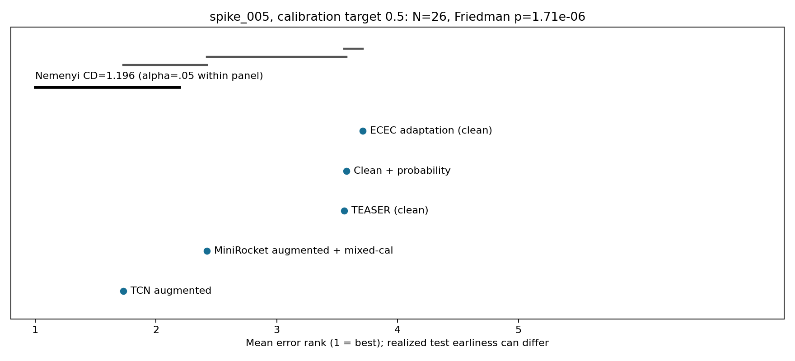


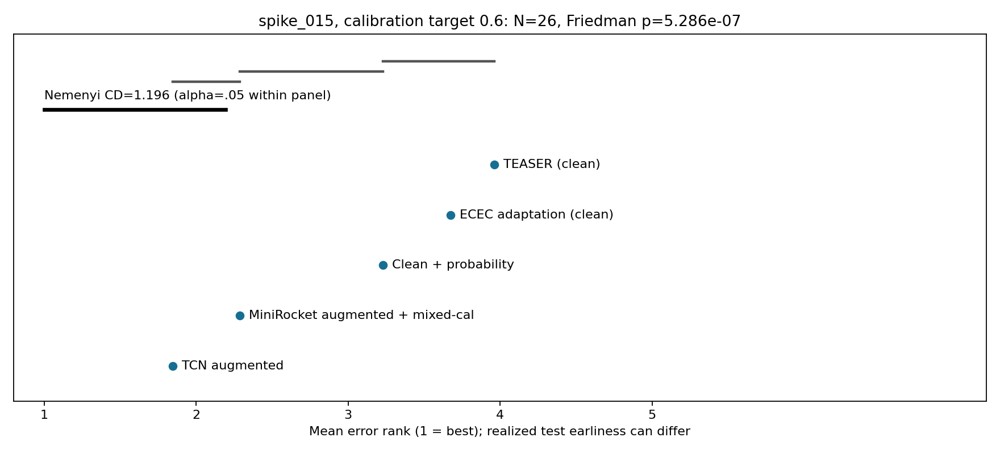
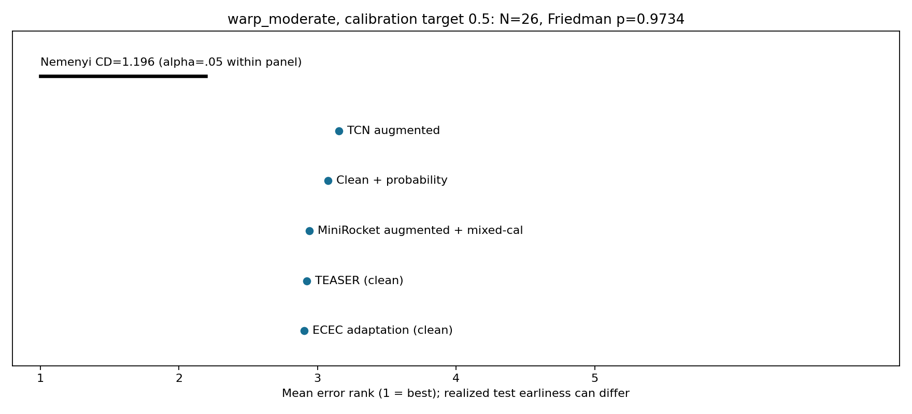
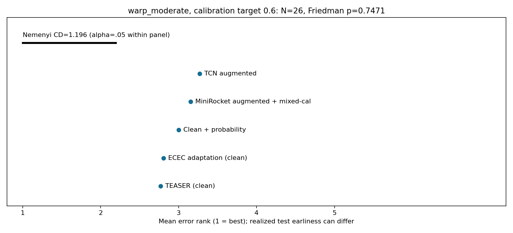
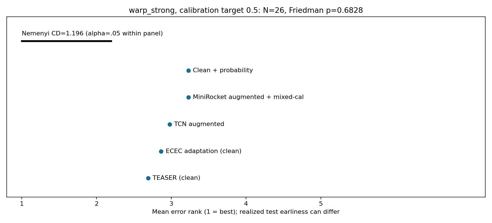
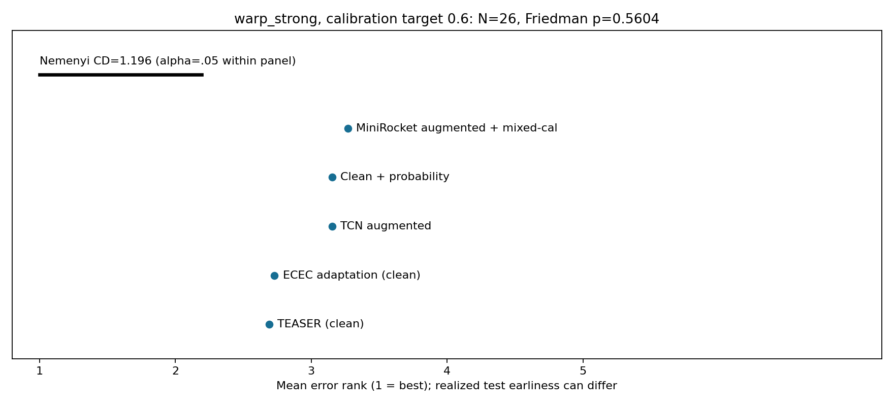
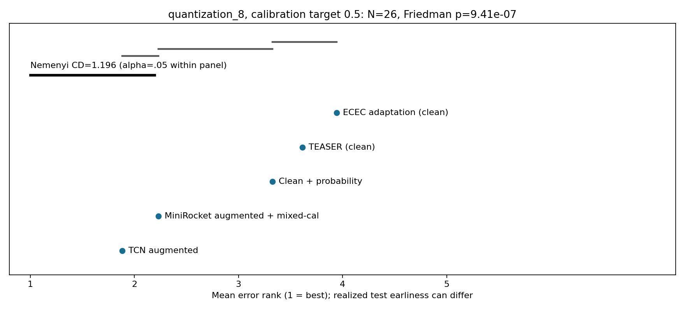

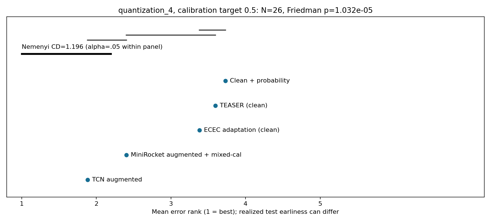
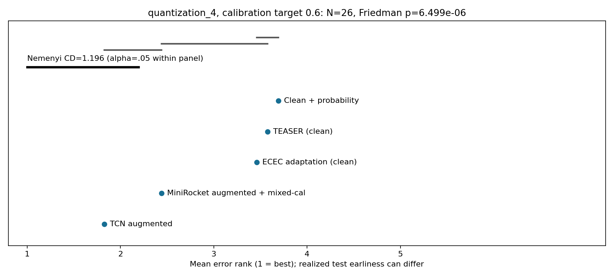
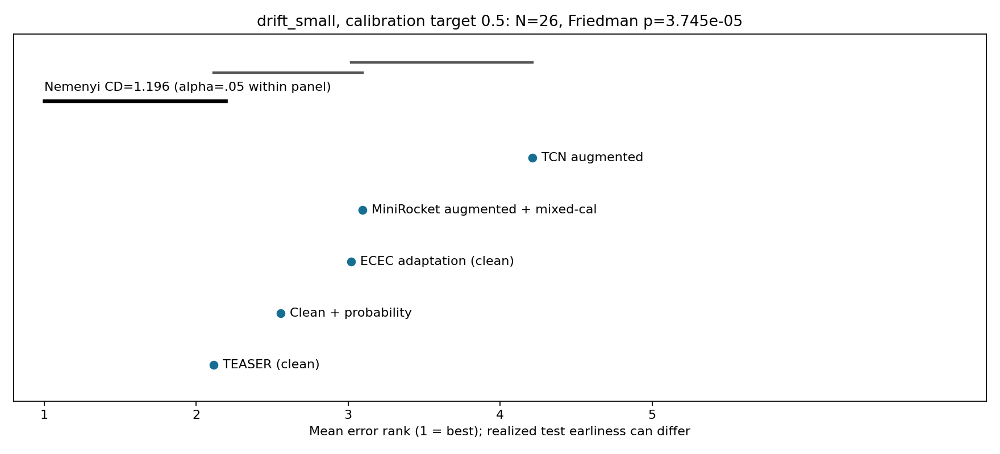
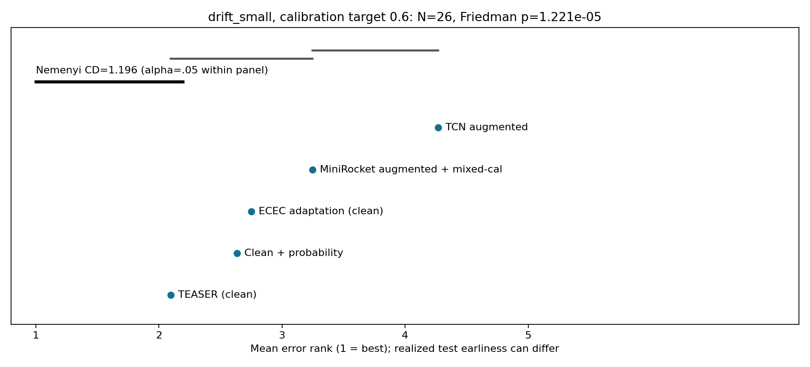
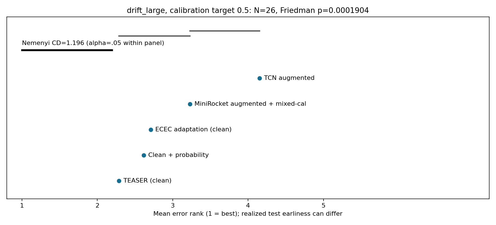
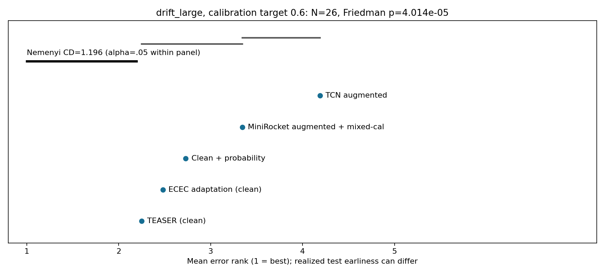
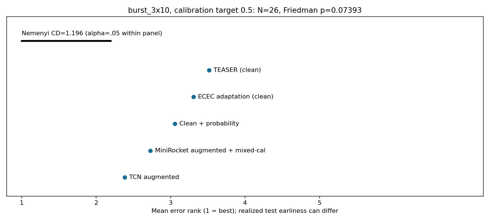
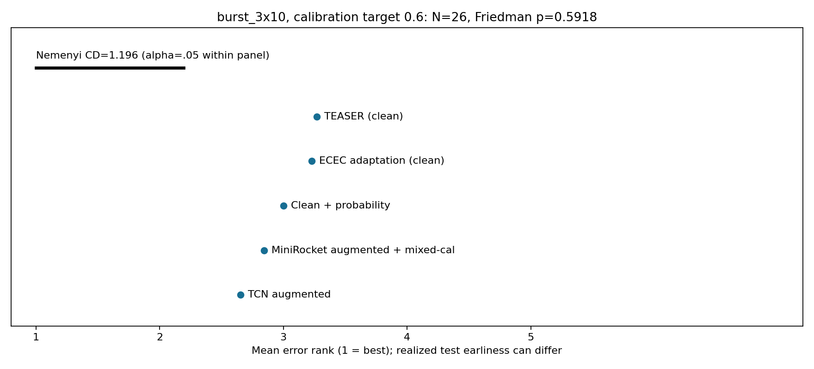
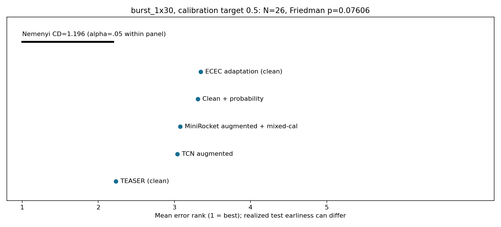
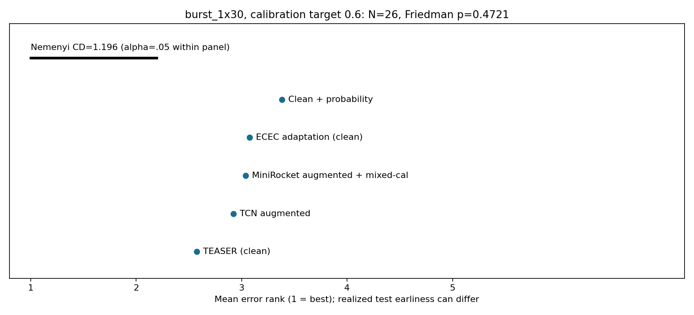

## Datasets and per-dataset effects

| dataset | train_size | test_size | length | n_classes | fit_count | validation_count | calibration_count |
| --- | --- | --- | --- | --- | --- | --- | --- |
| FordA | 3601 | 1320 | 500 | 2 | 2301 | 400 | 900 |
| ECG5000 | 500 | 4500 | 140 | 5 | 201 | 99 | 200 |
| StarLightCurves | 1000 | 8236 | 1024 | 3 | 550 | 200 | 250 |
| Wafer | 1000 | 6164 | 152 | 2 | 550 | 200 | 250 |
| ElectricDevices | 8926 | 7711 | 96 | 7 | 4000 | 401 | 2000 |
| Crop | 7200 | 16800 | 46 | 24 | 4000 | 408 | 1800 |
| FordB | 3636 | 810 | 500 | 2 | 2327 | 400 | 909 |
| NonInvasiveFetalECGThorax1 | 1800 | 1965 | 750 | 42 | 994 | 357 | 449 |
| PhalangesOutlinesCorrect | 1800 | 858 | 80 | 2 | 990 | 360 | 450 |
| HandOutlines | 1000 | 370 | 2709 | 2 | 550 | 200 | 250 |
| UWaveGestureLibraryX | 896 | 3582 | 315 | 8 | 494 | 178 | 224 |
| TwoPatterns | 1000 | 4000 | 128 | 4 | 552 | 199 | 249 |
| Strawberry | 613 | 370 | 235 | 2 | 290 | 123 | 200 |
| MiddlePhalanxOutlineCorrect | 600 | 291 | 80 | 2 | 280 | 120 | 200 |
| EthanolLevel | 504 | 500 | 1751 | 4 | 204 | 100 | 200 |
| MixedShapesRegularTrain | 500 | 2425 | 1024 | 5 | 200 | 100 | 200 |
| SwedishLeaf | 500 | 625 | 128 | 15 | 201 | 101 | 198 |
| FaceAll | 560 | 1690 | 131 | 14 | 252 | 112 | 196 |
| ShapesAll | 600 | 600 | 512 | 60 | 300 | 120 | 180 |
| SyntheticControl | 300 | 300 | 60 | 6 | 180 | 60 | 60 |
| EOGHorizontalSignal | 362 | 362 | 1250 | 12 | 218 | 72 | 72 |
| ChlorineConcentration | 467 | 3840 | 166 | 3 | 281 | 93 | 93 |
| SemgHandMovementCh2 | 450 | 450 | 1500 | 6 | 270 | 90 | 90 |
| LargeKitchenAppliances | 375 | 375 | 720 | 3 | 225 | 75 | 75 |
| InsectWingbeatSound | 220 | 1980 | 256 | 11 | 132 | 44 | 44 |
| CricketX | 390 | 390 | 300 | 12 | 234 | 78 | 78 |

Same splits and fit caps as before; small calibration counts in some main datasets remain a limitation. TwoLeadECG/ItalyPowerDemand are excluded from the main 26.

MiniRocket_aug vs MiniRocket_clean, error reduction pp averaged over nine checkpoints:

| dataset | spike_005 | spike_015 | warp_moderate | warp_strong | quantization_8 | quantization_4 | drift_small | drift_large | burst_3x10 | burst_1x30 |
| --- | --- | --- | --- | --- | --- | --- | --- | --- | --- | --- |
| FordA | 24.7660 | 8.8636 | -0.9714 | -0.3822 | 15.1111 | 12.2576 | 0.3098 | 0.6212 | 2.9663 | 2.0118 |
| ECG5000 | 0.9570 | -0.6035 | -0.8331 | -1.2968 | 6.9052 | 14.9719 | -0.0360 | -0.1990 | -0.1496 | 0.1630 |
| StarLightCurves | 27.7575 | 14.4636 | -0.5118 | 1.5895 | 27.0965 | 8.8025 | -0.6832 | -0.5690 | 1.1834 | 2.7360 |
| Wafer | 1.8905 | 0.5527 | -0.4276 | -0.1092 | 1.3458 | 2.4367 | 0.0534 | 0.6799 | -0.7535 | -1.2629 |
| ElectricDevices | -2.4165 | -3.8724 | -1.3213 | -1.4597 | -1.9280 | 0.2677 | -0.7352 | 0.5948 | -1.1744 | -1.1977 |
| Crop | -0.8003 | 0.5147 | -2.4689 | -2.1975 | 0.1519 | 0.0761 | -5.0164 | -1.7102 | -1.6783 | -3.5798 |
| FordB | 14.9383 | 6.5048 | -0.3320 | -0.4060 | 8.4801 | 11.2044 | -0.2908 | -0.2003 | 1.0453 | 0.1317 |
| NonInvasiveFetalECGThorax1 | 8.7260 | 2.1725 | -4.0317 | -1.6692 | 7.6517 | 1.2983 | -6.5649 | -15.6121 | 4.1425 | -2.4948 |
| PhalangesOutlinesCorrect | 8.0238 | 9.0728 | 0.7485 | 2.2870 | 17.9876 | 11.1759 | -1.2018 | 0.0803 | 8.3812 | 3.0122 |
| HandOutlines | 10.8108 | -0.5345 | -2.7628 | -3.3393 | 5.8438 | 0.0000 | -0.3664 | 1.6336 | 0.9429 | -3.0631 |
| UWaveGestureLibraryX | -1.6589 | 2.2470 | -1.8363 | -1.4455 | 14.9345 | 5.9296 | 0.1042 | -0.5887 | -0.8015 | -0.1439 |
| TwoPatterns | 1.5233 | 1.9228 | 0.1522 | 0.2328 | -0.3500 | 1.9989 | -0.3911 | -0.2961 | 0.7739 | -0.5294 |
| Strawberry | -0.9189 | -3.2913 | -2.6787 | -4.3483 | 0.6366 | -0.1622 | -1.3634 | -0.3844 | -2.3724 | -1.4835 |
| MiddlePhalanxOutlineCorrect | 1.3593 | 1.7564 | 0.1145 | -0.2444 | 2.3291 | 8.0107 | -1.8862 | -2.8484 | 2.3597 | -0.5116 |
| EthanolLevel | 0.3733 | -0.2667 | -1.0978 | 0.0400 | 1.0889 | -0.0844 | 0.2978 | -0.2978 | -0.1156 | 0.6756 |
| MixedShapesRegularTrain | 16.9778 | 13.8639 | -7.9487 | -7.7773 | 18.4092 | 13.7210 | -4.9329 | -5.8538 | -0.5746 | -0.5443 |
| SwedishLeaf | 7.3564 | 3.4844 | -4.6827 | -3.5484 | 20.4444 | 4.0604 | -3.3387 | -4.5973 | -4.9422 | -2.0551 |
| FaceAll | 1.7068 | 2.5128 | -1.2742 | 0.3761 | -2.3077 | 4.5404 | -0.8060 | -0.6561 | 2.0934 | 2.1972 |
| ShapesAll | 6.3926 | 2.0259 | -5.0519 | -2.6667 | 26.9185 | 3.2296 | -2.9333 | -2.7704 | 2.2556 | 0.6704 |
| SyntheticControl | 2.1704 | 1.1481 | 0.2000 | 0.6074 | -0.0667 | 0.7333 | -0.7037 | -0.8815 | -0.0667 | 0.3481 |
| EOGHorizontalSignal | -1.5470 | 10.1719 | -4.7637 | -3.9349 | -3.7078 | -2.7195 | -3.4868 | -3.5359 | 0.7858 | -3.6034 |
| ChlorineConcentration | 9.3872 | 12.5787 | 0.0955 | -0.9236 | 8.9664 | 8.6186 | -0.9832 | -0.9433 | 1.1285 | 0.6105 |
| SemgHandMovementCh2 | -1.7877 | 0.8938 | -2.6716 | -2.0642 | -1.4370 | -0.4099 | -3.1210 | -3.2593 | -2.9037 | -2.0543 |
| LargeKitchenAppliances | -0.5274 | 0.9481 | -0.3200 | -0.2726 | 3.6859 | 1.5052 | 0.3319 | -1.8667 | -0.5274 | 0.5807 |
| InsectWingbeatSound | 20.3030 | 14.7722 | -0.6981 | -0.1358 | 7.6150 | 9.7946 | 0.4703 | 0.4568 | 1.4826 | 2.0090 |
| CricketX | 9.2536 | 7.1624 | -1.8348 | -1.5613 | 7.5157 | 7.3162 | -1.6410 | -1.5840 | 3.0199 | -0.3932 |

TCN_aug vs MiniRocket_aug, error reduction pp averaged over nine checkpoints:

| dataset | spike_005 | spike_015 | warp_moderate | warp_strong | quantization_8 | quantization_4 | drift_small | drift_large | burst_3x10 | burst_1x30 |
| --- | --- | --- | --- | --- | --- | --- | --- | --- | --- | --- |
| FordA | 8.6027 | 11.1313 | 2.7222 | 3.7071 | 3.2997 | 8.2155 | 1.7542 | 1.6616 | 9.5707 | 10.9966 |
| ECG5000 | 12.7304 | 24.6622 | -0.3022 | -1.1496 | 1.7867 | 4.4533 | -0.8844 | -3.5195 | -0.7294 | -0.5012 |
| StarLightCurves | 1.6194 | -13.9858 | 2.4928 | 6.8116 | 14.2286 | 31.1621 | -0.1824 | -0.3316 | 4.2531 | 3.8797 |
| Wafer | 3.1866 | 3.8856 | 0.5837 | 1.8296 | -0.0375 | -0.3360 | -2.6548 | -5.4503 | 1.5062 | -0.6951 |
| ElectricDevices | 3.9139 | 0.3836 | 4.3923 | 3.7381 | 3.0274 | 3.2926 | 2.4436 | -2.2862 | 4.9084 | 3.2802 |
| Crop | 7.6515 | 3.1175 | 4.6530 | 4.4935 | 1.1999 | 1.1944 | 5.9054 | 0.5390 | 8.2169 | 8.8515 |
| FordB | 6.8368 | 4.7215 | 3.2346 | 3.7476 | 4.3429 | 9.5144 | 2.7270 | 2.9877 | 4.9739 | 8.7627 |
| NonInvasiveFetalECGThorax1 | 10.8114 | 4.4116 | 0.1187 | -0.3359 | 11.7354 | 1.6545 | -25.6093 | -24.8323 | 7.3633 | -3.5872 |
| PhalangesOutlinesCorrect | 3.9964 | 0.6527 | 1.6265 | 1.2562 | 3.3877 | 1.9710 | 1.2121 | 2.0824 | 3.9342 | 5.5866 |
| HandOutlines | -2.9249 | 2.0180 | -0.3964 | 0.1321 | 13.1351 | -8.3243 | -6.0060 | -9.3393 | -2.1622 | -2.1321 |
| UWaveGestureLibraryX | 3.4394 | 4.2862 | 2.5945 | 3.1429 | 3.7453 | 3.7403 | -3.5902 | -4.7249 | 4.6312 | 4.1591 |
| TwoPatterns | 10.1994 | 5.8378 | 3.8383 | 5.0483 | 3.1400 | 20.4122 | 1.5794 | -4.2161 | 3.9444 | 6.1811 |
| Strawberry | 3.1532 | 2.7267 | 2.8168 | 3.1471 | 0.3964 | -0.2162 | -15.6637 | -16.0480 | 3.8679 | -2.0120 |
| MiddlePhalanxOutlineCorrect | 5.0859 | 3.7877 | 2.2299 | 2.7033 | -0.2596 | 2.4590 | -5.6052 | 0.0764 | 3.6121 | 4.7881 |
| EthanolLevel | -0.8178 | -0.1378 | -1.9378 | -1.2444 | -0.6222 | -0.1511 | -1.1556 | 0.0889 | -0.6044 | 0.5022 |
| MixedShapesRegularTrain | -4.0082 | 6.2451 | -1.1042 | 1.3709 | 5.7549 | -2.2992 | -6.3377 | -10.3322 | 12.2997 | 1.5679 |
| SwedishLeaf | 0.0249 | 1.5431 | -3.0400 | -1.3404 | -3.4560 | -1.5502 | -8.5191 | -6.5742 | 5.1947 | 14.4391 |
| FaceAll | 7.5661 | 8.2459 | 9.4793 | 7.9737 | 2.8560 | -0.6851 | 1.7620 | -1.4017 | 11.1414 | 9.4924 |
| ShapesAll | 9.8667 | 2.0037 | -11.2370 | -6.4519 | 8.7370 | 10.3593 | -12.9593 | -23.9259 | 0.1370 | -1.9296 |
| SyntheticControl | 7.4815 | 4.4074 | 0.6889 | 3.8444 | 2.8000 | 7.0667 | 0.2667 | -5.7926 | 1.7407 | 7.7778 |
| EOGHorizontalSignal | -8.8336 | -7.8821 | -7.3726 | -7.5384 | 0.8963 | 0.6200 | -9.3186 | -9.4107 | -7.3972 | -0.9454 |
| ChlorineConcentration | 11.0017 | 12.3241 | 4.9653 | 8.4653 | 9.0758 | 14.6019 | -1.4549 | 4.3565 | 10.7269 | 12.7622 |
| SemgHandMovementCh2 | -1.2790 | -0.7802 | -0.2617 | -0.5531 | 0.7556 | -0.4049 | -2.2765 | -2.3111 | 4.6420 | 4.6568 |
| LargeKitchenAppliances | 10.0267 | 5.9081 | -2.8444 | -2.4237 | -11.7985 | -5.5763 | 1.0667 | -0.9363 | -2.6963 | -1.1022 |
| InsectWingbeatSound | 3.7217 | 9.3872 | -3.0606 | -3.7217 | 0.9921 | 2.7374 | -5.5039 | -11.0483 | -1.4231 | -5.0415 |
| CricketX | 6.2336 | 4.2849 | -4.6382 | -5.0883 | 4.0684 | 10.8148 | -6.1368 | -10.6724 | -3.9316 | -1.6581 |

## Runtime and audit

Parallel worker wall time 33.71 minutes. Frozen TCN inference on three RTX 8000 GPUs; MiniRocket transforms on CPU. No fitting or package installation. Normalized stream hashes, compact test predictions, full oracle calibration probabilities, policy settings and all draw metrics are retained. Original files are checked by a before/after SHA-256 audit.

Preflight issue corrected before evaluation:

```text
Initial preflight import error (fixed before evaluation): ImportError: cannot import name 'model_paths' from 'worker' (/home/ubuntu/host_share/kumail_mad/runs/ects_deep_scale_v1/code/worker.py)
Cause: imported prior code directory preceded new code on sys.path. Corrected only the new settings.py.
```

Inference worker errors: []

See fixed_length_stats.csv for exact-time tests; crosstype_fixed_op_stats.csv for deployable stopping; crosstype_transfer_gap.csv for macro transfer gaps; transfer_gap_draws.csv for every dataset/draw diagnostic.

