# Full-scale learned ECTS backbone benchmark

**Scope:** 26 main datasets x 5 paired draws x 7 conditions x 9 checkpoints. Independent heads, lambda=0, with and without an observed/filled mask. Model architectures and training settings were frozen before testing. All previous runs were read-only; no MiniRocket, TEASER or ECEC model was retrained.

Each macro mean gives all 26 datasets equal weight within each draw, then averages the five draw means. +/- denotes sample SD (ddof=1) across those five paired draw means. Dataset-level significance uses each dataset's five-draw mean and ALWAYS N=26; no overlap filtering or test-error-based setting selection.

## Final interpretation

**Verdict: the learned backbone has a limited, statistically supported noise advantage. The mask does not repair the missing-data weakness, and neither learned configuration dominates augmented MiniRocket across conditions.**

1. **Noise: partially confirmed at equal earliness.** At the exact halfway checkpoint, TCN_aug reduces error versus augmented MiniRocket by **3.09 +/- 0.30 percentage points at 10 dB** (Wilcoxon-Holm p=0.005328, W/T/L=22/0/4) and **3.89 +/- 0.52 points at 5 dB** (p=0.007622, 21/0/5). This supports the lower part of the pilot's 3-5 point claim at that checkpoint on N=26. The mask variant retains those gains: 3.03 +/- 0.40 and 3.80 +/- 0.65 points, p=0.014769 and 0.010702. At checkpoint 0.6, both variants still have positive mean gains, but neither survives the declared 28-test Holm family (plain p=0.224071 at 10 dB, 0.061197 at 5 dB; mask p=0.231951 and 0.057858). Mild noise (20 dB) is not significant. Averaging all nine fixed checkpoints, only 5 dB is significant: plain +2.96 +/- 0.26 points, p=0.023134; mask +2.99 +/- 0.51, p=0.020215 in the separate 14-test curve-average family. Only 5 dB has nonnegative mean gains at every checkpoint.

2. **Missingness mask: no demonstrated recovery.** At missing 30%/50%, TCN_aug_mask gains just 0.29/0.32 points over augmented MiniRocket at checkpoint 0.5 and -0.34/+0.01 points at checkpoint 0.6; all adjusted p=1. Its incremental gains over the plain TCN are only 0.03/0.13 points at 0.5 and 0.09/0.15 at 0.6, also not significant (all adjusted p=1). Across all checkpoints it remains worse than augmented MiniRocket by 1.44 points at missing 30% and 1.11 at missing 50%. Noise gains are preserved, but the requested missing-data fix is not supported.

3. **One configuration for both corruptions: no.** No model demonstrates significant improvement over augmented MiniRocket for both noise and missingness. The clean-data accuracy cost averaged across the nine checkpoints is **3.06 +/- 0.35 points for TCN_aug** and **3.04 +/- 0.29 for TCN_aug_mask**; at checkpoints 0.5/0.6 the costs are approximately 1.1-1.4 points. These are observed macro costs, not claims of significance at each fixed checkpoint.

**Deployable stopping is a separate negative result.** At mixed-calibration-selected targets 0.5 and 0.6, neither TCN has a Holm-significant positive error margin against augmented MiniRocket in any condition. The clean-data stopping cost is significant. Realized test earliness differs: for example, at 5 dB and calibration target 0.5, plain TCN decides at mean fraction 0.634 versus MiniRocket's 0.692, with a nonsignificant 1.34-point lower error. Therefore these stopping results cannot establish superiority at exactly equal test earliness; the fixed-prefix comparisons above provide the exact matched-time evidence. All setting choices were made from mixed calibration alone and held across test conditions.

**Recommendation:** retain the TCN as a noise-specific benchmark contribution, not a general replacement for augmented MiniRocket. Do not promote the mask variant as a successful missingness method. The full N=26 is the requested benchmark, but eight datasets informed the earlier model selection; the new-18 descriptive analysis below is an additional sensitivity check, not an independent preregistered replication.

**Execution and checks.** Used GPUs 0, 1 and 2 (Quadro RTX 8000). The 260 artifacts comprise 236 new fits and 24 compatible pilot checkpoints reused unchanged. New training plus validation consumed 1.396 GPU-hours; summed GPU-assigned job time including preparation/inference was 1.572 hours, and parallel worker wall time was 33.60 minutes. All 260 models passed value/mask causality checks (zero future gradients; maximum prefix-logit numerical difference 3.82e-6). All 7,025 protected prior files were unchanged; there was no baseline retraining or package installation.

**Mask-use audit.** All 130 trained mask models have nonzero learned mask-channel weights. For FordA draw 0, missing 50%, 32 held-out samples, replacing genuine flags by all-observed flags changes mean absolute class probability by 0.00323 (maximum 0.03792) and changes 2 of 288 checkpoint decisions. The original inference reproduces cached probabilities. This is a post-training implementation check, not an additional accuracy evaluation or tuning step; details are in mask_usage_audit.json.

## Data, splits and method

| dataset | train_size | test_size | length | n_classes | fit_count | validation_count | calibration_count |
| --- | --- | --- | --- | --- | --- | --- | --- |
| FordA | 3601 | 1320 | 500 | 2 | 2301 | 400 | 900 |
| ECG5000 | 500 | 4500 | 140 | 5 | 201 | 99 | 200 |
| StarLightCurves | 1000 | 8236 | 1024 | 3 | 550 | 200 | 250 |
| Wafer | 1000 | 6164 | 152 | 2 | 550 | 200 | 250 |
| ElectricDevices | 8926 | 7711 | 96 | 7 | 4000 | 401 | 2000 |
| Crop | 7200 | 16800 | 46 | 24 | 4000 | 408 | 1800 |
| FordB | 3636 | 810 | 500 | 2 | 2327 | 400 | 909 |
| NonInvasiveFetalECGThorax1 | 1800 | 1965 | 750 | 42 | 994 | 357 | 449 |
| PhalangesOutlinesCorrect | 1800 | 858 | 80 | 2 | 990 | 360 | 450 |
| HandOutlines | 1000 | 370 | 2709 | 2 | 550 | 200 | 250 |
| UWaveGestureLibraryX | 896 | 3582 | 315 | 8 | 494 | 178 | 224 |
| TwoPatterns | 1000 | 4000 | 128 | 4 | 552 | 199 | 249 |
| Strawberry | 613 | 370 | 235 | 2 | 290 | 123 | 200 |
| MiddlePhalanxOutlineCorrect | 600 | 291 | 80 | 2 | 280 | 120 | 200 |
| EthanolLevel | 504 | 500 | 1751 | 4 | 204 | 100 | 200 |
| MixedShapesRegularTrain | 500 | 2425 | 1024 | 5 | 200 | 100 | 200 |
| SwedishLeaf | 500 | 625 | 128 | 15 | 201 | 101 | 198 |
| FaceAll | 560 | 1690 | 131 | 14 | 252 | 112 | 196 |
| ShapesAll | 600 | 600 | 512 | 60 | 300 | 120 | 180 |
| SyntheticControl | 300 | 300 | 60 | 6 | 180 | 60 | 60 |
| EOGHorizontalSignal | 362 | 362 | 1250 | 12 | 218 | 72 | 72 |
| ChlorineConcentration | 467 | 3840 | 166 | 3 | 281 | 93 | 93 |
| SemgHandMovementCh2 | 450 | 450 | 1500 | 6 | 270 | 90 | 90 |
| LargeKitchenAppliances | 375 | 375 | 720 | 3 | 225 | 75 | 75 |
| InsectWingbeatSound | 220 | 1980 | 256 | 11 | 132 | 44 | 44 |
| CricketX | 390 | 390 | 300 | 12 | 234 | 78 | 78 |

The exact prior fit/validation/calibration indices and fit caps are retained. Some calibration sets remain smaller than 100; these data are kept in the main 26-dataset benchmark as requested. TwoLeadECG and ItalyPowerDemand are excluded.

Architecture: the pilot causal TCN, five residual blocks with two causal kernel-3 convolutions each, dilations 1/2/4/8/16, 64 channels, dropout 0.1, per-timestep channel-only LayerNorm; causal 1/2/4-bin prefix pooling plus the last feature; nine independent linear heads. The local receptive field is 125 samples, while prefix pooling uses all observations up to the checkpoint. No future samples, time-axis normalization, or noncausal padding are used.

Training: exact pilot curriculum (two epochs per newly introduced checkpoint, then at most 22 joint epochs), Adam lr=0.001, weight decay=0.0001, gradient clip=1, mean checkpoint CE, no consistency, no class reweighting (matching the previous unweighted logistic and pilot settings). Early stopping on unchanged clean+mixed validation CE, with at least six joint epochs; fit retains the original clean examples plus one fixed augmented copy.

The value channel uses the unchanged causal running normalization, including forward-filled positions as before. The binary mask is NOT normalized: 1 for acquired observations (including noisy observations), 0 for missing/imputed positions. It does not identify noise levels or class labels. Masks are reconstructed from the exact seeded corruption generator, rather than guessed from equal neighboring values. Both variants see identical signal arrays. The mask model adds 64 zero-initialized first-layer weights; other initial parameters and RNG states are paired. Only the mask variant receives acquisition flags; any mask gain is therefore an information/representation gain, not evidence that the same signal-only input suffices.

Training artifacts: 24 compatible pilot models reused and 236 new fits. The reused 24 models have identical split, augmentation, validation and calibration hashes; five previous test conditions reuse their saved predictions. The two newly requested conditions are evaluated using those frozen checkpoints. All other corrupted streams use the unchanged deterministic generators; raw corrupted arrays were not stored by scale_v1.

## Fixed-prefix gains and Wilcoxon-Holm (N=26)

Positive margins mean lower TCN error than augmented MiniRocket, in percentage points. The primary Holm family contains 28 tests: two TCN variants x seven conditions x prefixes 0.5/0.6. The other 98 checkpoint tests, 14 all-prefix-average tests, and 14 mask-versus-plain tests each have separate declared families.

| model | condition | prefix | error reduction pp +/- SD | W/T/L | p_raw | p_holm |
| --- | --- | --- | --- | --- | --- | --- |
| TCN_aug | clean | 0.5000 | -1.11 +/- 0.24 | 11/0/15 | 0.3276 | 1.0000 |
| TCN_aug_mask | clean | 0.5000 | -1.25 +/- 0.34 | 9/0/17 | 0.1651 | 1.0000 |
| TCN_aug | clean | 0.6000 | -1.40 +/- 0.57 | 11/0/15 | 0.2370 | 1.0000 |
| TCN_aug_mask | clean | 0.6000 | -1.38 +/- 0.42 | 10/0/16 | 0.1731 | 1.0000 |
| TCN_aug | noise_20db | 0.5000 | 1.71 +/- 0.35 | 16/0/10 | 0.1105 | 1.0000 |
| TCN_aug_mask | noise_20db | 0.5000 | 1.71 +/- 0.22 | 16/0/10 | 0.1227 | 1.0000 |
| TCN_aug | noise_20db | 0.6000 | 1.08 +/- 0.39 | 17/0/9 | 0.2914 | 1.0000 |
| TCN_aug_mask | noise_20db | 0.6000 | 1.06 +/- 0.32 | 17/0/9 | 0.3533 | 1.0000 |
| TCN_aug | noise_10db | 0.5000 | 3.09 +/- 0.30 | 22/0/4 | 0.0002 | 0.0053 |
| TCN_aug_mask | noise_10db | 0.5000 | 3.03 +/- 0.40 | 21/0/5 | 0.0006 | 0.0148 |
| TCN_aug | noise_10db | 0.6000 | 2.31 +/- 0.62 | 21/0/5 | 0.0102 | 0.2241 |
| TCN_aug_mask | noise_10db | 0.6000 | 2.21 +/- 0.66 | 20/0/6 | 0.0110 | 0.2320 |
| TCN_aug | noise_5db | 0.5000 | 3.89 +/- 0.52 | 21/0/5 | 0.0003 | 0.0076 |
| TCN_aug_mask | noise_5db | 0.5000 | 3.80 +/- 0.65 | 20/0/6 | 0.0004 | 0.0107 |
| TCN_aug | noise_5db | 0.6000 | 3.59 +/- 0.59 | 19/0/7 | 0.0027 | 0.0612 |
| TCN_aug_mask | noise_5db | 0.6000 | 3.54 +/- 0.74 | 20/0/6 | 0.0024 | 0.0579 |
| TCN_aug | missing_10pct | 0.5000 | -0.28 +/- 0.30 | 13/0/13 | 0.8613 | 1.0000 |
| TCN_aug_mask | missing_10pct | 0.5000 | -0.40 +/- 0.44 | 13/0/13 | 0.7454 | 1.0000 |
| TCN_aug | missing_10pct | 0.6000 | -0.52 +/- 0.48 | 12/0/14 | 0.7454 | 1.0000 |
| TCN_aug_mask | missing_10pct | 0.6000 | -0.58 +/- 0.55 | 12/0/14 | 0.6893 | 1.0000 |
| TCN_aug | missing_30pct | 0.5000 | 0.26 +/- 0.52 | 14/0/12 | 0.8222 | 1.0000 |
| TCN_aug_mask | missing_30pct | 0.5000 | 0.29 +/- 0.60 | 14/0/12 | 0.7454 | 1.0000 |
| TCN_aug | missing_30pct | 0.6000 | -0.43 +/- 0.36 | 12/0/14 | 0.8222 | 1.0000 |
| TCN_aug_mask | missing_30pct | 0.6000 | -0.34 +/- 0.36 | 12/0/14 | 0.7835 | 1.0000 |
| TCN_aug | missing_50pct | 0.5000 | 0.19 +/- 0.54 | 13/0/13 | 0.8613 | 1.0000 |
| TCN_aug_mask | missing_50pct | 0.5000 | 0.32 +/- 0.40 | 13/0/13 | 0.6528 | 1.0000 |
| TCN_aug | missing_50pct | 0.6000 | -0.14 +/- 0.42 | 11/0/15 | 0.8809 | 1.0000 |
| TCN_aug_mask | missing_50pct | 0.6000 | 0.01 +/- 0.42 | 12/0/14 | 0.9602 | 1.0000 |

All nine-prefix and curve-average results:

| model | condition | wins_both_primary_prefixes | significant_wins_both_primary | mean_nonnegative_all_nine_prefixes | curve_average_error_reduction | curve_average_p_holm |
| --- | --- | --- | --- | --- | --- | --- |
| TCN_aug | clean | False | False | False | -0.0306 | 0.1316 |
| TCN_aug | noise_20db | True | False | False | -0.0011 | 1.0000 |
| TCN_aug | noise_10db | True | False | False | 0.0161 | 0.4633 |
| TCN_aug | noise_5db | True | False | True | 0.0296 | 0.0231 |
| TCN_aug | missing_10pct | False | False | False | -0.0219 | 0.5351 |
| TCN_aug | missing_30pct | False | False | False | -0.0147 | 1.0000 |
| TCN_aug | missing_50pct | False | False | False | -0.0123 | 1.0000 |
| TCN_aug_mask | clean | False | False | False | -0.0304 | 0.1126 |
| TCN_aug_mask | noise_20db | True | False | False | -0.0010 | 1.0000 |
| TCN_aug_mask | noise_10db | True | False | False | 0.0158 | 0.4633 |
| TCN_aug_mask | noise_5db | True | False | True | 0.0299 | 0.0202 |
| TCN_aug_mask | missing_10pct | False | False | False | -0.0219 | 0.5351 |
| TCN_aug_mask | missing_30pct | False | False | False | -0.0144 | 1.0000 |
| TCN_aug_mask | missing_50pct | True | False | False | -0.0111 | 1.0000 |

## Accuracy and error at the two exact fixed checkpoints

| method | condition | prefix | accuracy % +/- SD | error % +/- SD | earliness | balanced accuracy % +/- SD |
| --- | --- | --- | --- | --- | --- | --- |
| MiniRocket_aug | clean | 0.5000 | 68.52 +/- 0.23 | 31.48 +/- 0.23 | 0.5003 | 65.88 +/- 0.24 |
| MiniRocket_aug | clean | 0.6000 | 70.80 +/- 0.20 | 29.20 +/- 0.20 | 0.6012 | 68.27 +/- 0.14 |
| MiniRocket_aug | missing_10pct | 0.5000 | 67.12 +/- 0.45 | 32.88 +/- 0.45 | 0.5003 | 64.53 +/- 0.49 |
| MiniRocket_aug | missing_10pct | 0.6000 | 69.34 +/- 0.36 | 30.66 +/- 0.36 | 0.6012 | 66.85 +/- 0.31 |
| MiniRocket_aug | missing_30pct | 0.5000 | 64.48 +/- 0.38 | 35.52 +/- 0.38 | 0.5003 | 61.88 +/- 0.40 |
| MiniRocket_aug | missing_30pct | 0.6000 | 67.31 +/- 0.21 | 32.69 +/- 0.21 | 0.6012 | 64.73 +/- 0.20 |
| MiniRocket_aug | missing_50pct | 0.5000 | 61.12 +/- 0.37 | 38.88 +/- 0.37 | 0.5003 | 58.37 +/- 0.37 |
| MiniRocket_aug | missing_50pct | 0.6000 | 63.82 +/- 0.29 | 36.18 +/- 0.29 | 0.6012 | 60.92 +/- 0.34 |
| MiniRocket_aug | noise_10db | 0.5000 | 58.96 +/- 0.16 | 41.04 +/- 0.16 | 0.5003 | 55.84 +/- 0.21 |
| MiniRocket_aug | noise_10db | 0.6000 | 62.13 +/- 0.16 | 37.87 +/- 0.16 | 0.6012 | 59.09 +/- 0.07 |
| MiniRocket_aug | noise_20db | 0.5000 | 63.56 +/- 0.27 | 36.44 +/- 0.27 | 0.5003 | 60.77 +/- 0.29 |
| MiniRocket_aug | noise_20db | 0.6000 | 66.81 +/- 0.25 | 33.19 +/- 0.25 | 0.6012 | 64.12 +/- 0.19 |
| MiniRocket_aug | noise_5db | 0.5000 | 54.04 +/- 0.50 | 45.96 +/- 0.50 | 0.5003 | 50.28 +/- 0.33 |
| MiniRocket_aug | noise_5db | 0.6000 | 56.55 +/- 0.32 | 43.45 +/- 0.32 | 0.6012 | 52.88 +/- 0.40 |
| MiniRocket_clean | clean | 0.5000 | 69.71 +/- 0.00 | 30.29 +/- 0.00 | 0.5003 | 67.06 +/- 0.00 |
| MiniRocket_clean | clean | 0.6000 | 72.33 +/- 0.00 | 27.67 +/- 0.00 | 0.6012 | 69.79 +/- 0.00 |
| MiniRocket_clean | missing_10pct | 0.5000 | 66.73 +/- 0.30 | 33.27 +/- 0.30 | 0.5003 | 64.53 +/- 0.27 |
| MiniRocket_clean | missing_10pct | 0.6000 | 69.71 +/- 0.15 | 30.29 +/- 0.15 | 0.6012 | 67.38 +/- 0.17 |
| MiniRocket_clean | missing_30pct | 0.5000 | 60.88 +/- 0.21 | 39.12 +/- 0.21 | 0.5003 | 59.02 +/- 0.26 |
| MiniRocket_clean | missing_30pct | 0.6000 | 64.26 +/- 0.25 | 35.74 +/- 0.25 | 0.6012 | 61.88 +/- 0.30 |
| MiniRocket_clean | missing_50pct | 0.5000 | 54.00 +/- 0.21 | 46.00 +/- 0.21 | 0.5003 | 52.05 +/- 0.20 |
| MiniRocket_clean | missing_50pct | 0.6000 | 57.84 +/- 0.21 | 42.16 +/- 0.21 | 0.6012 | 55.16 +/- 0.17 |
| MiniRocket_clean | noise_10db | 0.5000 | 36.91 +/- 0.12 | 63.09 +/- 0.12 | 0.5003 | 37.20 +/- 0.12 |
| MiniRocket_clean | noise_10db | 0.6000 | 40.48 +/- 0.09 | 59.52 +/- 0.09 | 0.6012 | 37.73 +/- 0.08 |
| MiniRocket_clean | noise_20db | 0.5000 | 46.42 +/- 0.17 | 53.58 +/- 0.17 | 0.5003 | 46.06 +/- 0.18 |
| MiniRocket_clean | noise_20db | 0.6000 | 50.52 +/- 0.08 | 49.48 +/- 0.08 | 0.6012 | 48.43 +/- 0.07 |
| MiniRocket_clean | noise_5db | 0.5000 | 33.66 +/- 0.06 | 66.34 +/- 0.06 | 0.5003 | 33.17 +/- 0.11 |
| MiniRocket_clean | noise_5db | 0.6000 | 35.89 +/- 0.10 | 64.11 +/- 0.10 | 0.6012 | 33.13 +/- 0.09 |
| TCN_aug | clean | 0.5000 | 67.40 +/- 0.40 | 32.60 +/- 0.40 | 0.5003 | 63.69 +/- 0.37 |
| TCN_aug | clean | 0.6000 | 69.40 +/- 0.45 | 30.60 +/- 0.45 | 0.6012 | 65.94 +/- 0.40 |
| TCN_aug | missing_10pct | 0.5000 | 66.83 +/- 0.24 | 33.17 +/- 0.24 | 0.5003 | 63.13 +/- 0.27 |
| TCN_aug | missing_10pct | 0.6000 | 68.82 +/- 0.41 | 31.18 +/- 0.41 | 0.6012 | 65.36 +/- 0.40 |
| TCN_aug | missing_30pct | 0.5000 | 64.75 +/- 0.32 | 35.25 +/- 0.32 | 0.5003 | 61.06 +/- 0.34 |
| TCN_aug | missing_30pct | 0.6000 | 66.87 +/- 0.30 | 33.13 +/- 0.30 | 0.6012 | 63.42 +/- 0.32 |
| TCN_aug | missing_50pct | 0.5000 | 61.32 +/- 0.25 | 38.68 +/- 0.25 | 0.5003 | 57.61 +/- 0.25 |
| TCN_aug | missing_50pct | 0.6000 | 63.68 +/- 0.34 | 36.32 +/- 0.34 | 0.6012 | 60.17 +/- 0.33 |
| TCN_aug | noise_10db | 0.5000 | 62.06 +/- 0.30 | 37.94 +/- 0.30 | 0.5003 | 58.25 +/- 0.12 |
| TCN_aug | noise_10db | 0.6000 | 64.44 +/- 0.50 | 35.56 +/- 0.50 | 0.6012 | 60.74 +/- 0.44 |
| TCN_aug | noise_20db | 0.5000 | 65.27 +/- 0.15 | 34.73 +/- 0.15 | 0.5003 | 61.54 +/- 0.21 |
| TCN_aug | noise_20db | 0.6000 | 67.89 +/- 0.33 | 32.11 +/- 0.33 | 0.6012 | 64.35 +/- 0.28 |
| TCN_aug | noise_5db | 0.5000 | 57.93 +/- 0.27 | 42.07 +/- 0.27 | 0.5003 | 53.91 +/- 0.22 |
| TCN_aug | noise_5db | 0.6000 | 60.13 +/- 0.68 | 39.87 +/- 0.68 | 0.6012 | 56.23 +/- 0.64 |
| TCN_aug_mask | clean | 0.5000 | 67.27 +/- 0.46 | 32.73 +/- 0.46 | 0.5003 | 63.61 +/- 0.43 |
| TCN_aug_mask | clean | 0.6000 | 69.43 +/- 0.45 | 30.57 +/- 0.45 | 0.6012 | 65.95 +/- 0.38 |
| TCN_aug_mask | missing_10pct | 0.5000 | 66.71 +/- 0.41 | 33.29 +/- 0.41 | 0.5003 | 63.06 +/- 0.35 |
| TCN_aug_mask | missing_10pct | 0.6000 | 68.76 +/- 0.43 | 31.24 +/- 0.43 | 0.6012 | 65.27 +/- 0.38 |
| TCN_aug_mask | missing_30pct | 0.5000 | 64.78 +/- 0.39 | 35.22 +/- 0.39 | 0.5003 | 61.17 +/- 0.37 |
| TCN_aug_mask | missing_30pct | 0.6000 | 66.96 +/- 0.34 | 33.04 +/- 0.34 | 0.6012 | 63.49 +/- 0.38 |
| TCN_aug_mask | missing_50pct | 0.5000 | 61.45 +/- 0.20 | 38.55 +/- 0.20 | 0.5003 | 57.86 +/- 0.24 |
| TCN_aug_mask | missing_50pct | 0.6000 | 63.83 +/- 0.18 | 36.17 +/- 0.18 | 0.6012 | 60.31 +/- 0.27 |
| TCN_aug_mask | noise_10db | 0.5000 | 62.00 +/- 0.40 | 38.00 +/- 0.40 | 0.5003 | 58.27 +/- 0.41 |
| TCN_aug_mask | noise_10db | 0.6000 | 64.33 +/- 0.55 | 35.67 +/- 0.55 | 0.6012 | 60.65 +/- 0.51 |
| TCN_aug_mask | noise_20db | 0.5000 | 65.27 +/- 0.28 | 34.73 +/- 0.28 | 0.5003 | 61.60 +/- 0.32 |
| TCN_aug_mask | noise_20db | 0.6000 | 67.86 +/- 0.31 | 32.14 +/- 0.31 | 0.6012 | 64.32 +/- 0.22 |
| TCN_aug_mask | noise_5db | 0.5000 | 57.84 +/- 0.49 | 42.16 +/- 0.49 | 0.5003 | 53.90 +/- 0.48 |
| TCN_aug_mask | noise_5db | 0.6000 | 60.08 +/- 0.82 | 39.92 +/- 0.82 | 0.6012 | 56.19 +/- 0.72 |

## Does adding the mask help?

| condition | prefix | mask error reduction pp +/- SD | W/T/L | p_holm |
| --- | --- | --- | --- | --- |
| clean | 0.5000 | -0.13 +/- 0.30 | 11/2/13 | 1.0000 |
| clean | 0.6000 | 0.02 +/- 0.50 | 11/0/15 | 1.0000 |
| noise_20db | 0.5000 | -0.00 +/- 0.30 | 10/1/15 | 1.0000 |
| noise_20db | 0.6000 | -0.03 +/- 0.18 | 11/1/14 | 1.0000 |
| noise_10db | 0.5000 | -0.06 +/- 0.35 | 11/1/14 | 1.0000 |
| noise_10db | 0.6000 | -0.11 +/- 0.31 | 8/1/17 | 1.0000 |
| noise_5db | 0.5000 | -0.09 +/- 0.34 | 11/1/14 | 1.0000 |
| noise_5db | 0.6000 | -0.05 +/- 0.26 | 11/0/15 | 1.0000 |
| missing_10pct | 0.5000 | -0.12 +/- 0.41 | 10/3/13 | 1.0000 |
| missing_10pct | 0.6000 | -0.06 +/- 0.48 | 11/0/15 | 1.0000 |
| missing_30pct | 0.5000 | 0.03 +/- 0.32 | 9/1/16 | 1.0000 |
| missing_30pct | 0.6000 | 0.09 +/- 0.45 | 13/0/13 | 1.0000 |
| missing_50pct | 0.5000 | 0.13 +/- 0.30 | 17/2/7 | 1.0000 |
| missing_50pct | 0.6000 | 0.15 +/- 0.34 | 19/0/7 | 1.0000 |

This direct paired mask-versus-plain comparison measures the incremental flag benefit. Beating the unmasked TCN does not by itself show that the mask TCN beats augmented MiniRocket; use the primary table for that second question.

## Deployable mixed-calibration-fixed stopping

For each dataset/method, choose one swept setting whose FIVE-DRAW MEAN mixed-calibration earliness is closest to 0.5 or 0.6, using earliness only. That setting is then fixed across draws and every test condition; its per-draw thresholds are calibrated on that draw's mixed calibration set. Both TCNs and augmented MiniRocket use the same sequential empirical calibration algorithm and alpha grid {0.02,0.05,0.10,0.15,0.20,0.30}, forcing a final decision. The clean baselines retain their cached probability/TEASER/ECEC sweeps: aeon TEASER uses the existing MiniRocket checkpoint estimator, and ECEC is the prior in-pipeline adaptation rather than a new official-code reproduction. This is NOT a formal error guarantee under distribution shift. No condition-matched oracle calibration is used.

**Matching limit:** realized TEST earliness can differ even when calibration targets match. These fixed-operating-point tests use all 26 datasets but are not substituted for exact fixed-prefix comparisons. The error margin may partly reflect unequal waiting; per-dataset absolute gaps and realized mean earliness are reported below.

| model | baseline | condition | target | error reduction pp +/- SD | TCN earliness | baseline earliness | mean |dataset gap| | N gap <=.05 | W/T/L | p_raw | p_holm |
| --- | --- | --- | --- | --- | --- | --- | --- | --- | --- | --- | --- |
| TCN_aug | MiniRocket_aug | clean | 0.5000 | -4.34 +/- 0.63 | 0.5601 | 0.5577 | 0.0813 | 11 | 6/0/20 | 0.0001 | 0.0107 |
| TCN_aug | Probability | clean | 0.5000 | -6.27 +/- 0.65 | 0.5601 | 0.5936 | 0.0967 | 9 | 5/0/21 | 0.0002 | 0.0137 |
| TCN_aug | TEASER | clean | 0.5000 | -2.51 +/- 0.65 | 0.5601 | 0.4806 | 0.1439 | 7 | 8/0/18 | 0.0941 | 1.0000 |
| TCN_aug | ECEC | clean | 0.5000 | -1.99 +/- 0.65 | 0.5601 | 0.4722 | 0.1383 | 9 | 10/0/16 | 0.1358 | 1.0000 |
| TCN_aug_mask | MiniRocket_aug | clean | 0.5000 | -4.41 +/- 0.46 | 0.5627 | 0.5577 | 0.0835 | 11 | 5/0/21 | 0.0001 | 0.0073 |
| TCN_aug_mask | Probability | clean | 0.5000 | -6.35 +/- 0.25 | 0.5627 | 0.5936 | 0.0930 | 9 | 5/0/21 | 0.0001 | 0.0096 |
| TCN_aug_mask | TEASER | clean | 0.5000 | -2.58 +/- 0.25 | 0.5627 | 0.4806 | 0.1513 | 3 | 8/0/18 | 0.0669 | 1.0000 |
| TCN_aug_mask | ECEC | clean | 0.5000 | -2.06 +/- 0.25 | 0.5627 | 0.4722 | 0.1346 | 8 | 10/0/16 | 0.1165 | 1.0000 |
| TCN_aug | MiniRocket_aug | clean | 0.6000 | -4.93 +/- 0.66 | 0.6026 | 0.5857 | 0.0640 | 12 | 6/0/20 | 0.0002 | 0.0171 |
| TCN_aug | Probability | clean | 0.6000 | -6.78 +/- 0.74 | 0.6026 | 0.6442 | 0.1141 | 6 | 5/0/21 | 0.0001 | 0.0096 |
| TCN_aug | TEASER | clean | 0.6000 | -4.34 +/- 0.74 | 0.6026 | 0.5859 | 0.1159 | 6 | 7/0/19 | 0.0102 | 0.5398 |
| TCN_aug | ECEC | clean | 0.6000 | -3.18 +/- 0.74 | 0.6026 | 0.5526 | 0.1133 | 10 | 9/0/17 | 0.0204 | 0.9397 |
| TCN_aug_mask | MiniRocket_aug | clean | 0.6000 | -5.03 +/- 0.35 | 0.6051 | 0.5857 | 0.0735 | 10 | 5/0/21 | 0.0002 | 0.0121 |
| TCN_aug_mask | Probability | clean | 0.6000 | -6.88 +/- 0.36 | 0.6051 | 0.6442 | 0.1146 | 7 | 5/0/21 | 0.0001 | 0.0065 |
| TCN_aug_mask | TEASER | clean | 0.6000 | -4.44 +/- 0.36 | 0.6051 | 0.5859 | 0.1271 | 2 | 7/0/19 | 0.0047 | 0.2720 |
| TCN_aug_mask | ECEC | clean | 0.6000 | -3.28 +/- 0.36 | 0.6051 | 0.5526 | 0.1168 | 9 | 8/0/18 | 0.0110 | 0.5633 |
| TCN_aug | MiniRocket_aug | noise_20db | 0.5000 | -1.72 +/- 0.50 | 0.5754 | 0.5982 | 0.0667 | 11 | 9/0/17 | 0.0709 | 1.0000 |
| TCN_aug | Probability | noise_20db | 0.5000 | 16.75 +/- 0.31 | 0.5754 | 0.4644 | 0.1604 | 5 | 23/0/3 | 0.0000 | 0.0013 |
| TCN_aug | TEASER | noise_20db | 0.5000 | 17.48 +/- 0.57 | 0.5754 | 0.5100 | 0.1416 | 10 | 22/0/4 | 0.0000 | 0.0019 |
| TCN_aug | ECEC | noise_20db | 0.5000 | 17.51 +/- 0.41 | 0.5754 | 0.4810 | 0.1542 | 7 | 23/0/3 | 0.0000 | 0.0001 |
| TCN_aug_mask | MiniRocket_aug | noise_20db | 0.5000 | -1.87 +/- 0.51 | 0.5769 | 0.5982 | 0.0668 | 12 | 7/0/19 | 0.0272 | 1.0000 |
| TCN_aug_mask | Probability | noise_20db | 0.5000 | 16.60 +/- 0.24 | 0.5769 | 0.4644 | 0.1530 | 6 | 21/0/5 | 0.0001 | 0.0042 |
| TCN_aug_mask | TEASER | noise_20db | 0.5000 | 17.33 +/- 0.43 | 0.5769 | 0.5100 | 0.1401 | 8 | 21/0/5 | 0.0000 | 0.0022 |
| TCN_aug_mask | ECEC | noise_20db | 0.5000 | 17.37 +/- 0.30 | 0.5769 | 0.4810 | 0.1502 | 6 | 23/0/3 | 0.0000 | 0.0001 |
| TCN_aug | MiniRocket_aug | noise_20db | 0.6000 | -2.37 +/- 0.45 | 0.6214 | 0.6353 | 0.0485 | 14 | 7/0/19 | 0.0254 | 1.0000 |
| TCN_aug | Probability | noise_20db | 0.6000 | 15.99 +/- 0.38 | 0.6214 | 0.5270 | 0.1334 | 7 | 22/0/4 | 0.0001 | 0.0065 |
| TCN_aug | TEASER | noise_20db | 0.6000 | 14.83 +/- 0.38 | 0.6214 | 0.6377 | 0.1186 | 7 | 21/0/5 | 0.0002 | 0.0137 |
| TCN_aug | ECEC | noise_20db | 0.6000 | 16.75 +/- 0.37 | 0.6214 | 0.5560 | 0.1234 | 7 | 22/0/4 | 0.0000 | 0.0003 |
| TCN_aug_mask | MiniRocket_aug | noise_20db | 0.6000 | -2.48 +/- 0.51 | 0.6216 | 0.6353 | 0.0593 | 12 | 6/0/20 | 0.0120 | 0.5983 |
| TCN_aug_mask | Probability | noise_20db | 0.6000 | 15.88 +/- 0.44 | 0.6216 | 0.5270 | 0.1298 | 7 | 21/0/5 | 0.0001 | 0.0065 |
| TCN_aug_mask | TEASER | noise_20db | 0.6000 | 14.73 +/- 0.44 | 0.6216 | 0.6377 | 0.1170 | 8 | 21/0/5 | 0.0002 | 0.0137 |
| TCN_aug_mask | ECEC | noise_20db | 0.6000 | 16.65 +/- 0.42 | 0.6216 | 0.5560 | 0.1250 | 8 | 22/0/4 | 0.0000 | 0.0002 |
| TCN_aug | MiniRocket_aug | noise_10db | 0.5000 | -0.32 +/- 0.34 | 0.6049 | 0.6533 | 0.0835 | 11 | 12/0/14 | 0.7835 | 1.0000 |
| TCN_aug | Probability | noise_10db | 0.5000 | 24.37 +/- 0.22 | 0.6049 | 0.3746 | 0.2470 | 7 | 24/0/2 | 0.0000 | 0.0000 |
| TCN_aug | TEASER | noise_10db | 0.5000 | 24.45 +/- 0.17 | 0.6049 | 0.4823 | 0.1845 | 7 | 24/0/2 | 0.0000 | 0.0000 |
| TCN_aug | ECEC | noise_10db | 0.5000 | 24.85 +/- 0.30 | 0.6049 | 0.4770 | 0.1634 | 4 | 25/0/1 | 0.0000 | 0.0000 |
| TCN_aug_mask | MiniRocket_aug | noise_10db | 0.5000 | -0.32 +/- 0.60 | 0.6100 | 0.6533 | 0.0800 | 12 | 11/1/14 | 0.5995 | 1.0000 |
| TCN_aug_mask | Probability | noise_10db | 0.5000 | 24.37 +/- 0.41 | 0.6100 | 0.3746 | 0.2538 | 6 | 24/0/2 | 0.0000 | 0.0000 |
| TCN_aug_mask | TEASER | noise_10db | 0.5000 | 24.45 +/- 0.45 | 0.6100 | 0.4823 | 0.1921 | 5 | 23/0/3 | 0.0000 | 0.0001 |
| TCN_aug_mask | ECEC | noise_10db | 0.5000 | 24.86 +/- 0.38 | 0.6100 | 0.4770 | 0.1607 | 6 | 25/0/1 | 0.0000 | 0.0000 |
| TCN_aug | MiniRocket_aug | noise_10db | 0.6000 | -0.86 +/- 0.44 | 0.6536 | 0.6950 | 0.0634 | 14 | 10/0/16 | 0.4082 | 1.0000 |
| TCN_aug | Probability | noise_10db | 0.6000 | 24.28 +/- 0.31 | 0.6536 | 0.4134 | 0.2499 | 7 | 25/0/1 | 0.0000 | 0.0000 |
| TCN_aug | TEASER | noise_10db | 0.6000 | 22.67 +/- 0.38 | 0.6536 | 0.6090 | 0.1408 | 8 | 23/0/3 | 0.0000 | 0.0001 |
| TCN_aug | ECEC | noise_10db | 0.6000 | 24.73 +/- 0.24 | 0.6536 | 0.5501 | 0.1447 | 7 | 25/0/1 | 0.0000 | 0.0000 |
| TCN_aug_mask | MiniRocket_aug | noise_10db | 0.6000 | -0.77 +/- 0.67 | 0.6572 | 0.6950 | 0.0697 | 12 | 10/0/16 | 0.5153 | 1.0000 |
| TCN_aug_mask | Probability | noise_10db | 0.6000 | 24.37 +/- 0.58 | 0.6572 | 0.4134 | 0.2567 | 7 | 24/1/1 | 0.0000 | 0.0000 |
| TCN_aug_mask | TEASER | noise_10db | 0.6000 | 22.76 +/- 0.64 | 0.6572 | 0.6090 | 0.1357 | 8 | 24/0/2 | 0.0000 | 0.0000 |
| TCN_aug_mask | ECEC | noise_10db | 0.6000 | 24.82 +/- 0.50 | 0.6572 | 0.5501 | 0.1414 | 6 | 25/0/1 | 0.0000 | 0.0000 |
| TCN_aug | MiniRocket_aug | noise_5db | 0.5000 | 1.34 +/- 0.35 | 0.6337 | 0.6917 | 0.0924 | 9 | 15/0/11 | 0.1574 | 1.0000 |
| TCN_aug | Probability | noise_5db | 0.5000 | 23.95 +/- 0.55 | 0.6337 | 0.3580 | 0.3051 | 2 | 25/0/1 | 0.0000 | 0.0000 |
| TCN_aug | TEASER | noise_5db | 0.5000 | 24.20 +/- 0.59 | 0.6337 | 0.4844 | 0.2169 | 3 | 23/0/3 | 0.0000 | 0.0000 |
| TCN_aug | ECEC | noise_5db | 0.5000 | 24.67 +/- 0.51 | 0.6337 | 0.4654 | 0.1854 | 4 | 24/0/2 | 0.0000 | 0.0000 |
| TCN_aug_mask | MiniRocket_aug | noise_5db | 0.5000 | 1.40 +/- 0.55 | 0.6391 | 0.6917 | 0.0882 | 10 | 17/0/9 | 0.0842 | 1.0000 |
| TCN_aug_mask | Probability | noise_5db | 0.5000 | 24.01 +/- 0.63 | 0.6391 | 0.3580 | 0.3122 | 3 | 26/0/0 | 0.0000 | 0.0000 |
| TCN_aug_mask | TEASER | noise_5db | 0.5000 | 24.26 +/- 0.72 | 0.6391 | 0.4844 | 0.2253 | 2 | 24/0/2 | 0.0000 | 0.0000 |
| TCN_aug_mask | ECEC | noise_5db | 0.5000 | 24.73 +/- 0.62 | 0.6391 | 0.4654 | 0.1866 | 6 | 25/0/1 | 0.0000 | 0.0000 |
| TCN_aug | MiniRocket_aug | noise_5db | 0.6000 | 1.20 +/- 0.40 | 0.6851 | 0.7367 | 0.0761 | 11 | 14/0/12 | 0.2578 | 1.0000 |
| TCN_aug | Probability | noise_5db | 0.6000 | 24.10 +/- 0.58 | 0.6851 | 0.3972 | 0.2976 | 4 | 25/0/1 | 0.0000 | 0.0000 |
| TCN_aug | TEASER | noise_5db | 0.6000 | 23.32 +/- 0.73 | 0.6851 | 0.6122 | 0.1633 | 5 | 24/0/2 | 0.0000 | 0.0000 |
| TCN_aug | ECEC | noise_5db | 0.6000 | 24.10 +/- 0.50 | 0.6851 | 0.5363 | 0.1737 | 5 | 25/0/1 | 0.0000 | 0.0000 |
| TCN_aug_mask | MiniRocket_aug | noise_5db | 0.6000 | 1.36 +/- 0.68 | 0.6892 | 0.7367 | 0.0831 | 11 | 16/0/10 | 0.1574 | 1.0000 |
| TCN_aug_mask | Probability | noise_5db | 0.6000 | 24.26 +/- 0.82 | 0.6892 | 0.3972 | 0.3032 | 5 | 26/0/0 | 0.0000 | 0.0000 |
| TCN_aug_mask | TEASER | noise_5db | 0.6000 | 23.48 +/- 1.00 | 0.6892 | 0.6122 | 0.1566 | 7 | 24/1/1 | 0.0000 | 0.0000 |
| TCN_aug_mask | ECEC | noise_5db | 0.6000 | 24.25 +/- 0.77 | 0.6892 | 0.5363 | 0.1683 | 7 | 25/0/1 | 0.0000 | 0.0000 |
| TCN_aug | MiniRocket_aug | missing_10pct | 0.5000 | -3.40 +/- 0.73 | 0.5629 | 0.5628 | 0.0759 | 11 | 7/0/19 | 0.0020 | 0.1203 |
| TCN_aug | Probability | missing_10pct | 0.5000 | -3.52 +/- 0.50 | 0.5629 | 0.5871 | 0.1031 | 7 | 8/0/18 | 0.0435 | 1.0000 |
| TCN_aug | TEASER | missing_10pct | 0.5000 | -0.58 +/- 0.51 | 0.5629 | 0.4979 | 0.1399 | 8 | 12/0/14 | 0.7835 | 1.0000 |
| TCN_aug | ECEC | missing_10pct | 0.5000 | 0.45 +/- 0.45 | 0.5629 | 0.4767 | 0.1311 | 7 | 14/0/12 | 0.9007 | 1.0000 |
| TCN_aug_mask | MiniRocket_aug | missing_10pct | 0.5000 | -3.48 +/- 0.50 | 0.5662 | 0.5628 | 0.0793 | 10 | 5/0/21 | 0.0006 | 0.0390 |
| TCN_aug_mask | Probability | missing_10pct | 0.5000 | -3.60 +/- 0.12 | 0.5662 | 0.5871 | 0.0959 | 8 | 8/0/18 | 0.0334 | 1.0000 |
| TCN_aug_mask | TEASER | missing_10pct | 0.5000 | -0.66 +/- 0.10 | 0.5662 | 0.4979 | 0.1473 | 5 | 11/0/15 | 0.7078 | 1.0000 |
| TCN_aug_mask | ECEC | missing_10pct | 0.5000 | 0.37 +/- 0.27 | 0.5662 | 0.4767 | 0.1278 | 8 | 14/0/12 | 0.9801 | 1.0000 |
| TCN_aug | MiniRocket_aug | missing_10pct | 0.6000 | -4.06 +/- 0.63 | 0.6066 | 0.5923 | 0.0568 | 12 | 7/0/19 | 0.0013 | 0.0831 |
| TCN_aug | Probability | missing_10pct | 0.6000 | -4.00 +/- 0.62 | 0.6066 | 0.6374 | 0.1194 | 7 | 9/0/17 | 0.0312 | 1.0000 |
| TCN_aug | TEASER | missing_10pct | 0.6000 | -2.34 +/- 0.58 | 0.6066 | 0.6063 | 0.1166 | 6 | 9/0/17 | 0.1987 | 1.0000 |
| TCN_aug | ECEC | missing_10pct | 0.6000 | -0.92 +/- 0.50 | 0.6066 | 0.5585 | 0.1036 | 11 | 12/0/14 | 0.5317 | 1.0000 |
| TCN_aug_mask | MiniRocket_aug | missing_10pct | 0.6000 | -4.21 +/- 0.45 | 0.6092 | 0.5923 | 0.0687 | 9 | 7/0/19 | 0.0008 | 0.0543 |
| TCN_aug_mask | Probability | missing_10pct | 0.6000 | -4.14 +/- 0.27 | 0.6092 | 0.6374 | 0.1150 | 8 | 8/0/18 | 0.0190 | 0.9109 |
| TCN_aug_mask | TEASER | missing_10pct | 0.6000 | -2.49 +/- 0.22 | 0.6092 | 0.6063 | 0.1209 | 4 | 9/0/17 | 0.1358 | 1.0000 |
| TCN_aug_mask | ECEC | missing_10pct | 0.6000 | -1.07 +/- 0.18 | 0.6092 | 0.5585 | 0.1081 | 10 | 13/0/13 | 0.4678 | 1.0000 |
| TCN_aug | MiniRocket_aug | missing_30pct | 0.5000 | -2.71 +/- 0.66 | 0.5698 | 0.5733 | 0.0737 | 12 | 8/0/18 | 0.0163 | 0.8003 |
| TCN_aug | Probability | missing_30pct | 0.5000 | 1.39 +/- 0.49 | 0.5698 | 0.5607 | 0.1443 | 2 | 13/0/13 | 0.4992 | 1.0000 |
| TCN_aug | TEASER | missing_30pct | 0.5000 | 3.75 +/- 0.40 | 0.5698 | 0.5201 | 0.1409 | 8 | 15/0/11 | 0.0669 | 1.0000 |
| TCN_aug | ECEC | missing_30pct | 0.5000 | 5.47 +/- 0.41 | 0.5698 | 0.4813 | 0.1263 | 7 | 18/0/8 | 0.0051 | 0.2926 |
| TCN_aug_mask | MiniRocket_aug | missing_30pct | 0.5000 | -2.77 +/- 0.61 | 0.5745 | 0.5733 | 0.0740 | 12 | 8/0/18 | 0.0102 | 0.5398 |
| TCN_aug_mask | Probability | missing_30pct | 0.5000 | 1.33 +/- 0.38 | 0.5745 | 0.5607 | 0.1405 | 2 | 13/0/13 | 0.5317 | 1.0000 |
| TCN_aug_mask | TEASER | missing_30pct | 0.5000 | 3.69 +/- 0.37 | 0.5745 | 0.5201 | 0.1426 | 7 | 14/0/12 | 0.0525 | 1.0000 |
| TCN_aug_mask | ECEC | missing_30pct | 0.5000 | 5.41 +/- 0.38 | 0.5745 | 0.4813 | 0.1248 | 7 | 18/0/8 | 0.0073 | 0.4010 |
| TCN_aug | MiniRocket_aug | missing_30pct | 0.6000 | -3.37 +/- 0.66 | 0.6172 | 0.6064 | 0.0508 | 13 | 9/0/17 | 0.0094 | 0.5067 |
| TCN_aug | Probability | missing_30pct | 0.6000 | 0.88 +/- 0.50 | 0.6172 | 0.6108 | 0.1563 | 2 | 13/0/13 | 0.6348 | 1.0000 |
| TCN_aug | TEASER | missing_30pct | 0.6000 | 1.64 +/- 0.50 | 0.6172 | 0.6316 | 0.1252 | 5 | 12/0/14 | 0.5317 | 1.0000 |
| TCN_aug | ECEC | missing_30pct | 0.6000 | 4.24 +/- 0.48 | 0.6172 | 0.5603 | 0.1024 | 12 | 17/0/9 | 0.0190 | 0.9109 |
| TCN_aug_mask | MiniRocket_aug | missing_30pct | 0.6000 | -3.53 +/- 0.60 | 0.6206 | 0.6064 | 0.0591 | 12 | 8/0/18 | 0.0056 | 0.3143 |
| TCN_aug_mask | Probability | missing_30pct | 0.6000 | 0.71 +/- 0.29 | 0.6206 | 0.6108 | 0.1533 | 4 | 13/0/13 | 0.7644 | 1.0000 |
| TCN_aug_mask | TEASER | missing_30pct | 0.6000 | 1.47 +/- 0.33 | 0.6206 | 0.6316 | 0.1238 | 5 | 12/0/14 | 0.5317 | 1.0000 |
| TCN_aug_mask | ECEC | missing_30pct | 0.6000 | 4.07 +/- 0.21 | 0.6206 | 0.5603 | 0.1059 | 12 | 17/0/9 | 0.0254 | 1.0000 |
| TCN_aug | MiniRocket_aug | missing_50pct | 0.5000 | -2.52 +/- 0.90 | 0.5774 | 0.5859 | 0.0681 | 11 | 9/0/17 | 0.0272 | 1.0000 |
| TCN_aug | Probability | missing_50pct | 0.5000 | 5.65 +/- 0.52 | 0.5774 | 0.5242 | 0.1768 | 2 | 16/0/10 | 0.0493 | 1.0000 |
| TCN_aug | TEASER | missing_50pct | 0.5000 | 7.19 +/- 0.57 | 0.5774 | 0.5273 | 0.1395 | 9 | 17/0/9 | 0.0043 | 0.2525 |
| TCN_aug | ECEC | missing_50pct | 0.5000 | 9.57 +/- 0.69 | 0.5774 | 0.4821 | 0.1287 | 5 | 19/0/7 | 0.0004 | 0.0280 |
| TCN_aug_mask | MiniRocket_aug | missing_50pct | 0.5000 | -2.38 +/- 0.71 | 0.5842 | 0.5859 | 0.0637 | 14 | 9/0/17 | 0.0382 | 1.0000 |
| TCN_aug_mask | Probability | missing_50pct | 0.5000 | 5.79 +/- 0.23 | 0.5842 | 0.5242 | 0.1725 | 2 | 16/0/10 | 0.0334 | 1.0000 |
| TCN_aug_mask | TEASER | missing_50pct | 0.5000 | 7.34 +/- 0.32 | 0.5842 | 0.5273 | 0.1388 | 6 | 17/0/9 | 0.0039 | 0.2340 |
| TCN_aug_mask | ECEC | missing_50pct | 0.5000 | 9.72 +/- 0.40 | 0.5842 | 0.4821 | 0.1277 | 7 | 19/0/7 | 0.0004 | 0.0280 |
| TCN_aug | MiniRocket_aug | missing_50pct | 0.6000 | -2.98 +/- 1.04 | 0.6285 | 0.6213 | 0.0458 | 13 | 10/0/16 | 0.0254 | 1.0000 |
| TCN_aug | Probability | missing_50pct | 0.6000 | 5.10 +/- 0.72 | 0.6285 | 0.5720 | 0.1889 | 5 | 15/0/11 | 0.0751 | 1.0000 |
| TCN_aug | TEASER | missing_50pct | 0.6000 | 5.20 +/- 0.70 | 0.6285 | 0.6426 | 0.1268 | 9 | 15/0/11 | 0.0941 | 1.0000 |
| TCN_aug | ECEC | missing_50pct | 0.6000 | 8.55 +/- 0.74 | 0.6285 | 0.5582 | 0.1179 | 9 | 19/0/7 | 0.0014 | 0.0910 |
| TCN_aug_mask | MiniRocket_aug | missing_50pct | 0.6000 | -2.88 +/- 0.83 | 0.6339 | 0.6213 | 0.0464 | 17 | 9/0/17 | 0.0220 | 0.9887 |
| TCN_aug_mask | Probability | missing_50pct | 0.6000 | 5.21 +/- 0.43 | 0.6339 | 0.5720 | 0.1895 | 6 | 15/0/11 | 0.0751 | 1.0000 |
| TCN_aug_mask | TEASER | missing_50pct | 0.6000 | 5.30 +/- 0.43 | 0.6339 | 0.6426 | 0.1253 | 7 | 15/0/11 | 0.0525 | 1.0000 |
| TCN_aug_mask | ECEC | missing_50pct | 0.6000 | 8.65 +/- 0.52 | 0.6339 | 0.5582 | 0.1218 | 8 | 18/0/8 | 0.0018 | 0.1103 |

Holm correction for this table spans all 112 comparisons (2 TCNs x 4 baselines x 7 conditions x 2 targets), matching the global-family convention of select_v1. The separate mask-versus-plain stopping family has 14 tests.

Realized mean accuracy/error/earliness for all six methods:

| method | condition | target | accuracy % +/- SD | error % +/- SD | earliness +/- SD |
| --- | --- | --- | --- | --- | --- |
| ECEC | clean | 0.5000 | 72.20 +/- 0.00 | 27.80 +/- 0.00 | 0.47 +/- 0.00 |
| ECEC | clean | 0.6000 | 73.88 +/- 0.00 | 26.12 +/- 0.00 | 0.55 +/- 0.00 |
| ECEC | missing_10pct | 0.5000 | 69.12 +/- 0.21 | 30.88 +/- 0.21 | 0.48 +/- 0.00 |
| ECEC | missing_10pct | 0.6000 | 71.09 +/- 0.19 | 28.91 +/- 0.19 | 0.56 +/- 0.00 |
| ECEC | missing_30pct | 0.5000 | 62.17 +/- 0.15 | 37.83 +/- 0.15 | 0.48 +/- 0.00 |
| ECEC | missing_30pct | 0.6000 | 64.15 +/- 0.24 | 35.85 +/- 0.24 | 0.56 +/- 0.00 |
| ECEC | missing_50pct | 0.5000 | 54.53 +/- 0.32 | 45.47 +/- 0.32 | 0.48 +/- 0.00 |
| ECEC | missing_50pct | 0.6000 | 56.50 +/- 0.29 | 43.50 +/- 0.29 | 0.56 +/- 0.00 |
| ECEC | noise_10db | 0.5000 | 40.44 +/- 0.13 | 59.56 +/- 0.13 | 0.48 +/- 0.00 |
| ECEC | noise_10db | 0.6000 | 41.36 +/- 0.12 | 58.64 +/- 0.12 | 0.55 +/- 0.00 |
| ECEC | noise_20db | 0.5000 | 50.86 +/- 0.17 | 49.14 +/- 0.17 | 0.48 +/- 0.00 |
| ECEC | noise_20db | 0.6000 | 52.37 +/- 0.11 | 47.63 +/- 0.11 | 0.56 +/- 0.00 |
| ECEC | noise_5db | 0.5000 | 36.83 +/- 0.07 | 63.17 +/- 0.07 | 0.47 +/- 0.00 |
| ECEC | noise_5db | 0.6000 | 38.24 +/- 0.14 | 61.76 +/- 0.14 | 0.54 +/- 0.00 |
| MiniRocket_aug | clean | 0.5000 | 74.55 +/- 0.32 | 25.45 +/- 0.32 | 0.56 +/- 0.00 |
| MiniRocket_aug | clean | 0.6000 | 75.63 +/- 0.21 | 24.37 +/- 0.21 | 0.59 +/- 0.01 |
| MiniRocket_aug | missing_10pct | 0.5000 | 72.97 +/- 0.30 | 27.03 +/- 0.30 | 0.56 +/- 0.00 |
| MiniRocket_aug | missing_10pct | 0.6000 | 74.24 +/- 0.25 | 25.76 +/- 0.25 | 0.59 +/- 0.01 |
| MiniRocket_aug | missing_30pct | 0.5000 | 70.34 +/- 0.29 | 29.66 +/- 0.29 | 0.57 +/- 0.01 |
| MiniRocket_aug | missing_30pct | 0.6000 | 71.75 +/- 0.38 | 28.25 +/- 0.38 | 0.61 +/- 0.01 |
| MiniRocket_aug | missing_50pct | 0.5000 | 66.62 +/- 0.50 | 33.38 +/- 0.50 | 0.59 +/- 0.01 |
| MiniRocket_aug | missing_50pct | 0.6000 | 68.02 +/- 0.65 | 31.98 +/- 0.65 | 0.62 +/- 0.01 |
| MiniRocket_aug | noise_10db | 0.5000 | 65.62 +/- 0.24 | 34.38 +/- 0.24 | 0.65 +/- 0.00 |
| MiniRocket_aug | noise_10db | 0.6000 | 66.94 +/- 0.23 | 33.06 +/- 0.23 | 0.69 +/- 0.01 |
| MiniRocket_aug | noise_20db | 0.5000 | 70.10 +/- 0.34 | 29.90 +/- 0.34 | 0.60 +/- 0.00 |
| MiniRocket_aug | noise_20db | 0.6000 | 71.49 +/- 0.26 | 28.51 +/- 0.26 | 0.64 +/- 0.01 |
| MiniRocket_aug | noise_5db | 0.5000 | 60.16 +/- 0.24 | 39.84 +/- 0.24 | 0.69 +/- 0.01 |
| MiniRocket_aug | noise_5db | 0.6000 | 61.14 +/- 0.22 | 38.86 +/- 0.22 | 0.74 +/- 0.01 |
| Probability | clean | 0.5000 | 76.49 +/- 0.00 | 23.51 +/- 0.00 | 0.59 +/- 0.00 |
| Probability | clean | 0.6000 | 77.48 +/- 0.00 | 22.52 +/- 0.00 | 0.64 +/- 0.00 |
| Probability | missing_10pct | 0.5000 | 73.09 +/- 0.14 | 26.91 +/- 0.14 | 0.59 +/- 0.00 |
| Probability | missing_10pct | 0.6000 | 74.17 +/- 0.08 | 25.83 +/- 0.08 | 0.64 +/- 0.00 |
| Probability | missing_30pct | 0.5000 | 66.25 +/- 0.27 | 33.75 +/- 0.27 | 0.56 +/- 0.00 |
| Probability | missing_30pct | 0.6000 | 67.51 +/- 0.22 | 32.49 +/- 0.22 | 0.61 +/- 0.00 |
| Probability | missing_50pct | 0.5000 | 58.45 +/- 0.24 | 41.55 +/- 0.24 | 0.52 +/- 0.00 |
| Probability | missing_50pct | 0.6000 | 59.94 +/- 0.36 | 40.06 +/- 0.36 | 0.57 +/- 0.00 |
| Probability | noise_10db | 0.5000 | 40.93 +/- 0.17 | 59.07 +/- 0.17 | 0.37 +/- 0.00 |
| Probability | noise_10db | 0.6000 | 41.81 +/- 0.11 | 58.19 +/- 0.11 | 0.41 +/- 0.00 |
| Probability | noise_20db | 0.5000 | 51.62 +/- 0.12 | 48.38 +/- 0.12 | 0.46 +/- 0.00 |
| Probability | noise_20db | 0.6000 | 53.13 +/- 0.08 | 46.87 +/- 0.08 | 0.53 +/- 0.00 |
| Probability | noise_5db | 0.5000 | 37.56 +/- 0.24 | 62.44 +/- 0.24 | 0.36 +/- 0.00 |
| Probability | noise_5db | 0.6000 | 38.24 +/- 0.26 | 61.76 +/- 0.26 | 0.40 +/- 0.00 |
| TCN_aug | clean | 0.5000 | 70.22 +/- 0.65 | 29.78 +/- 0.65 | 0.56 +/- 0.02 |
| TCN_aug | clean | 0.6000 | 70.70 +/- 0.74 | 29.30 +/- 0.74 | 0.60 +/- 0.01 |
| TCN_aug | missing_10pct | 0.5000 | 69.57 +/- 0.62 | 30.43 +/- 0.62 | 0.56 +/- 0.02 |
| TCN_aug | missing_10pct | 0.6000 | 70.17 +/- 0.68 | 29.83 +/- 0.68 | 0.61 +/- 0.01 |
| TCN_aug | missing_30pct | 0.5000 | 67.64 +/- 0.43 | 32.36 +/- 0.43 | 0.57 +/- 0.02 |
| TCN_aug | missing_30pct | 0.6000 | 68.39 +/- 0.51 | 31.61 +/- 0.51 | 0.62 +/- 0.02 |
| TCN_aug | missing_50pct | 0.5000 | 64.10 +/- 0.41 | 35.90 +/- 0.41 | 0.58 +/- 0.02 |
| TCN_aug | missing_50pct | 0.6000 | 65.04 +/- 0.48 | 34.96 +/- 0.48 | 0.63 +/- 0.02 |
| TCN_aug | noise_10db | 0.5000 | 65.30 +/- 0.25 | 34.70 +/- 0.25 | 0.60 +/- 0.02 |
| TCN_aug | noise_10db | 0.6000 | 66.09 +/- 0.35 | 33.91 +/- 0.35 | 0.65 +/- 0.02 |
| TCN_aug | noise_20db | 0.5000 | 68.37 +/- 0.32 | 31.63 +/- 0.32 | 0.58 +/- 0.02 |
| TCN_aug | noise_20db | 0.6000 | 69.12 +/- 0.34 | 30.88 +/- 0.34 | 0.62 +/- 0.01 |
| TCN_aug | noise_5db | 0.5000 | 61.51 +/- 0.51 | 38.49 +/- 0.51 | 0.63 +/- 0.02 |
| TCN_aug | noise_5db | 0.6000 | 62.34 +/- 0.55 | 37.66 +/- 0.55 | 0.69 +/- 0.02 |
| TCN_aug_mask | clean | 0.5000 | 70.14 +/- 0.25 | 29.86 +/- 0.25 | 0.56 +/- 0.01 |
| TCN_aug_mask | clean | 0.6000 | 70.60 +/- 0.36 | 29.40 +/- 0.36 | 0.61 +/- 0.01 |
| TCN_aug_mask | missing_10pct | 0.5000 | 69.49 +/- 0.22 | 30.51 +/- 0.22 | 0.57 +/- 0.01 |
| TCN_aug_mask | missing_10pct | 0.6000 | 70.03 +/- 0.35 | 29.97 +/- 0.35 | 0.61 +/- 0.01 |
| TCN_aug_mask | missing_30pct | 0.5000 | 67.58 +/- 0.38 | 32.42 +/- 0.38 | 0.57 +/- 0.02 |
| TCN_aug_mask | missing_30pct | 0.6000 | 68.22 +/- 0.37 | 31.78 +/- 0.37 | 0.62 +/- 0.01 |
| TCN_aug_mask | missing_50pct | 0.5000 | 64.25 +/- 0.29 | 35.75 +/- 0.29 | 0.58 +/- 0.02 |
| TCN_aug_mask | missing_50pct | 0.6000 | 65.14 +/- 0.32 | 34.86 +/- 0.32 | 0.63 +/- 0.01 |
| TCN_aug_mask | noise_10db | 0.5000 | 65.30 +/- 0.42 | 34.70 +/- 0.42 | 0.61 +/- 0.02 |
| TCN_aug_mask | noise_10db | 0.6000 | 66.17 +/- 0.61 | 33.83 +/- 0.61 | 0.66 +/- 0.01 |
| TCN_aug_mask | noise_20db | 0.5000 | 68.23 +/- 0.26 | 31.77 +/- 0.26 | 0.58 +/- 0.01 |
| TCN_aug_mask | noise_20db | 0.6000 | 69.01 +/- 0.40 | 30.99 +/- 0.40 | 0.62 +/- 0.01 |
| TCN_aug_mask | noise_5db | 0.5000 | 61.57 +/- 0.60 | 38.43 +/- 0.60 | 0.64 +/- 0.02 |
| TCN_aug_mask | noise_5db | 0.6000 | 62.50 +/- 0.79 | 37.50 +/- 0.79 | 0.69 +/- 0.02 |
| TEASER | clean | 0.5000 | 72.72 +/- 0.00 | 27.28 +/- 0.00 | 0.48 +/- 0.00 |
| TEASER | clean | 0.6000 | 75.04 +/- 0.00 | 24.96 +/- 0.00 | 0.59 +/- 0.00 |
| TEASER | missing_10pct | 0.5000 | 70.15 +/- 0.17 | 29.85 +/- 0.17 | 0.50 +/- 0.00 |
| TEASER | missing_10pct | 0.6000 | 72.52 +/- 0.13 | 27.48 +/- 0.13 | 0.61 +/- 0.00 |
| TEASER | missing_30pct | 0.5000 | 63.89 +/- 0.20 | 36.11 +/- 0.20 | 0.52 +/- 0.00 |
| TEASER | missing_30pct | 0.6000 | 66.75 +/- 0.18 | 33.25 +/- 0.18 | 0.63 +/- 0.00 |
| TEASER | missing_50pct | 0.5000 | 56.90 +/- 0.18 | 43.10 +/- 0.18 | 0.53 +/- 0.00 |
| TEASER | missing_50pct | 0.6000 | 59.84 +/- 0.33 | 40.16 +/- 0.33 | 0.64 +/- 0.00 |
| TEASER | noise_10db | 0.5000 | 40.85 +/- 0.14 | 59.15 +/- 0.14 | 0.48 +/- 0.00 |
| TEASER | noise_10db | 0.6000 | 43.41 +/- 0.07 | 56.59 +/- 0.07 | 0.61 +/- 0.00 |
| TEASER | noise_20db | 0.5000 | 50.89 +/- 0.34 | 49.11 +/- 0.34 | 0.51 +/- 0.00 |
| TEASER | noise_20db | 0.6000 | 54.28 +/- 0.10 | 45.72 +/- 0.10 | 0.64 +/- 0.00 |
| TEASER | noise_5db | 0.5000 | 37.30 +/- 0.18 | 62.70 +/- 0.18 | 0.48 +/- 0.00 |
| TEASER | noise_5db | 0.6000 | 39.02 +/- 0.23 | 60.98 +/- 0.23 | 0.61 +/- 0.00 |

## Nemenyi diagrams

Each diagram uses all 26 datasets and all six stopping methods at one mixed-calibration target. The Nemenyi CD controls pairwise rank comparisons within that diagram at 0.05; omnibus Friedman p-values and mean ranks are below. These ranks inherit the realized-earliness matching limitation.

| condition | target | N | k | CD | friedman_stat | friedman_p | TCN_aug | TCN_aug_mask | MiniRocket_aug | Probability | TEASER | ECEC |
| --- | --- | --- | --- | --- | --- | --- | --- | --- | --- | --- | --- | --- |
| clean | 0.5000 | 26 | 6 | 1.4786 | 27.0728 | 0.0001 | 4.2885 | 4.5192 | 3.1923 | 2.2692 | 2.9615 | 3.7692 |
| clean | 0.6000 | 26 | 6 | 1.4786 | 28.3444 | 0.0000 | 4.3269 | 4.6731 | 3.2308 | 2.4808 | 2.7115 | 3.5769 |
| noise_20db | 0.5000 | 26 | 6 | 1.4786 | 63.6359 | 0.0000 | 2.4615 | 2.8077 | 1.8077 | 4.5385 | 4.3654 | 5.0192 |
| noise_20db | 0.6000 | 26 | 6 | 1.4786 | 59.8462 | 0.0000 | 2.6154 | 2.9231 | 1.7308 | 4.4231 | 4.2692 | 5.0385 |
| noise_10db | 0.5000 | 26 | 6 | 1.4786 | 78.6157 | 0.0000 | 2.2500 | 2.2885 | 2.0385 | 4.6731 | 4.5769 | 5.1731 |
| noise_10db | 0.6000 | 26 | 6 | 1.4786 | 82.4917 | 0.0000 | 2.3269 | 2.2885 | 1.9231 | 4.6538 | 4.4615 | 5.3462 |
| noise_5db | 0.5000 | 26 | 6 | 1.4786 | 85.7953 | 0.0000 | 2.2115 | 1.9038 | 2.2692 | 4.8654 | 4.7308 | 5.0192 |
| noise_5db | 0.6000 | 26 | 6 | 1.4786 | 91.7933 | 0.0000 | 2.2308 | 1.8846 | 2.1538 | 4.7500 | 4.7500 | 5.2308 |
| missing_10pct | 0.5000 | 26 | 6 | 1.4786 | 18.5714 | 0.0023 | 3.8462 | 4.1154 | 2.5385 | 2.8077 | 3.4231 | 4.2692 |
| missing_10pct | 0.6000 | 26 | 6 | 1.4786 | 15.0989 | 0.0099 | 3.9615 | 4.1923 | 2.6154 | 3.0385 | 3.1923 | 4.0000 |
| missing_30pct | 0.5000 | 26 | 6 | 1.4786 | 21.9560 | 0.0005 | 3.2692 | 3.6154 | 2.1923 | 3.5000 | 3.9231 | 4.5000 |
| missing_30pct | 0.6000 | 26 | 6 | 1.4786 | 17.5824 | 0.0035 | 3.3462 | 3.7692 | 2.3462 | 3.6154 | 3.4615 | 4.4615 |
| missing_50pct | 0.5000 | 26 | 6 | 1.4786 | 31.0352 | 0.0000 | 3.1923 | 3.1154 | 2.0385 | 3.9615 | 4.0769 | 4.6154 |
| missing_50pct | 0.6000 | 26 | 6 | 1.4786 | 26.8482 | 0.0001 | 3.2115 | 3.3269 | 2.1538 | 4.0000 | 3.6154 | 4.6923 |

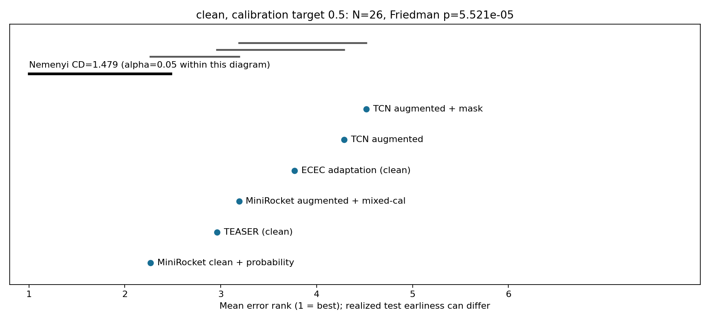
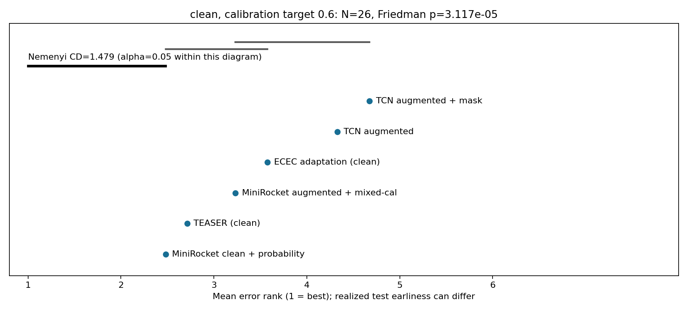
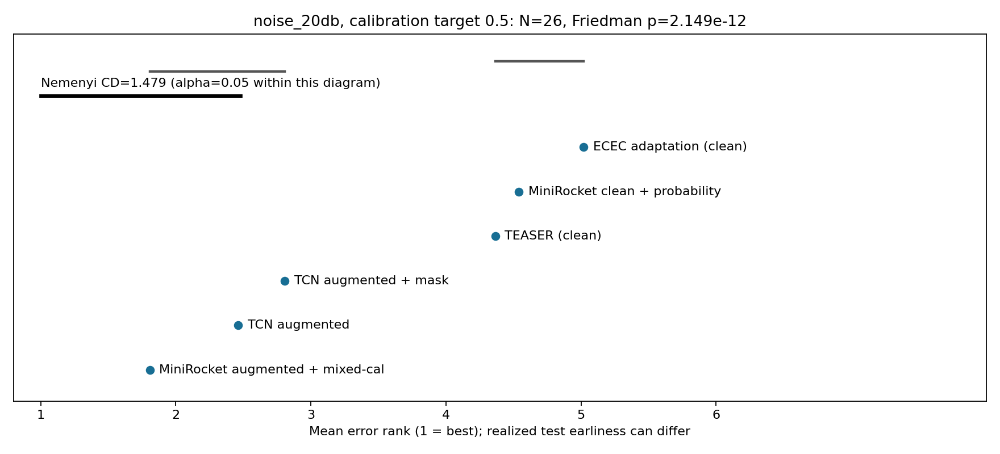
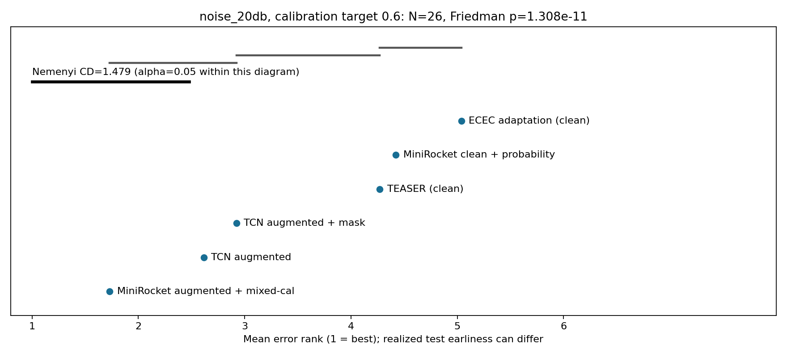
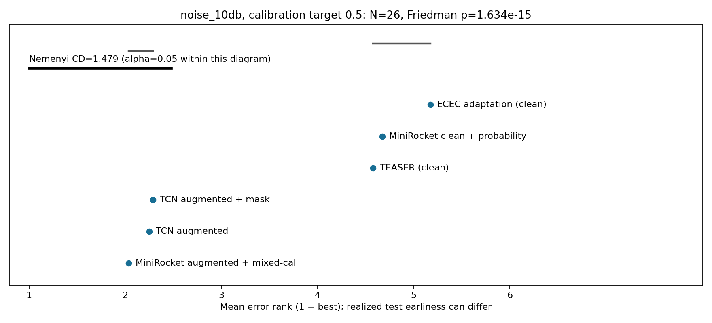
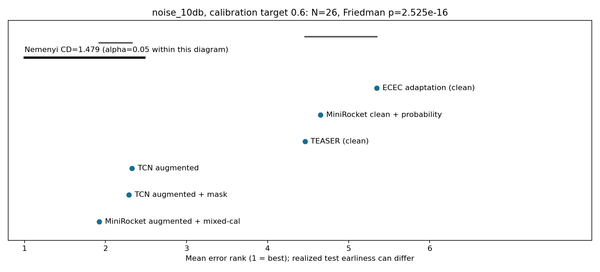
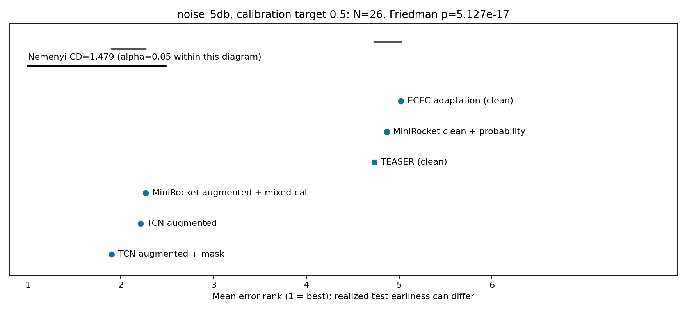
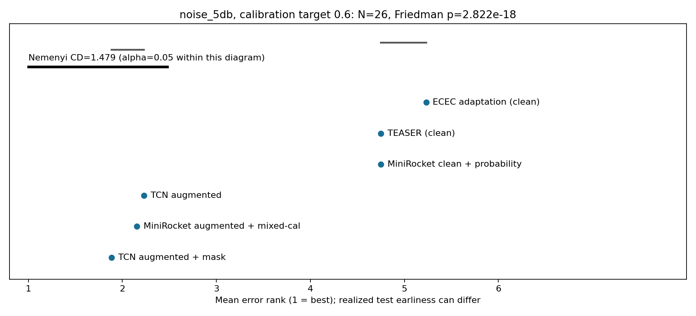
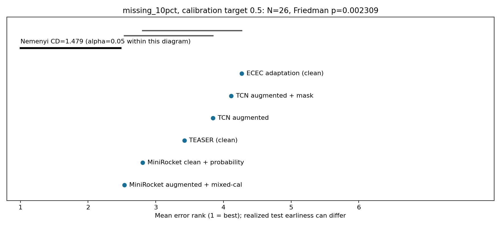
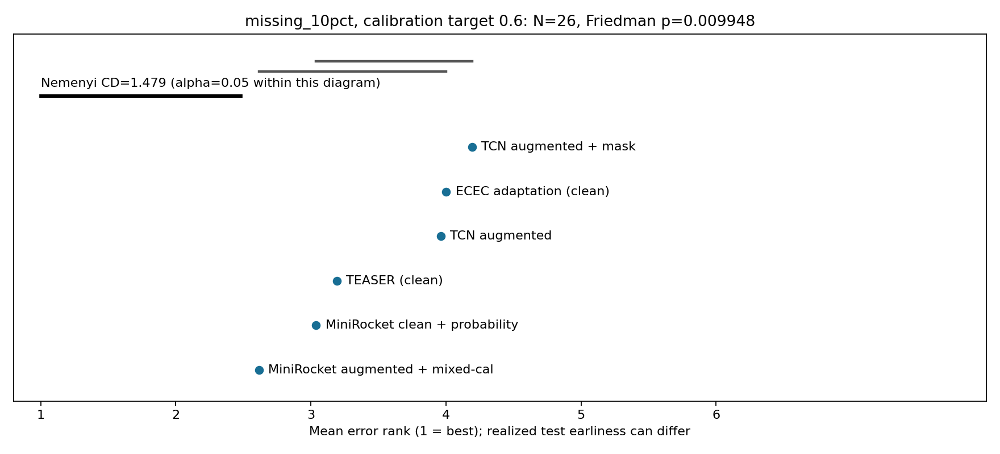
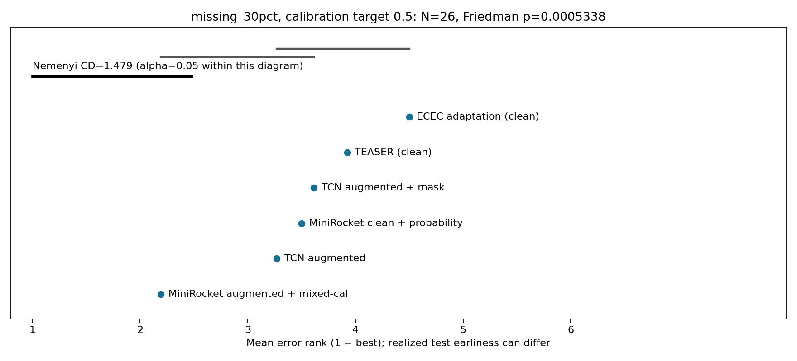
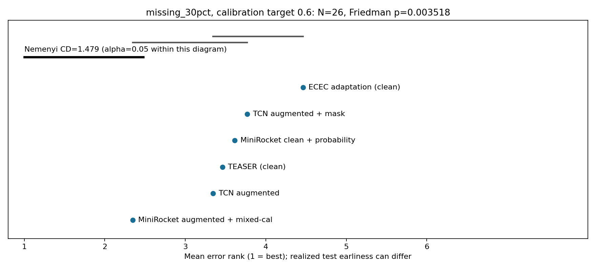
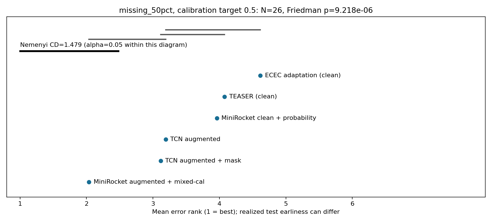
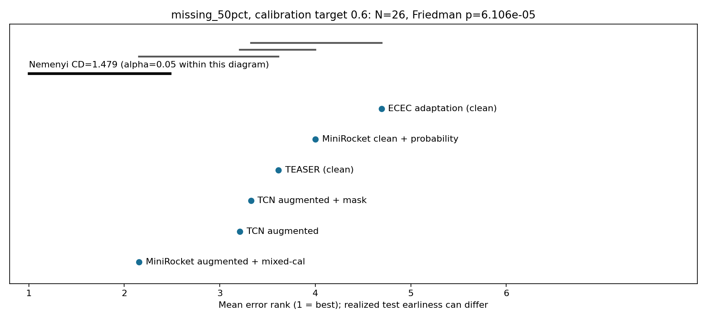

## Clean-data cost

Positive values are increased clean error versus augmented MiniRocket, in percentage points.

| model | prefix | clean error cost pp +/- SD |
| --- | --- | --- |
| TCN_aug | 0.5000 | 1.11 +/- 0.24 |
| TCN_aug | 0.6000 | 1.40 +/- 0.57 |
| TCN_aug | all_prefixes | 3.06 +/- 0.35 |
| TCN_aug_mask | 0.5000 | 1.25 +/- 0.34 |
| TCN_aug_mask | 0.6000 | 1.38 +/- 0.42 |
| TCN_aug_mask | all_prefixes | 3.04 +/- 0.29 |

## Per-dataset heterogeneity and confirmation cohort

The main aggregate includes the eight pilot datasets and eighteen additional datasets. It is not a completely new test-dataset collection; model architecture selection used the pilot validation results. The new-18 sensitivity table below shows whether the average effect persists outside the pilot datasets, without replacing the requested N=26 tests.

| model | condition | N | error reduction pp +/- SD |
| --- | --- | --- | --- |
| TCN_aug | clean | 18 | -3.85 +/- 0.51 |
| TCN_aug | noise_20db | 18 | -0.91 +/- 0.27 |
| TCN_aug | noise_10db | 18 | 0.69 +/- 0.38 |
| TCN_aug | noise_5db | 18 | 2.28 +/- 0.37 |
| TCN_aug | missing_10pct | 18 | -2.91 +/- 0.41 |
| TCN_aug | missing_30pct | 18 | -2.05 +/- 0.21 |
| TCN_aug | missing_50pct | 18 | -1.55 +/- 0.29 |
| TCN_aug_mask | clean | 18 | -3.74 +/- 0.30 |
| TCN_aug_mask | noise_20db | 18 | -0.87 +/- 0.16 |
| TCN_aug_mask | noise_10db | 18 | 0.71 +/- 0.43 |
| TCN_aug_mask | noise_5db | 18 | 2.42 +/- 0.66 |
| TCN_aug_mask | missing_10pct | 18 | -2.87 +/- 0.23 |
| TCN_aug_mask | missing_30pct | 18 | -2.06 +/- 0.16 |
| TCN_aug_mask | missing_50pct | 18 | -1.57 +/- 0.27 |

Per-dataset mean error reduction (percentage points), averaged across all checkpoints/draws:

TCN_aug

| dataset | clean | noise_20db | noise_10db | noise_5db | missing_10pct | missing_30pct | missing_50pct |
| --- | --- | --- | --- | --- | --- | --- | --- |
| ChlorineConcentration | -3.3501 | 2.8628 | 9.5052 | 11.1458 | 3.1088 | 7.5104 | 9.0197 |
| CricketX | -5.3618 | -4.5128 | -0.7692 | 2.2735 | -5.5100 | -4.7806 | -4.9915 |
| Crop | 5.4657 | 10.3595 | 7.2755 | 4.3213 | 7.8926 | 8.9714 | 7.9083 |
| ECG5000 | -0.7007 | -0.1215 | 0.1501 | -0.7926 | -0.6800 | -0.8514 | -1.7728 |
| EOGHorizontalSignal | -9.3063 | -5.8072 | -3.6832 | 4.3953 | -9.1590 | -8.9380 | -8.5083 |
| ElectricDevices | 2.8790 | 7.8485 | 9.3958 | 7.9168 | 4.5940 | 5.7053 | 5.1923 |
| EthanolLevel | -7.7600 | -2.3022 | -0.8356 | -0.1244 | -6.7556 | -5.4933 | -4.0400 |
| FaceAll | 1.6463 | 1.8632 | 2.9047 | 5.5319 | 1.7278 | 1.1979 | 1.1953 |
| FordA | 1.7929 | 1.8418 | 2.4714 | 3.3249 | 1.9933 | 2.4512 | 2.8704 |
| FordB | 2.8505 | 2.4005 | 3.1193 | 4.0165 | 2.6612 | 2.7929 | 3.3032 |
| HandOutlines | -5.3033 | -2.1502 | 0.2823 | 3.8198 | -4.9550 | -4.5766 | -3.8018 |
| InsectWingbeatSound | -3.6543 | -3.4007 | -2.9484 | -2.0269 | -3.6465 | -3.4321 | -2.7957 |
| LargeKitchenAppliances | -3.4904 | 2.9333 | 0.5630 | -0.9541 | -2.8978 | -2.2696 | -1.7422 |
| MiddlePhalanxOutlineCorrect | -6.3307 | -2.3062 | 2.2986 | 2.4437 | -5.3303 | -1.4891 | 1.9168 |
| MixedShapesRegularTrain | -5.8914 | -5.2609 | -5.6137 | -5.7008 | -5.6550 | -5.9473 | -6.6153 |
| NonInvasiveFetalECGThorax1 | -14.6079 | -6.0209 | 6.3568 | 13.3424 | -13.6884 | -13.5098 | -15.0874 |
| PhalangesOutlinesCorrect | -0.4325 | 4.9624 | 2.4812 | 1.6162 | 3.0510 | 4.5636 | 4.3849 |
| SemgHandMovementCh2 | -2.1481 | -0.0049 | -0.2222 | -0.8198 | -1.8123 | -2.2272 | -3.1704 |
| ShapesAll | -11.3593 | -3.8815 | 2.1852 | 9.6556 | -10.2815 | -8.4370 | -6.8667 |
| StarLightCurves | -0.0583 | 1.5191 | 2.4934 | 1.8337 | -0.0496 | 0.0583 | 0.2175 |
| Strawberry | -10.1922 | -5.6517 | -0.1802 | -0.4505 | -8.9009 | -6.4925 | -5.2432 |
| SwedishLeaf | -8.6720 | -2.9298 | -3.5413 | -3.0364 | -6.6169 | -5.4862 | -4.2844 |
| SyntheticControl | 0.8148 | 1.3852 | 2.5333 | 3.8815 | -0.0444 | -2.2296 | -3.6370 |
| TwoPatterns | 1.5539 | 1.8922 | 3.5178 | 6.1961 | 1.7483 | 2.1544 | 2.1533 |
| UWaveGestureLibraryX | 1.8289 | 1.3115 | 1.1328 | 2.9276 | 1.9828 | 2.0876 | 1.9592 |
| Wafer | 0.1269 | 0.2711 | 0.9424 | 2.2925 | 0.2004 | 0.3356 | 0.3454 |

TCN_aug_mask

| dataset | clean | noise_20db | noise_10db | noise_5db | missing_10pct | missing_30pct | missing_50pct |
| --- | --- | --- | --- | --- | --- | --- | --- |
| ChlorineConcentration | -3.3519 | 2.8623 | 9.5127 | 11.1453 | 3.1047 | 7.5156 | 9.0174 |
| CricketX | -5.8803 | -5.0484 | -1.1567 | 2.3134 | -6.1766 | -5.7151 | -5.9601 |
| Crop | 5.4843 | 10.1701 | 7.1345 | 4.2492 | 7.9468 | 9.1604 | 8.3081 |
| ECG5000 | -0.8000 | -0.2237 | -0.0247 | -1.0672 | -0.7546 | -0.8158 | -1.5037 |
| EOGHorizontalSignal | -9.4107 | -5.8625 | -3.8244 | 4.3339 | -9.2511 | -9.1222 | -8.6556 |
| ElectricDevices | 1.6412 | 7.5886 | 8.8644 | 7.0992 | 3.9271 | 6.2693 | 6.2606 |
| EthanolLevel | -7.4267 | -2.3467 | -0.8356 | -0.0622 | -6.5911 | -5.4311 | -4.2089 |
| FaceAll | 1.4477 | 1.5687 | 2.3721 | 4.8021 | 1.3596 | 0.7745 | 0.5444 |
| FordA | 1.7609 | 1.8098 | 2.3586 | 3.1380 | 2.0067 | 2.5269 | 3.4125 |
| FordB | 3.2291 | 2.9246 | 3.5309 | 4.1536 | 2.9575 | 3.1001 | 3.4870 |
| HandOutlines | -4.7147 | -1.7297 | 0.7808 | 4.0000 | -4.4685 | -3.9459 | -2.9009 |
| InsectWingbeatSound | -3.6801 | -3.4119 | -2.9607 | -2.0617 | -3.6285 | -3.4343 | -2.7957 |
| LargeKitchenAppliances | -3.3541 | 3.5733 | 0.7348 | -0.7585 | -2.7200 | -2.2044 | -1.8252 |
| MiddlePhalanxOutlineCorrect | -6.6132 | -2.5888 | 1.8786 | 2.3291 | -5.3990 | -1.7564 | 1.9931 |
| MixedShapesRegularTrain | -6.2561 | -5.2738 | -5.2756 | -5.1125 | -5.9281 | -6.1590 | -6.7317 |
| NonInvasiveFetalECGThorax1 | -15.2446 | -6.5671 | 5.7880 | 12.7181 | -14.2098 | -13.9056 | -14.7967 |
| PhalangesOutlinesCorrect | -0.9013 | 4.3642 | 2.7066 | 2.4709 | 2.4372 | 4.1932 | 4.0145 |
| SemgHandMovementCh2 | -1.8963 | 0.1432 | -0.1086 | -0.8593 | -1.6790 | -2.2173 | -3.1309 |
| ShapesAll | -10.4370 | -3.2222 | 2.8889 | 10.0741 | -9.5185 | -7.7074 | -6.3852 |
| StarLightCurves | -0.0974 | 1.6775 | 2.3536 | 1.8704 | -0.0963 | -0.0024 | 0.1673 |
| Strawberry | -8.9489 | -4.9189 | 0.7447 | 0.5946 | -8.3123 | -6.3423 | -4.6486 |
| SwedishLeaf | -8.2809 | -3.3102 | -4.9564 | -3.3920 | -6.4071 | -4.9813 | -3.9324 |
| SyntheticControl | 0.8222 | 1.3481 | 2.5259 | 3.9111 | 0.0222 | -2.2963 | -3.6444 |
| TwoPatterns | 1.8678 | 2.2900 | 3.8567 | 6.7467 | 2.1467 | 2.5289 | 2.6756 |
| UWaveGestureLibraryX | 1.8121 | 1.3022 | 1.1254 | 2.9189 | 1.9697 | 2.0907 | 1.9573 |
| Wafer | 0.1316 | 0.2769 | 0.9510 | 2.2922 | 0.2041 | 0.3353 | 0.3519 |

## Runtime and audits

All three RTX 8000 GPUs used. Current-run training + validation occupancy: 1.396 GPU-hours. Parallel worker wall time: 0.560 hours. This excludes subsequent reporting/transfer. Reused pilot training time is not charged again.

All original sources/data/runs are hash-audited in source_audit.json. Artifact completeness, mask pairing, zero future-input gradients, suffix-perturbation equivalence, and pilot reuse are checked in artifact_audit.json. No datasets were removed and no prior result was overwritten. Error tracebacks, if any, are preserved in logs/.

Files: deep_scale_fixedlength.csv contains all dataset/draw/checkpoint records; fixedlength_macro.csv and fixedlength_per_dataset.csv contain means/SDs. deep_scale_fixedlength_stats.csv contains exact-prefix tests; deep_scale_fixedop_stats.csv contains the deployable fixed-setting tests. All trained models, compact predictions, calibration probabilities, splits/provenance, code and logs are retained.

